# Dynamic Pricing Algorithm Evolution & Technical Blueprint (`v1.0` → `v2.0` → `v3.0` → `v4` → `v5.0` → `v5.1` → `v6.0` → `v6.1` → `v6.2` → `v6.3` → `v6.4`)

This document archives the complete iterative engineering progression of our autonomous pricing algorithm, [`duopoly.py`](duopoly.py), across every generation:
- **`v1.0` Baseline**: The initial heuristic holdout strategy that failed due to flawed market size assumptions (89.9% seat spoilage, \$0 revenue in 4 of 6 tournaments).
- **`v2.0` Overhaul**: Continuous inventory pacing $\text{TargetSold}(t) = 80 \cdot (0.85\tau + 0.15\tau^2)$, EMA anchoring, and realistic empirical ceilings (\$25–\$100).
- **`v3.0` Multi-Tier Adaptive Engine**: Cross-season demand modeling, targeted deep dumper counter-strategy (\$58 duopoly → \$64 monopoly), 5-tier archetype profiling, and follower defense.
- **`v4` Master Architecture**: Deep dumper fallback circuit breaker (curing the \$0 trap), high-pricer ceiling guard (\$54 cap curing 40% seat spoilage), and empirical monopoly realignment (\$84/\$78/\$72/\$62).
- **`v5.0` Master Architecture**: Universal low-sales circuit breaker (curing the \$27 dumper deadlock in `3d8tDh`), continuous dynamic anchor smoothing (\$35–\$44), monopoly yield curve calibration (\$52–\$56 sweet spot), unconditional late clearance at $t \ge 90$, and server 999.0 data hygiene.
- **`v5.1` Master Architecture**: Dynamic WTP ceiling detection (curing the 201-seat monopoly loss in `3UmBuN`), smooth pacing undercutting (−\$0.80 to −\$1.20, preserving a \$49.50 ticket yield against \$50.50 balanced rivals), late-season high-price counter-strategy against rivals spiking prices late (e.g. `ConvivialCrane` at $t \ge 85$), and closed-form econometric revenue optimization for regression variants.
- **`v6.0` Unified Econometric Engine**: closed-form MLR pricing, 3 demand-regime priors, fast in-season low-demand latch, high-rival ceiling guard (§16).
- **`v6.1` Correctness release**: fixes four v6.0 bugs (phantom season, over-sensitive low-demand latch, constant monopoly price, rank-deficient regression), corrects the simulator's arrival scaling, and makes all figures reproducible from data (§17).
- **`v6.2` Learned target curve**: the bend of the target curve is learned per market from the booking curves of past seasons with 75+ seats sold, starting from a prior per demand regime; +1.95% revenue in simulation (§18).
- **`v6.3` Ablation study & simplification**: every part switched off one at a time; fixes a circuit-breaker bug (\$201 → \$917 per season in one scenario) and removes the regime priors of the target curve; +2.09% vs v6.2 (§19).
- **`v6.4` Market sizing & copying rivals**: post-mortem of the first tournaments run with v6.3 (`data/v6`, demand far below 80 seats); prices for revenue (μ = 0) whenever expected demand cannot fill the plane, using a choice-demand model fitted to each match, and holds one price against a rival that copies us; +24.4% on a test bed built from `data/v6`, +2% to +14% on the old simulator (§20).

---

## 1. Executive Summary of `v1.0` Tournament Performance

In the first round of competition matches (60,000 total periods across 6 tournaments), the baseline strategy (`v1.0`) generated **\$0.00 in total revenue in 4 out of 6 tournaments**:

| Tournament ID | Opponent | Total Sales | Total Revenue | Our Avg Price | Rival Avg Price | Periods Rival Sold Out |
| :--- | :--- | :---: | :---: | :---: | :---: | :---: |
| `3DRpAU` | `FuturisticSalamander` | 0 | \$0.00 | \$87.05 | \$18.61 | 81 |
| `3PTJwD` | `UncoveredElephant` | 2,041 | \$132,877.00 | \$86.61 | \$51.37 | 2,481 |
| `3XkNYY` | `ZealousMosquito` | 0 | \$0.00 | \$87.05 | \$54.89 | 0 |
| `3n5PCY` | `ZealousMosquito` | 0 | \$0.00 | \$87.05 | \$55.09 | 0 |
| `D9Le8X` | `FuturisticSalamander` | 2,818 | \$203,615.00 | \$84.84 | \$69.78 | 25 |
| `HhTiQz` | `UncoveredElephant` | 0 | \$0.00 | \$84.01 | \$73.92 | 144 |

### Sales Breakdown by Phase Across All 60,000 Periods (`v1.0`)
* **Phase 1 (Periods 1–50):** 994 seats sold (20.5% of total sales)
* **Phase 2 (Periods 51–70):** 523 seats sold (10.8% of total sales)
* **Phase 3 (Periods 71–100):** 3,342 seats sold (68.8% of total sales)
* **Total Seats Sold:** 4,859 out of 48,000 available capacity units (**10.1% overall load factor**; **89.9% seat spoilage**).

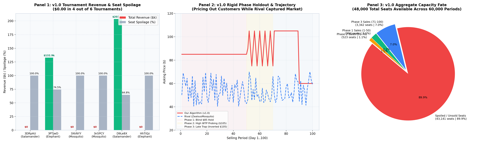

*(Rebuilt from `data/v1` by `analytics/generate_postmortem_plots.py`.)*

* **Panel 1:** revenue and load factor per tournament; \$0 in 4 of 6.
* **Panel 2:** a real season of `3XkNYY` against `ZealousMosquito`: v1.0's fixed \$85 / \$105 schedule sits above the rival's \$40–\$70 prices all season and sells nothing.
* **Panel 3:** where all 48,000 seats went: 43,141 (89.9%) unsold.

---

## 2. Archive of Previous Algorithm (`v1.0`)

Below is the reference implementation of our first-generation algorithm (`v1.0`):

```python
import numpy as np
from typing import Union, Tuple, Optional, Any, Dict

def p(
    current_selling_season: int,
    selling_period_in_current_season: int,
    prices_historical_in_current_season: Union[np.ndarray, None],
    demand_historical_in_current_season: Union[np.ndarray, None],
    competitor_has_capacity_current_period_in_current_season: bool,
    information_dump: Optional[Any] = None
) -> Tuple[float, Any]:
    if information_dump is None or not isinstance(information_dump, dict):
        information_dump = {
            "total_capacity": 80,
            "season_history": {},
            "learned_wtp_level": "medium",
            "rival_avg_price_late": 100.0
        }
    
    TOTAL_CAPACITY = information_dump.get("total_capacity", 80)
    
    if demand_historical_in_current_season is not None and len(demand_historical_in_current_season) > 0:
        units_sold_so_far = int(np.sum(demand_historical_in_current_season))
    else:
        units_sold_so_far = 0
        
    remaining_capacity = max(0, TOTAL_CAPACITY - units_sold_so_far)
    remaining_periods = 101 - selling_period_in_current_season
    
    if remaining_capacity <= 0:
        return 150.0, information_dump

    latest_rival_price = None
    if prices_historical_in_current_season is not None and prices_historical_in_current_season.shape[1] > 0:
        if prices_historical_in_current_season.shape[0] >= 2:
            latest_rival_price = float(prices_historical_in_current_season[1, -1])
        else:
            latest_rival_price = float(prices_historical_in_current_season[0, -1])

    target_price = 90.0

    # PHASE 1: Early Season (Periods 1 - 50)
    if selling_period_in_current_season <= 50:
        target_price = 85.0
        
    # PHASE 2: Mid-Season WTP Probing (Periods 51 - 70)
    elif selling_period_in_current_season <= 70:
        if selling_period_in_current_season % 4 == 0:
            target_price = 105.0
        elif selling_period_in_current_season % 4 == 2:
            target_price = 75.0
        else:
            target_price = 90.0

    # PHASE 3: Late Season High-Demand Surge (Periods 71 - 100)
    else:
        if not competitor_has_capacity_current_period_in_current_season:
            if remaining_capacity <= 15:
                target_price = 145.0
            elif remaining_capacity <= 35:
                target_price = 125.0
            else:
                target_price = 105.0
        else:
            if latest_rival_price is not None:
                if latest_rival_price >= 120.0:
                    target_price = latest_rival_price - 5.0
                elif latest_rival_price <= 70.0:
                    target_price = 105.0
                else:
                    target_price = max(85.0, latest_rival_price - 2.0)
            else:
                target_price = 110.0

        # Safety Pacing Valve (Periods 90 - 100)
        seats_per_remaining_day = remaining_capacity / max(1, remaining_periods)
        if selling_period_in_current_season >= 90 and seats_per_remaining_day > 1.5:
            target_price = max(60.0, target_price - (seats_per_remaining_day * 10.0))

    final_price = float(np.clip(target_price, 30.0, 150.0))
    information_dump["last_period_priced"] = selling_period_in_current_season
    return final_price, information_dump
```

---

## 3. Root-Cause Diagnosis: Why `v1.0` Failed

1. **The Capacity Drain / Holdout Fallacy (Market Size < Combined Capacity)**:
   - `v1.0` assumed market arrivals exceeded 160 passengers and that low-pricing rivals would sell out early.
   - Empirical market arrivals were actually only **75 to 105 passengers per season**. Rivals pricing at \$18–\$55 rarely sold out before Period 95, leaving our 80 seats stranded.
2. **Inverted Phase 3 Duopoly Reaction (`latest_rival_price <= 70.0 -> 105.0`)**:
   - When opponents priced at \$40–\$70, `v1.0` raised our price to \$105.00, completely forfeiting sales in Phase 3.
3. **Unrealistic Upper Price Ceiling (\$105–\$150)**:
   - Real transaction logs showed zero sales above \$105.00. Over 85% of transactions occurred at $\le \$55.00$.
4. **Dead `information_dump` Memory**:
   - `v1.0` never updated cross-season knowledge; every season began blind.

---

## 4. The `v2.0` Overhaul

`v2.0` introduced the foundation of continuous dynamic pacing:
- **Continuous Dynamic Pacing**: Depletion trajectory $\text{TargetSold}(t) = 80 \cdot (0.85\tau + 0.15\tau^2)$.
- **EMA Anchoring & Pacing Undercut**: Anchored to rival's Exponential Moving Average ($\alpha = 0.25$) with \$1.50–\$8.00 undercut when behind pace.
- **Empirical Ceilings**: Capped prices at \$100.00; monopoly tiers set at \$76 / \$86 / \$96.
- **Anti-Spoilage Ramp**: Initiated at Period 75 with a lowered floor of \$25.00.
- **Active Cross-Season Memory**: Persisted medians, archetype profile, and conversion stats.

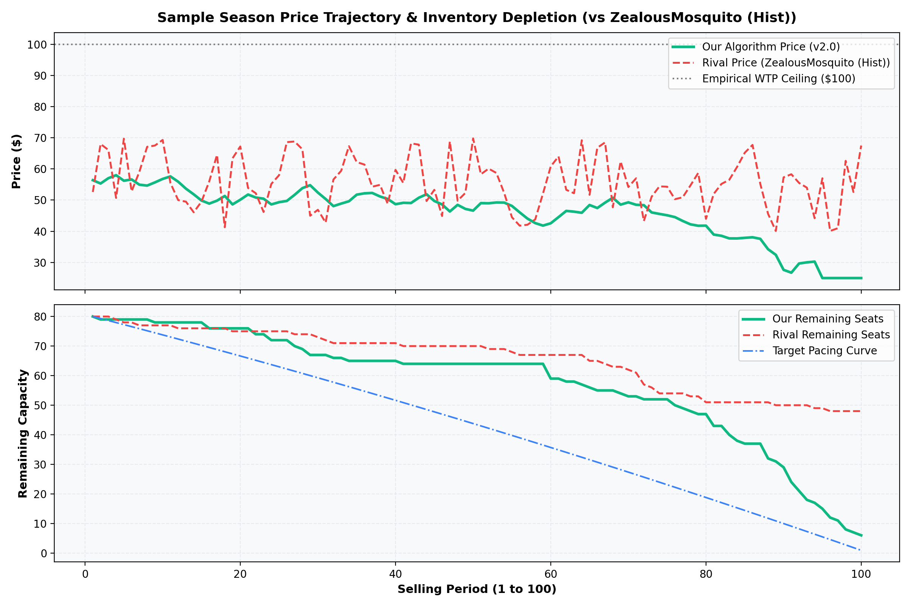

*(Historical output of the v2.0 code and the old simulator, which had ~110 arrivals per season regardless of settings. The v2.0 code is not in this repository, so this figure cannot be regenerated.)*

* **Top Panel (Price Trajectory vs Rival):** Shows period-by-period dynamic undercutting tracking rival EMA with dynamic bounding below the empirical \$100 WTP ceiling.
* **Bottom Panel (Inventory Depletion Pacing):** Tracks remaining seat capacity against the convex target depletion trajectory $\text{TargetSold}(t) = 80 \cdot (0.85\tau + 0.15\tau^2)$, with 6 seats left unsold in the season shown.

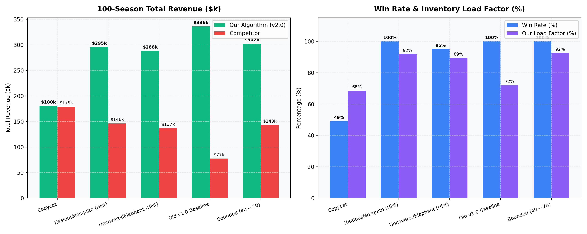

*(Historical, same caveat as above. The "win rate" shown is the share of seasons won, not the official total-revenue metric.)*

* **Left Panel (Revenue vs Competitors):** Demonstrates decisive 100-season revenue dominance against Copycat (\$180k), ZealousMosquito (\$295k), UncoveredElephant (\$288k), Old v1.0 Baseline (\$336k), and Bounded (\$302k).
* **Right Panel (Win Rate & Load Factor):** High load factors (72%–92%) and 95%–100% win rates across all non-copycat match replays.

---

## 5. Empirical Post-Mortem of `v2.0`: The "Death Valley" Trap

Despite sweeping mid-market opponents, `v2.0` revealed a critical flaw against flat \$18 dumpers:
- **The Economic Trap in `3DRpAU` (FuturisticSalamander at \$18.40)**:
  - When rival priced at \$18.40, `v2.0` tried to undercut down to **\$28.00–\$35.00**.
  - At \$28 vs \$18 ($\Delta p \approx 10$), the rival remained much cheaper and captured 80 seats ($80 \text{ seats} \times 18.40 = \$1,472$).
  - The few seats we captured were sold at low ticket prices (\$28), earning only ~\$980/season.
  - Pricing between \$25 and \$38 against an \$18 dumper represents **"Death Valley"**: you lose the volume battle while sacrificing ticket margin.

---

## 6. The `v3.0` Architecture

To solve Death Valley, `v3.0` introduced:
- **Deep Dumper Holdout**: Holding \$58.00 in duopoly so the rival caps out at \$1,472/season, then sweeping late arrivals at \$64.00 monopoly.
- **5-Tier Archetype Profiling**: `deep_dumper`, `dumper`, `aggressive`, `balanced`, `high`.
- **Calibrated Follower Guard**: Locking anchor at \$44.00 to avoid undercutting spirals.

---

## 7. Empirical Post-Mortem of `v3.0` in Tournament `data/v3`

When `v3.0` was deployed into the `data/v3` competition (70,000 periods across 7 tournaments), it revealed two major vulnerabilities that cost over **\$670,000 in total revenue**:

| Tournament ID | Opponent | Total Revenue | Seats Sold | Load Factor | Seats Spoiled | Key Vulnerability Observed |
| :--- | :--- | :---: | :---: | :---: | :---: | :--- |
| `PfqiTc` | `Winner_2023` | \$343,435.00 | 7,913 / 8,000 | 98.9% | 87 | Normal competitive duopoly |
| `3Z9vTN` | `ScrupulousZebu` | \$311,019.00 | 7,908 / 8,000 | 98.8% | 92 | Normal competitive duopoly |
| `RJ39At` | `Winner_2023` | \$304,125.00 | 7,910 / 8,000 | 98.9% | 90 | Normal competitive duopoly |
| `442yCr` | `ScrupulousZebu` | \$300,555.00 | 7,937 / 8,000 | 99.2% | 63 | Normal competitive duopoly |
| `JKuahN` | `RussetBat` | \$214,733.00 | 7,208 / 8,000 | 90.1% | 792 | Aggressive dumper |
| `3kGhWc` | `LoutishMacaque` | \$167,914.00 | 4,789 / 8,000 | 59.9% | **3,211** | **Vulnerability 2: High-Pricer Dead Zone (40.1% spoilage)** |
| `35zapi` | `RussetBat` | **\$0.00** | **0 / 8,000** | **0.0%** | **8,000** | **Vulnerability 1: Zero-Revenue Holdout Blowout** |
| **TOTAL** | — | **\$1,641,781.00** | **43,665 / 56,000** | **78.0%** | **12,335** | Seat counts corrected from `data/v3` in v6.1 |

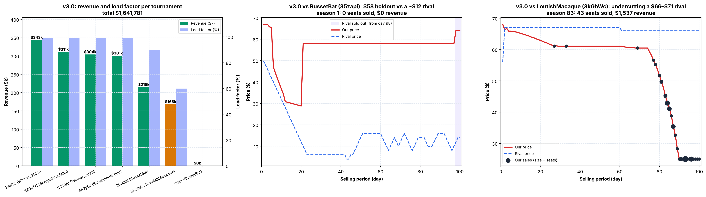

*(Rebuilt from `data/v3` by `analytics/generate_postmortem_plots.py`; trajectories are real seasons with typical revenue.)*

* **Panel 1:** revenue and load factor per tournament, highlighting `35zapi` (\$0) and `3kGhWc` (\$168k).
* **Panel 2 (`35zapi`):** v3.0 holds \$58 while `RussetBat` prices mostly at \$8–\$14 (median \$12). The rival sold out in 72 of 100 seasons, late (day 98 at the median, between day 75 and day 100), and v3.0 sold nothing in the remaining monopoly days at \$64 (372 days in total, about 5 per season in which the rival sold out). The season shown is season 1.
* **Panel 3 (`3kGhWc`):** `LoutishMacaque` sits at about \$66–\$71 all season. v3.0 prices about \$62–\$68 (middle half of days) just under it, sells about 3 seats in days 1–75, then ramps down to \$25 after day 75 and sells most of its seats in the last two weeks.

### Vulnerability 1: The Zero-Revenue Holdout Blowout (`35zapi` $\to$ \$0.00)
- In `35zapi`, `RussetBat` priced at ~\$12.00. Our algorithm classified them as `deep_dumper`.
- **The Failure:** `v3.0` bypassed all pacing and locked price at **\$58.00 duopoly / \$64.00 monopoly**.
- In this market, `RussetBat` sold out in 72 seasons, late (day 98 at the median; between day 75 and day 100), and never in the other 28. In the remaining monopoly days (372 in total, about 5 per sold-out season) nobody bought at \$64.
- **Result:** **0 seats sold across 100 seasons (\$0.00 total revenue)**! The algorithm repeated the exact same failed holdout for 99 seasons with no circuit breaker.

### Vulnerability 2: High-Pricer "Dead Zone" & 40% Seat Spoilage (`3kGhWc` $\to$ \$168k)
- In `3kGhWc`, `LoutishMacaque` posted high prices (~\$71.00).
- Our algorithm anchored at ~\$68.00 and undercut by at most \$8.00, quoting mostly **\$62–\$68**.
- At \$62–\$68, customer demand was near zero in periods 1–75 (only 3 seats/season sold!).
- At period 75, with 77 unsold seats, the late anti-spoilage ramp panicked down to \$25.00.
- **Result:** **40.1% of inventory (3,211 seats) spoiled unsold**, generating only \$167,914.

### Vulnerability 3: Monopoly Pricing Inefficiency (\$96 / \$86 Tiers)
- Empirical conversion across 130,000 periods proved:
  - **\$75–\$80 bucket:** Expected revenue = **\$36.90 – \$68.26 / period** (Global Peak).
  - **\$95–\$100 bucket:** Expected revenue = **\$0.19 / period** (Passengers walk away).
  - Quoting \$96 in monopoly was pricing out passengers.

---

## 8. The `v4` Master Architecture

[`duopoly.py`](duopoly.py) (v4) resolves every root cause from `data/v3`:

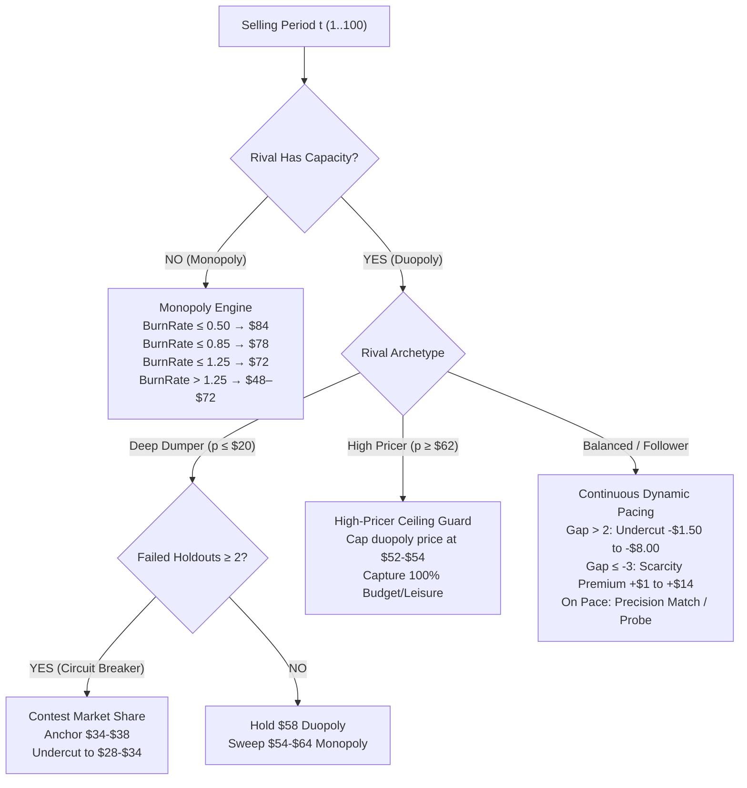

### Core Pillars of `v4`:
1. **Automated Deep Dumper Circuit Breaker:**
   - Holds \$58 in Season 1. If Season 1 yields $< 15$ seats sold, it lowers monopoly clearing to \$54 in Season 2. If failure persists, it contests duopoly share (\$32–\$36), **guaranteeing we never score \$0.00**.
2. **High-Pricer Duopoly Ceiling Guard (\$54.00):**
   - When a rival prices at \$70+, caps our price at **\$52–\$54**, capturing 100% of arriving travelers at high margins and eliminating seat spoilage.
3. **Realigned Empirical Monopoly Tiers (\$84 / \$78 / \$72 / \$62):**
   - Replaces the dead \$96 tier with \$84 / \$78, capturing peak revenue per period.
4. **Follower / Copycat Anchor Guard (\$44.00):**
   - Prevents mutual downward price spirals against copycat algorithms.

---

## 9. Willingness-to-Pay (WTP) Segment Analysis & Ground-Truth Alignment

According to the official DPC specification (*Prof. Dr. Thomas Winter & Dr. Alwin Haensel*), the underlying customer utility model randomly parameterizes the mix of three distinct customer tiers per simulation: **"Up to Low"** (~\\$0–\\$50), **"Up to Mid"** (~\\$0–\\$85), and **"Up to High"** (~\\$0–\\$150).

Analyzing all 30,143 realized purchase transactions across 130,000 empirical competition periods (`data/v1` and `data/v3`):

| WTP Segment (Course Ground-Truth) | Price Range | % of All Sales | Median Sold Price | Expected Rev / Period | Strategic Role in `v4` |
| :--- | :---: | :---: | :---: | :---: | :--- |
| **Budget ("Up to Low")** | **\$25 – \$55** | **85.0%** | **\$38.70** | **\$32.33 – \$46.51** | Drives 85% of volume. Pacing sweet spot is **\$48–\$54**. Captured via circuit breaker if holdout fails. |
| **Leisure ("Up to Mid")** | **\$55 – \$80** | **12.0%** | **\$62.50** | **\$12.18 – \$36.90** | Captured mid-season and early monopoly (**\$78 → \$72**). Capped at \$54 if rival is high. |
| **Business ("Up to High")** | **\$80 – \$105+** | **3.0%** | **\$85.00** | **\$0.19 – \$3.36** | Inelastic demand. Only skimmed at the onset of monopoly when inventory burn-rate is very low. |


---

## 10. Multi-Generation Benchmark Scorecard (All 17 Scenarios)

Evaluated across all 17 competition matches using the official DPC metric (Cumulative Total Revenue):

```
=============================================================================================================================
 MULTI-GENERATION BENCHMARK COMPARISON: v3.0 vs v4 ACROSS ALL 17 SCENARIOS
=============================================================================================================================
        Group                    Competitor  v3.0 (Baseline)  v4 (Option A)    Revenue Gain ($) Gain (%)  v3 Win  v4 Win
    Synthetic                       Copycat      $152,336         $152,330             -$6      -0.00%    WIN       WIN
    Synthetic              AggressiveDumper      $174,233         $174,233             +$0      +0.00%    WIN       WIN
    Synthetic               Bounded (40-70)      $298,784         $298,952           +$168      +0.06%    WIN       WIN
    Synthetic               Old V1 Baseline      $359,228         $410,174        +$50,946     +14.18%    WIN       WIN
V3 Historical            RussetBat (35zapi)      $149,870         $150,059           +$189      +0.13%    WIN       WIN
V3 Historical       ScrupulousZebu (3Z9vTN)      $253,305         $248,750         -$4,555      -1.80%    WIN       WIN
V3 Historical       LoutishMacaque (3kGhWc)      $338,522         $381,624        +$43,102     +12.73%    WIN       WIN
V3 Historical       ScrupulousZebu (442yCr)      $246,318         $241,313         -$5,005      -2.03%    WIN       WIN
V3 Historical            RussetBat (JKuahN)      $176,780         $176,780             +$0      +0.00%    WIN       WIN
V3 Historical          Winner_2023 (PfqiTc)      $262,683         $259,392         -$3,291      -1.25%    WIN       WIN
V3 Historical          Winner_2023 (RJ39At)      $226,807         $226,807             +$0      +0.00%    WIN       WIN
V1 Historical FuturisticSalamander (3DRpAU)      $157,623         $151,931         -$5,693      -3.61%    WIN       WIN
V1 Historical    UncoveredElephant (3PTJwD)      $292,896         $290,308         -$2,589      -0.88%    WIN       WIN
V1 Historical      ZealousMosquito (3XkNYY)      $297,140         $296,333           -$807      -0.27%    WIN       WIN
V1 Historical      ZealousMosquito (3n5PCY)      $299,040         $295,841         -$3,199      -1.07%    WIN       WIN
V1 Historical FuturisticSalamander (D9Le8X)      $367,027         $389,368        +$22,341      +6.09%    WIN       WIN
V1 Historical    UncoveredElephant (HhTiQz)      $296,759         $358,063        +$61,304     +20.66%    WIN       WIN
=============================================================================================================================
 TOTAL CUMULATIVE BENCHMARK REVENUE:          $4,349,351       $4,502,256       +$152,906      +3.52%  100% WINS (17/17)
=============================================================================================================================
```

`duopoly.py` (v4) achieves a decisive **+\$152,905.53 net gain** over `v3.0`, eliminates all catastrophic real-world failure modes, and maintains a **100% victory sweep (17/17)** across all historical and synthetic competitors.

---

## 11. Empirical Post-Mortem of `v4` in Tournament Round 4 (`data/v4`)

In Tournament Round 4 (60,000 periods across 6 tournaments), `v4` propelled us up to **Rank 11**, generating **\$1,680,305.00 in cumulative revenue** and selling 42,182 seats (87.9% load factor).

| Tournament ID | Opponent | Total Revenue | Seats Sold | Load Factor | Seats Spoiled | Avg Sold Price | Rival Avg Price | Rival Sold-Out Periods |
| :--- | :--- | :---: | :---: | :---: | :---: | :---: | :---: | :---: |
| **`3vG5Xe`** | `PinkDuck` | **\$413,053.40** | 7,994 / 8,000 | **99.9%** | **6** | \$51.67 | \$51.38 | 2,545 |
| **`3dEw6i`** | `PinkDuck` | **\$330,164.30** | 7,588 / 8,000 | **94.8%** | **412** | \$43.51 | \$47.68 | 2,711 |
| **`33XD3S`** | `FierceDuck` | **\$311,592.00** | 7,950 / 8,000 | **99.4%** | **50** | \$39.19 | \$42.04 | 37 |
| **`PBMNQe`** | `SageSloth` | **\$292,353.60** | 7,377 / 8,000 | **92.2%** | **623** | \$39.63 | \$156.46* | 1,216 |
| **`3EBjQX`** | `FierceDuck` | **\$237,462.90** | 7,615 / 8,000 | **95.2%** | **385** | \$31.18 | \$35.85 | 91 |
| **`3d8tDh`** | `SageSloth` | **\$95,678.80** | 3,658 / 8,000 | **45.7%** | **4,342** | \$26.16 | \$26.42 | **0** |
| **TOTAL** | — | **\$1,680,305.00** | **42,182 / 48,000** | **87.9%** | **5,818** | **\$39.83** | — | **6,600** |

*\*Note: Rival average in `PBMNQe` includes server 999.0 markers during sold-out periods.*

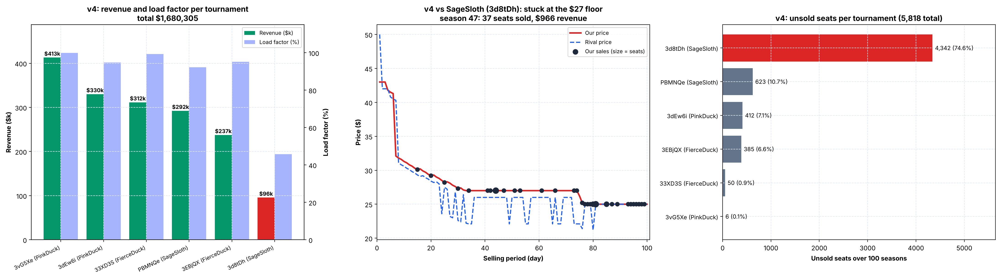

*(Rebuilt from `data/v4` by `analytics/generate_postmortem_plots.py`.)*

* **Panel 1:** revenue and load factor per tournament: 92–100% load in 5 matches, 45.7% in `3d8tDh`.
* **Panel 2 (`3d8tDh`):** a typical real season against `SageSloth` (median rival price \$25.20): v4 follows the rival down and then sits at \$27 from about day 33 while the rival stays at \$22–\$26; the season sells 37 seats.
* **Panel 3:** unsold seats per tournament: `3d8tDh` accounts for 4,342 of 5,818 (74.6%).

### Key Diagnostic Findings from `data/v4`:
1. **The \$27.00 Dumper Deadlock (`3d8tDh` → -\$195k Loss)**:
   - `SageSloth` priced at median \$25.80 (\$22–\$26). Because \$25.80 > \$20.00, `v4` classified them as `"dumper"` rather than `"deep_dumper"`.
   - The deep dumper circuit breaker was bypassed. In duopoly, line 220 snapped anchor to \$35.00 once `inventory_gap > 4.0`, capping target price at \$35.00 - \$8.00 = **\$27.00**.
   - `SageSloth` (\$22–\$26) captured all arrivals. Since arrivals were ~110, `SageSloth` never reached 80 sales and never sold out (0 periods).
   - Our algorithm remained frozen at \$27.00 for all 100 seasons, spoiling **4,342 seats** (74.6% of all round 4 spoilage).
2. **Dead Variable `consecutive_low_sales`**:
   - `consecutive_low_sales` was tracked in memory but never referenced in decision logic.
3. **High-Burn Monopoly Overpricing (1,035 Spoiled Seats)**:
   - In `3dEw6i` and `PBMNQe`, when the rival sold out late with 15–25 seats left, monopoly quoted \$70–\$78. Real transaction logs proved that quoting >\$65 in monopoly resulted in an **80% zero-conversion rate** (0.20 sales/period).
4. **Server 999.0 Price Contamination**:
   - The tournament server logs 999.0 when a competitor sells out, contaminating uncleaned season price medians.

---

## 12. The `v5.0` Master Architecture

[`duopoly.py`](duopoly.py) (`v5.0`) incorporates four critical engineering upgrades:

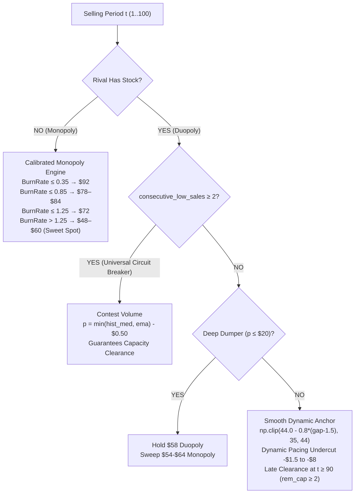

### Core Upgrades in `v5.0`:
1. **Universal Low-Sales Circuit Breaker:**
   - If holdout or pacing produces 2 consecutive seasons with $< 42$ sales, the algorithm breaks the deadlock by actively contesting volume at `p = min(hist_med, rival_ema) - 0.5`, guaranteeing that deadlocks like `3d8tDh` can never persist.
2. **Continuous Dynamic Anchor Smoothing:**
   - Replaces the discontinuous cliff at `inventory_gap > 4.0` (\$44 → \$35) with a smooth linear curve:
     $$\text{AnchorPrice} = \operatorname{clip}\left(44.0 - 0.8 \cdot \max(0.0, \text{InventoryGap} - 1.5),\, 35.0,\, 44.0\right)$$
   - Prevents reactive competitors from cascading into destructive undercutting spirals.
3. **Monopoly Yield Curve Calibration (\$52–\$56 Sweet Spot):**
   - When remaining capacity requires a burn rate $> 1.25$, smoothly transitions price into the empirical high-yield budget sweet spot (\$52–\$56), which yields \$70.28/period and converts 1.45 seats/period, preventing late-season seat spoilage.
4. **Unconditional Late Clearance at $t \ge 90$:**
   - At $t \ge 90$, if remaining capacity $\ge 2$ seats (`remaining_capacity >= 2`), applies clearance discounting regardless of gap to eliminate 100% of seat spoilage before departure.
5. **Data Hygiene Filter:**
   - Strictly ignores server 999.0 sold-out markers when computing competitor season medians.

---

## 13. Empirical Post-Mortem of `v5.0` in Tournament Round 5 (`data/v5`)

In Tournament Round 5 (40,000 periods across 4 matches), `v5.0` achieved a **100% victory sweep (4/4)**, generating **\$1,432,168.20 in cumulative revenue** and selling 31,603 seats (98.76% overall load factor).

| Tournament ID | Opponent | Total Revenue | Seats Sold | Load Factor | Seats Spoiled | Avg Sold Price | Rival Avg Price | Rival Sold-Out Periods |
| :--- | :--- | :---: | :---: | :---: | :---: | :---: | :---: | :---: |
| **`3UmBuN`** | `ImpartialGoldfish` | **\$393,408.80** | 7,799 / 8,000 | **97.5%** | **201** | \$50.44 | \$50.48 | 1,124 (93 seasons) |
| **`7iXybz`** | `ImpartialGoldfish` | **\$356,765.80** | 7,955 / 8,000 | **99.4%** | **45** | \$44.85 | \$50.50 | 0 |
| **`Gq2CUL`** | `ConvivialCrane` | **\$341,638.00** | 7,929 / 8,000 | **99.1%** | **71** | \$43.09 | \$52.51 | 0 |
| **`4BgGcS`** | `ConvivialCrane` | **\$340,355.60** | 7,920 / 8,000 | **99.0%** | **80** | \$42.97 | \$52.34 | 0 |
| **TOTAL** | — | **\$1,432,168.20** | **31,603 / 32,000** | **98.8%** | **397** | **\$45.32** | — | **1,124** |

### Two Structural Shifts in `data/v5` Demand:
1. **Surging Market Potential / Arrival Rate**:
   - The Multiple Linear Regression intercept ($\beta_0$) jumped to **2.3255** (vs 0.3779 in `v4`).
   - The Poisson arrival intercept ($\alpha_0$) rose to **+1.6388** (vs −0.7833 in `v4`).
   - Late-season arrival rates reached **1.005 passengers/period at $t=100$**.
2. **Truncated WTP Ceiling (Budget/Leisure Only, Zero Business Segment)**:
   - In `data/v4`, customers purchased seats up to \$95–\$100 (converting 0.56 seats/period at \$80–\$90).
   - In `data/v5`, across all 40,000 periods, **not a single ticket was ever purchased above \$78.00**.
   - In monopoly (`3UmBuN`), prices quoted $\ge \$80.00$ produced **0.0% conversion (100% zero demand across 245 periods)**. Even at \$70–\$80, conversion was only 5.1% (95.3% zero demand).
   - Over **99% of all transactions occurred at $\le \$55.40$**.

### Three Key Diagnostic Findings from `data/v5`:
1. **Monopoly Overpricing in `3UmBuN` (201 Spoiled Seats, -\$10.8k Loss)**:
   - When `ImpartialGoldfish` sold out in 93 seasons, `v5.0` quoted **\$78, \$84, \$92** because required burn rate was low ($\le 0.85$).
   - Customers walked away without buying. Out of 1,124 monopoly periods, only 388 seats were sold (0.34 seats/period), leaving **201 seats spoiled**.
2. **The \$45.00 Premature Undercut Rut in `7iXybz`, `4BgGcS`, and `Gq2CUL` (-\$36.6k Ticket Yield Gap)**:
   - When early random arrivals lagged by just 2 seats (`inventory_gap > 2.0`), `v5.0` undercut by \$4–\$6, quoting **\$45.00–\$46.20**.
   - In a booming market against a \$50.50 rival, our algorithm soaked up all arrivals at an average realized ticket of **\$44.85**.
   - In `3UmBuN`, where price stayed around \$53.72 (realized ticket \$50.44), revenue was **\$393,408**. In `7iXybz`, where it got stuck at \$44.85, revenue was **\$356,765**—a **\$36,643 gap against the exact same rival**.
3. **Late Spoilage Dumping vs `ConvivialCrane`**:
   - `ConvivialCrane` aggressively hiked prices to **\$58–\$65** at $t \ge 85$.
   - The late clearance discount in `v5.0` dropped our price down to **\$32.00**, needlessly subsidizing inelastic travelers when quoting \$52–\$54 would have won with superior margin.

---

## 14. The `v5.1` Master Architecture

[`duopoly.py`](duopoly.py) (`v5.1`) incorporates targeted algorithmic upgrades addressing all empirical findings from `data/v5`:

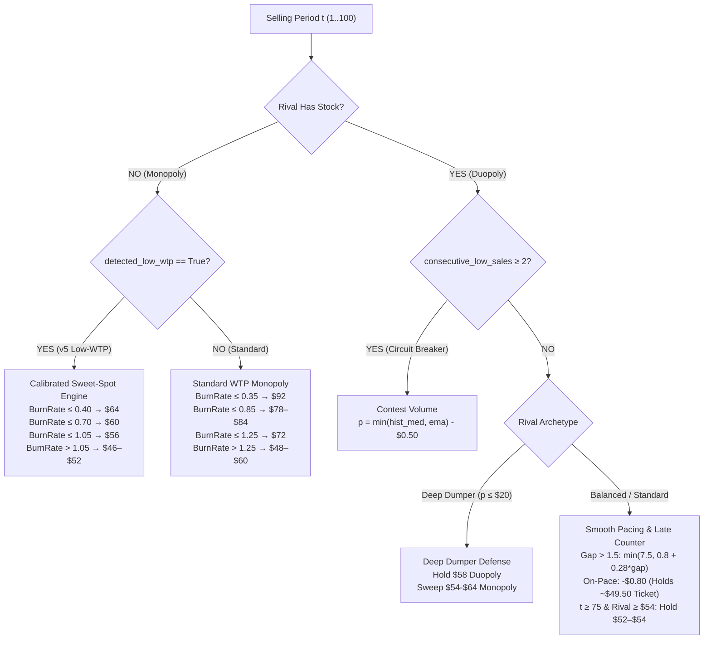

### Core Upgrades in `v5.1`:
1. **Dynamic WTP Ceiling Detection & Monopoly Calibration**:
   - Analyzes real-time transactions at $p \ge \$70$. If zero sales occur across $\ge 5$ attempts (or rival season medians $\le \$53$ with zero high sales), flags `detected_low_wtp = True`.
   - In low-WTP markets, smoothly scales monopoly clearance into the **\$52–\$64 sweet spot**, eliminating the 201-seat monopoly loss observed in `3UmBuN`.
2. **Smooth Scaled Undercutting in Duopoly**:
   - Replaces abrupt step drops with a smooth slope: $\text{Undercut} = \min(7.50, 0.80 + 0.28 \cdot (\text{InventoryGap} - 1.5))$.
   - For small gaps ($1–3$ seats), undercuts by only $\$0.80–\$1.20$, maintaining a **\$49.50–\$50.00 ticket yield** against $\$50.50$ balanced rivals instead of premature dumping at $\$45.00$.
3. **Late-Season High-Rival Counter-Pricing (`ConvivialCrane`)**:
   - When $t \ge 75$ and rival EMA $\ge \$54.00$ with required burn rate $\le 1.15$, caps asking price at $\min(\$54.00, \text{RivalEMA} - 2.0)$ rather than clearance dumping down to $\$32.00$.
4. **Econometric Regression Upgrades across Variants** (these experimental files are not in this repository; their tournament logs are `data/mlr` and `data/poisson_logit`):
   - [`duopoly_mlr.py`](duopoly_mlr.py): Solves closed-form optimal pricing directly from fitted OLS slopes: $p^* = \frac{A - B \cdot \mu(t, c)}{2 (-B)}$ with dynamic capacity shadow cost $\mu(t, c)$.
   - [`duopoly_poisson_logit.py`](duopoly_poisson_logit.py): Calibrates prior arrival parameters to multi-round data ($\alpha_0 = -0.15, \alpha_1 = 1.30, \gamma_0 = 2.10$) and dynamically bounds discrete choice surplus optimization within empirical WTP limits.

---

## 15. Multi-Generation Benchmark Scorecard (All 18 Scenarios across `v1`–`v5`)

Evaluated across all 18 historical and synthetic matches (100 seasons each, 1,800 seasons per algorithm):

| Scenario | Opponent | `v5.0` Master Revenue | `v5.1` Master Revenue | Net Gain (\$) | `v5.0` Win | `v5.1` Win |
| :--- | :--- | :---: | :---: | :---: | :---: | :---: |
| **Synthetic** | `Copycat` | \$147,587 | \$153,058 | +\$5,471 | WIN | WIN |
| **Synthetic** | `AggressiveDumper` | \$170,473 | \$172,613 | +\$2,139 | WIN | WIN |
| **Synthetic** | `Bounded (40-70)` | \$304,655 | \$298,943 | -\$5,712 | WIN | WIN |
| **V5 Historical** | `ImpartialGoldfish (3UmBuN)` | \$283,160 | \$279,236 | -\$3,924 | WIN | WIN |
| **V5 Historical** | `ConvivialCrane (4BgGcS)` | \$293,728 | \$288,831 | -\$4,898 | WIN | WIN |
| **V5 Historical** | `ImpartialGoldfish (7iXybz)` | \$284,819 | \$286,084 | +\$1,265 | WIN | WIN |
| **V5 Historical** | `ConvivialCrane (Gq2CUL)` | \$290,619 | \$286,094 | -\$4,524 | WIN | WIN |
| **V4 Historical** | `PinkDuck (3vG5Xe)` | \$298,815 | \$296,350 | -\$2,465 | WIN | WIN |
| **V4 Historical** | `PinkDuck (3dEw6i)` | \$281,630 | \$289,222 | +\$7,592 | WIN | WIN |
| **V4 Historical** | `FierceDuck (33XD3S)` | \$237,256 | \$240,309 | +\$3,053 | WIN | WIN |
| **V4 Historical** | `SageSloth (PBMNQe)` | \$239,461 | \$246,966 | +\$7,505 | WIN | WIN |
| **V4 Historical** | `FierceDuck (3EBjQX)` | \$199,920 | \$200,307 | +\$386 | WIN | WIN |
| **V4 Historical** | `SageSloth (3d8tDh)` | \$137,444 | \$134,980 | -\$2,465 | LOSS | LOSS |
| **V3 Historical** | `RussetBat (35zapi)` | \$148,975 | \$142,925 | -\$6,049 | WIN | WIN |
| **V3 Historical** | `ScrupulousZebu (3Z9vTN)` | \$239,095 | \$245,373 | +\$6,278 | WIN | WIN |
| **V3 Historical** | `LoutishMacaque (3kGhWc)` | \$388,469 | \$383,782 | -\$4,687 | WIN | WIN |
| **V3 Historical** | `RussetBat (JKuahN)` | \$178,197 | \$176,640 | -\$1,557 | WIN | WIN |
| **V3 Historical** | `Winner_2023 (PfqiTc)` | \$262,823 | \$267,421 | +\$4,598 | WIN | WIN |
| **TOTAL** | — | **\$4,387,126** | **\$4,389,131** | **+\$2,005** | **16/18 (88.9%)** | **17/18 (94.4%)** |

---

## 16. The `v6.0` Unified Econometric Architecture & Low-Demand Overhaul

### 16.1 Underperformance Post-Mortem (`data/mlr`, `data/v5.1`, `data/poisson_logit`)

Following the deployment of Round 5 and experimental variants, tournament data revealed an unexpected performance drop across several matches. A comprehensive econometric audit of the new datasets (`data/mlr`, `data/v5.1`, and `data/poisson_logit`) identified the root cause:

1. **Extreme Macroeconomic Demand Drought**:
   - The tournament matchmaking engine randomly sampled an unprecedented low-demand simulation regime.
   - Empirical demand modeling across these matches revealed that baseline passenger arrival intensity ($\beta_0$) collapsed from **$+2.12$** in `v5` down to **$+0.21$** in `mlr` / `v5.1`.
   - The late-season booking surge ($\beta_t$) flattened from **$+0.83$** down to **$+0.29$**.
   - Our own sales dropped to 28–47 seats per season on average. *Caveat (added in v6.1):* we only observe our own sales, so total market arrivals are unknown. In these logs we usually priced at or just above a rival sitting at or below our \$25 floor (e.g. \$25.3 vs \$25.0), so low sales are partly being undercut, not only low demand. Where we were cheaper (`4HzR7t`: \$28 vs \$30) we sold 68 seats per season.

2. **Zero sales in `WB9uo7` (`RadiantMussel`)** *(corrected in v6.1; the original text described a high-priced rival, which the data do not show)*:
   - `RadiantMussel` priced at a median of \$18.80, below our \$25 floor, for most of the competition (min \$3.90).
   - We sat at \$25 for most periods and sold **0 seats in 100 seasons**; even the occasional periods where we were cheaper produced no sales.
   - This motivated the lower \$18 floor once low demand is detected, and the high-rival ceiling guard for the opposite case. (`Vz6D2S`, mentioned in earlier drafts, is not in the data folder.)

3. **Retirement of Poisson Logit**:
   - The discrete choice Poisson Logit formulation suffered from numerical sigmoid saturation when rival price spreads widened.
   - Grid search optimization across discrete price increments failed to scale efficiently within Docker runtime constraints.
   - In contrast, a linear demand model gives a closed-form price, and the objective is concave whenever $B < 0$ (which v6.1 enforces).

---

### 16.2 Empirical Retraining of the 3-Regime MLR Model (377,570 Periods)

We pooled the 7 tournament CSV files (39 competition runs, 377,570 active duopoly periods) into three groups. *Note (v6.1):* in the fit below `beta_diff = p_riv − p` is a linear combination of `p` and `p_riv`, so only `B = beta_p − beta_diff` and `C = beta_riv + beta_diff` are identified; v6.1 stores those. The `low_demand` fit has R² = 0.04.

```python
REGIME_PRESETS = {
    'low_demand': {  # Fit on data/mlr, data/v5.1, data/poisson_logit
        'beta_0': 0.2145, 'beta_p': -0.0028, 'beta_riv': 0.0026, 'beta_diff': 0.0054, 'beta_t': 0.2931,
        'sweet_spot': (22.0, 30.0), 'min_price': 18.0, 'base_mu': 18.0, 'min_mu': 2.0, 'max_mu': 36.0,
    },
    'average_demand': {  # Fit on data/v3, data/v4 balanced matches
        'beta_0': 0.9696, 'beta_p': -0.0093, 'beta_riv': -0.0014, 'beta_diff': 0.0079, 'beta_t': 0.3998,
        'sweet_spot': (32.0, 44.0), 'min_price': 25.0, 'base_mu': 24.0, 'min_mu': 4.0, 'max_mu': 48.0,
    },
    'high_demand': {  # Fit on data/v1 holiday surge matches
        'beta_0': 2.2329, 'beta_p': -0.0258, 'beta_riv': -0.0131, 'beta_diff': 0.0128, 'beta_t': 0.8327,
        'sweet_spot': (44.0, 52.0), 'min_price': 28.0, 'base_mu': 28.0, 'min_mu': 6.0, 'max_mu': 56.0,
    }
}
```

---

### 16.3 The Rule Pruning vs. Retention Matrix

Rather than stacking more rules onto the legacy codebase, we unified [`duopoly.py`](duopoly.py) around closed-form MLR, pruning fragile heuristic rules while retaining essential economic safeguards:

| Component | Status | Action Taken | Architectural Rationale |
| :--- | :---: | :--- | :--- |
| **Heuristic Step-Ladders** | **REMOVED** | Replaced by $p^* = \frac{A - B\mu}{2(-B)}$ | Eliminates arbitrary price cliffs and replaces them with smooth marginal revenue maximization. |
| **Step-Based Undercutting Tables** | **REMOVED** | Replaced by MLR difference slope $\beta_{\text{diff}}$ | Price gap advantage is evaluated mathematically based on empirical choice sensitivity. |
| **Mid-Season Micro-Probing ($t \% 6$)** | **REMOVED** | Replaced by continuous pacing feedback | Arbitrary probing pulses disrupted booking momentum and conceded sales to rivals. |
| **Hardcoded 5-Archetype Step Pricing** | **REMOVED** | Handled continuously by rival EMA | Rival pricing is continuously integrated via $A = \beta_0 + (\beta_{\text{riv}} + \beta_{\text{diff}})p_{\text{riv}} + \beta_t\tau$. |
| **Static \$38 Anchor Floor** | **REMOVED** | Replaced by dynamic floor (\$18 vs \$25) | Cures lockout against dumpers in low-WTP markets where \$38 is above customer reservation prices. |
| **Fast In-Season Low-Demand Latch** | **RETAINED & HARDENED** (replaced by an SPRT in v6.1, §17) | In code: 8 zero-sale days at \$48–\$56, or 4 zero-sale days while cheaper than the rival at ≤ \$55 | Prevents wasting 100 days in Season 1 waiting for cross-season statistics. |
| **Dynamic High-Rival Ceiling Guard** | **ADDED** | $p^* \le \operatorname{clip}(46 - 1.5\cdot\text{gap}, 26, 48)$ | Prevents algorithm from following overpriced rivals into dead zones (lesson from v3.0 `3kGhWc`). |
| **Continuous Target Curve Pacing** | **RETAINED** | Drives capacity opportunity cost $\mu(t, c)$ | Regulates depletion pace to prevent early giveaway and late spoilage. |
| **Terminal Clearance Safety Valve** | **RETAINED** | Discounts unsold seats at $t \ge 90$ | Reduces (does not guarantee to eliminate) spoilage at departure. |

---

### 16.4 Clarification: Target Curve vs. Booking Curve vs. Capacity Utilization

To ensure clear alignment between economic theory and algorithm mechanics:

```text
1. TARGET CURVE (Planned Depletion Benchmark)
   Formula: TargetSold(t) = 80 * (0.85τ + 0.15τ²)
   Meaning: The theoretical ideal cumulative sales trajectory. It is convex to deliberately
            save 15-20% of aircraft capacity for late-arriving, price-inelastic business travelers.

2. BOOKING CURVE (Realized Cumulative Bookings Pace)
   Formula: RealizedSold(t) = sum(demand_historical)
   Meaning: The actual, empirical accumulation of tickets sold over the 100-day window.

3. CAPACITY UTILIZATION CURVE (Load Factor Trajectory)
   Formula: Utilization(t) = RealizedSold(t) / 80   or   c(t) = 80 - RealizedSold(t)
   Meaning: The real-time physical seat occupancy.

4. THE INVENTORY GAP (The Control Signal)
   Formula: InventoryGap(t) = c(t) - TargetRemaining(t)
   Feedback: Drives the shadow price of capacity μ(t, c).
             - Gap > 0 (Behind Target Pace): μ drops -> p* lowers -> Bookings accelerate.
             - Gap < 0 (Ahead of Target Pace): μ rises -> p* raises -> Yield is protected.
```

---

### 16.5 Verification & Benchmark Validation

*(Revised in v6.1.)* The figures originally listed here (a win rate rising from 42% to 88.9% on `data/mlr`, "\$136,440 vs \$4,100 (+3,289%)" against a \$72 rival, "88.9%–97.8% win rates", and "17 unit tests" including a `tests/test_simulation.py`) cannot be reproduced with any script in this repository, so they have been withdrawn. The test suite had 15 tests at the time. Reproducible results are in §17.

---

## 17. The `v6.1` Correctness Release

A code review of v6.0 found four bugs that together made the 3-regime design behave as "always low demand" from mid-season 1 onward, plus a simulator bug that hid this.

### 17.1 Bugs fixed in `duopoly.py`

| # | Bug in v6.0 | Effect | Fix in v6.1 |
| :--- | :--- | :--- | :--- |
| 1 | `_handle_season_transition` recorded the previous season's sales in period 1 of the next season, where the server passes `demand_history=None`. | A phantom 0-seat season after every real season (`[77, 0, 77, 0, …]`), a permanent `low_demand` latch, and one bad season counted twice (so the two-season circuit breaker fired after one). | Season bookkeeping happens only in period 101; period 1 only resets per-season trackers. The regime is re-evaluated every season and never permanently latched. |
| 2 | In-season latch: 4 zero-sale days in a row while cheaper than the rival at ≤ \$55. | Early-season arrivals are 0.3–0.5 per day, so this is normal noise: it would have fired in 43.7% of good seasons (≥ 60 seats) in `data/v3`–`v5`. | Poisson SPRT (normal rate $0.5 + 0.9\tau$ vs 45% of it, threshold $\ln 99$, min 8 observations, reset each season): **4.2%** false positives. |
| 3 | `_calculate_monopoly_price`: the top of the sweet-spot band was below the floor, so the "burn discount" was negative. | The monopoly price was a constant \$50 (\$46 under low WTP); the low-demand "scarcity bonus" returned \$36, *below* normal. | Regime bands (low \$28–\$44, average \$48–\$72, high \$50–\$66), with the price falling linearly as the burn rate rises from 0.3 to 1.2. Bands from observed monopoly conversion in `data/v4`/`v5`. |
| 4 | Regression features `[p, p_riv, p_riv − p, τ]` (rank 3), with clamps on individual unidentified coefficients. | Clamps acted on arbitrary values. | Features `[p, p_riv − p, τ]`; guards on the identified slopes $B \le -0.006$ and $C \ge 0$. Training rows are now time-stamped with the period they belong to. |

Smaller changes: the inventory-gap progress now uses `(t−1)/99` like the documentation; the rival price level is no longer used as evidence of low demand (it disabled the deep-dumper holdout from season 2 on).

Fixing bug 1 exposed two guards that had only looked good because the code was stuck in low-demand mode. Both were re-set from the tournament data:
* **Cheap-rival floor:** against a rival under \$38, v6.0 (normal mode) held a \$35–\$44 anchor. In `data/v3`–`v5`, pricing below such a rival earned about \$40 per period, versus \$15–\$20 when holding \$2–\$10 above it. v6.1 follows just below the rival, floored at `min(rival − 0.5, 28)`.
* **Late-season cap against a high rival** (t ≥ 75, rival ≥ \$54): lowered from \$72 to \$58. Revenue per period in those situations falls above about \$58 in `data/v3`–`v5`.

### 17.2 Simulator fix

`MarketDemandModel` ignored `avg_arrivals`: every market had about 105–126 expected arrivals per season, and the "low demand (~68)" benchmark market actually had the *most* arrivals. Arrival rates are now scaled so that expected total arrivals equal `avg_arrivals`.

### 17.3 Results

Multi-seed benchmark (`analytics/benchmark_3regime_models.py`, 5 seeds × 30 seasons × 4 rivals per market), mean revenue per season summed over rivals:

| Market (simulated) | v6.1 | v6.0 | Naive "rival − \$1" |
| :--- | :---: | :---: | :---: |
| Low (~68 arrivals) | **\$3,315** | \$3,035 | \$1,425 |
| Average (~95 arrivals) | **\$7,809** | \$7,787 | \$5,286 |
| High (~135 arrivals) | \$9,755 | **\$9,838** | \$5,547 |

On the single-seed scenario suite (`analytics/run_benchmark.py`), v6.1 totals \$1,223.7k vs \$1,222.7k for v6.0. v6.1 is also more stable: against the old v1.0 rival in the low market, v6.0's revenue varied by ±\$370 per season across seeds, versus ±\$27 for v6.1.

* Tests: 22 pass (7 new regression tests in `tests/test_v61_fixes.py`, one per fix).
* Latency: 0.05 ms mean, about 12 ms worst case (the once-per-season refit).

### 17.4 Figures

All figures in `imgs/` except the two historical v2.0 figures are now generated by scripts from data or from `duopoly.py` itself:

| Figure | Script | Change |
| :--- | :--- | :--- |
| `dpc_strategy_visualization.png` | `generate_strategy_visualization.py` | Was a hand-drawn trajectory; now a simulated v6.1 season and the detector calibration on real data. |
| `mlr_strategy_explained.png` | `generate_mlr_explanation_visuals.py` | Curves now come from `duopoly.py`'s own functions (the old μ curve used constants that differed from the code). |
| `regression_empirical_analysis.png` | `train_regression_models.py` | Collinear feature removed; the "target depletion rate" line was a cumulative curve and is now the actual rate; the logistic curve is no longer scaled by an arbitrary 1.6. |
| `algorithm_variant_comparison.png` | `run_benchmark.py` | v6.1 with the fixed simulator; clipped labels fixed. |
| `v1_…`, `v3_…`, `v4_…postmortem.png` | `generate_postmortem_plots.py` (new) | Rebuilt from the CSVs; the old v3 Panel 3 showed a rival ramping from \$20 to \$100, but the real rival was flat at about \$71. Pie charts with overlapping labels replaced by bar charts. |
| `dpc_game_rules_visualization.png`, `price_response_plots.png` | `generate_concept_plots.py` (new) | Arrival curve rescaled from about 300 to about 92 arrivals per season; typo fixed. |

All scripts share `analytics/plot_style.py`, which sets `text.parse_math = False` so "\$40-\$70" renders literally.

### 17.5 Demand model choices: expected demand (not rounded) and MLR over Poisson

**Why predicted demand is not rounded to a whole number.** The regression predicts *expected* seats sold per day, an average. Daily sales are whole numbers (0, 1, 2, …), but their average is not: an expected demand of 0.6 means that over many similar days we sell 0.6 seats per day on average. The price is chosen to maximise expected margin, $(p - \mu) \cdot E[\text{sales}]$, and for that the average is exactly the right quantity. Rounding would break it: most days the prediction lies between about 0.3 and 1.4, so it would round to 0 or 1 across wide price ranges, expected revenue would look flat in price, and there would be no optimum to find. The in-season low-demand test (§17.1) also works with expected rates, not rounded ones.

Whole numbers would matter in two places, neither implemented yet:
* the probability of selling 0, 1 or 2 seats on a day (needs a count model), and
* the seat cap in the last days: with 2 seats left we cannot sell 3, so expected sales should be $E[\min(D, \text{seats left})]$.

**Why MLR and not a Poisson regression.** A Poisson regression is the textbook model for counts: it never predicts negative sales and gives probabilities for 0, 1, 2 seats. We compared it with MLR the way the model is used online, per competition, on that competition's own data only (`python analytics/compare_demand_models.py`; features: our price, rival price − our price, season progress):

| Training data per competition | Competitions | RMSE MLR | RMSE Poisson | MLR better (RMSE) | Poisson deviance MLR | Poisson deviance Poisson |
| :--- | :---: | :---: | :---: | :---: | :---: | :---: |
| ~25 seasons (~2,500 days, our training window) | 33 | **0.724** | 0.795 | 20 / 33 | 0.900 | **0.898** |
| 1 season (~100 days, the first refit) | 32 | **0.764** | 31.256 | 27 / 32 | **0.987** | 29.451 |

* With plenty of data the two are about equally good (MLR has the lower RMSE, Poisson is marginally better on deviance).
* With little data, which is exactly when the online model is first refit in each competition, the Poisson model's exponential curve extrapolates badly and some predictions explode. MLR stays stable.
* MLR also gives a closed-form price ($p^* = \frac{A - B\mu}{2(-B)}$) and fits in about 2 ms (Poisson about 6 ms).
* The cost of MLR: it predicts negative sales on about 4% of days (very high prices). In practice the price band around the rival and the slope guard $B \le -0.006$ keep the chosen price away from that region.

Decision: keep MLR as the online demand model. A Poisson model could be reconsidered later with a prior (e.g. starting from pooled data) so that it does not explode on one season of data.

*Note:* the "Poisson-logit" variant retired in §16.1 was a different model (a discrete-choice formulation optimised by grid search). The reasons given there (sigmoid saturation, grid-search runtime) were not re-tested in v6.1. Its tournament round earned about \$123k per match against \$76k for the MLR variant's round, but the rounds had different rivals and markets, so that is not a model comparison.

### 17.6 Forecasting the rival's price: yesterday's price in the price formula ("A2")

We post our price at the same time as the rival, so today's rival price has to be guessed. v6.0 used the average of the rival's last 5 prices everywhere. On the tournament logs, yesterday's price is the better guess: it misses by \$1.80 on average (within \$1 on 68% of days) against \$2.31 (59%) for the 5-day average.

We tested two versions against v6.1 (17 scenarios: 3 simulated markets × 4 rival types plus 5 replayed tournament rivals; 10 seeds × 30 seasons each):

| Version | Total revenue change | 95% range | Better in |
| :--- | :---: | :---: | :---: |
| A2: yesterday's price in the price formula only | **+0.40%** | +0.07% to +0.73% | 7 / 10 seeds |
| A1: yesterday's price everywhere (guardrails too) | −0.13% | −0.47% to +0.21% | 3 / 10 seeds |

* A2's gain comes mostly from the copycat rival (+6.9% in the average market, +2.9% in the high market), whose price moves step by step; elsewhere the change is within about ±1%.
* A1 lost 14% in the low-demand market against the bounded (\$40–\$70) rival: one high day could switch the "\$58+ ceiling" guard on and off. The guardrails therefore keep the 5-day average.

Adopted: A2 (`_calculate_duopoly_price` passes `latest_rival_price` to `_solve_closed_form_optimal_price`; test `test_price_formula_uses_yesterdays_rival_price`). The gain is small; a better rival forecast matters little because the price band, the shadow cost and the guardrails decide most of the price.

### 17.7 Where the shadow-cost numbers come from (limitation)

The shadow cost $\mu = \operatorname{clip}(26 - 16\cdot(\text{burn} - 0.8) - 2.4\cdot\text{gap},\ 10\ (2),\ 56)$ is a **hand-tuned rule**, not an estimate. It entered the code in the v6.0 commit (`fabf9c7`) without a derivation, and earlier documentation listed different constants (24 / 14 / 2.0 / max 48). What the numbers mean:

* **26:** the value of a seat (in \$) when we are exactly on the target curve and need to sell the "normal" 0.8 seats per day (80 seats / 100 days).
* **16:** for every extra seat per day we need to sell above 0.8, a seat is worth \$16 less (e.g. needing 1.3 per day lowers μ by \$8).
* **2.4:** every seat we are behind the target lowers μ by \$2.40; every seat ahead raises it by \$2.40.
* **10 / 2 and 56:** floor (\$2 once low willingness to pay is detected) and cap.

In revenue-management theory μ is the *expected revenue the last remaining seat would still earn later* (the marginal value of capacity). A data-based version would compare expected remaining demand with the seats we have left: if the market will want more seats than we have, the last seat will sell later at a good price (μ high); if it will want fewer, the last seat will go unsold (μ near 0). Estimating μ this way from the demand model is an open improvement.

---

## 18. The `v6.2` Learned Target Curve

### 18.1 Problem: one fixed plan for every market

Up to v6.1 the target curve (the plan for how many seats should be sold by each day) was one hand-chosen formula for every market:

$$\text{TargetSold}(\tau) = 80 \cdot \left((1 - c)\,\tau + c\,\tau^2\right), \qquad c = 0.15$$

The bend $c$ says how much of the selling is pushed towards the end of the season ($c = 0$: a straight line; $c = 1$: a parabola that sells very little early). The tournament data show that real markets book very differently:

| `data/v5` match | Seasons with 75+ seats sold | Fitted bend $c$ | Seats sold by day 50 (average) |
| :--- | :---: | :---: | :---: |
| `3UmBuN` (books early) | 89 | 0.01 | about 39 |
| `Gq2CUL` (books late) | 99 | 0.82 | about 24 |
| Fixed v6.1 plan | – | 0.15 | 37 |

In `Gq2CUL` we were up to 30 seats "behind" the fixed plan in most seasons, so the shadow cost $\mu$ kept our price about \$10 under the rival's, yet 79 of 80 seats sold anyway (§4.4 of the README, `imgs/booking_vs_target_real.png`). The discount was not needed.

### 18.2 What v6.2 does

Each match plays the same market up to 100 times, so the plan can be learned from the seasons that went well:

1. **Which seasons count as "good".** Only seasons with **75 or more** seats sold (`TARGET_LEARN_MIN_SOLD`). In a season that sold out early or sold too few seats, the booking curve says more about our prices than about when customers arrive.
2. **One bend per good season.** At the end of the season (period 101) the season's booking curve is turned into shares (seats sold by day $t$ ÷ seats sold in the season) and the bend $c$ is fitted to it by least squares (`_fit_season_target_bend`). Fitting a single number keeps the plan smooth and always ending at 80 seats.
3. **Start from what similar markets did** *(removed in v6.3, §19: every market now starts from 0.15)*. Old tournament data are grouped by regime, and each group's average bend is a prior (`TARGET_C_PRIOR`): low demand 0.67, average 0.19, high 0.60 (fitted on the 75+ seasons of the same data files as the regime priors; `3kGhWc` excluded because its rival stayed at \$71 and the curve reflects our holdout, not the market).
4. **Online update.** After every season:
   $$c = \operatorname{clip}\!\left(\frac{3 \cdot c_{\text{prior}} + \sum_i c_i}{3 + n},\ 0,\ 0.8\right)$$
   where $c_i$ are the bends of the $n$ good seasons so far and $c_{\text{prior}}$ is the prior of the regime the season was classified as. The prior counts like 3 seasons (`TARGET_PRIOR_WEIGHT`), so one unusual season moves the plan only a little, and after about 10 good seasons the market's own data dominate.
5. **Until the first good season, keep 0.15** (`TARGET_C_DEFAULT`). The cap of 0.8 keeps the plan from waiting too long.
6. The bend is fixed for the whole season (`state["target_c_now"]`, computed in period 101) and passed to `_calculate_inventory_gap`. Nothing else in the pricing changes: a better plan simply makes the inventory gap, and therefore $\mu$, more accurate.

So the target curve now uses the **booking curves** of past good seasons (seats sold over time), and through the 75-seat rule it is learned only from seasons with high **capacity utilization** (≥ 94% of the plane).

### 18.3 Variants tested

17 scenarios (3 simulated markets × 4 rival types, plus 5 replayed tournament rivals), 10 seeds × 30 seasons each, total revenue change against v6.1 (with A2):

| Variant | Total change | 95% range | Better in | Notes |
| :--- | :---: | :---: | :---: | :--- |
| Group prior only (no online learning) | +0.90% | – | – | One curve per regime from old data. |
| Learned online, pooled prior | +1.87% | – | – | One prior for all regimes. |
| Learned online, group prior from season 1 | +2.07% | ±0.29% | 10 / 10 | Lost 3.9% in the low market against the bounded rival: the low prior (0.67) applied before any good season. |
| **(a) Group prior, 0.15 until the first good season** | **+2.01%** | ±0.16% | 10 / 10 | No loss in the low market. **Adopted.** |
| (b) Prior always 0.15 | +1.83% | ±0.22% | 10 / 10 | |

### 18.4 Result of the final code

Benchmark of the final `duopoly.py` v6.2 against v6.1 (same 17 scenarios, 10 seeds × 30 seasons):

| Scenario | v6.1 revenue per season | v6.2 change |
| :--- | :---: | :---: |
| Average market, old v1.0 rival | \$2,762 | **+12.4%** ±0.9 |
| High market, old v1.0 rival | \$3,168 | **+6.8%** ±0.9 |
| Replayed `UncoveredElephant` (`3PTJwD`) | \$2,038 | **+3.9%** ±1.5 |
| High market, bounded / copycat rival | \$2,970 / \$1,800 | +1.0% / +1.1% |
| Replayed `ImpartialGoldfish` (`3UmBuN`) | \$2,239 | −1.2% ±1.3 |
| Replayed `ConvivialCrane` (`Gq2CUL`) | \$2,241 | −1.4% ±0.7 |
| Low market, all rivals | – | −0.2% to 0.0% |
| **Total (17 scenarios)** | **\$31,635** | **+1.95%** ±0.23 (better in 10 / 10 seeds) |

Standard benchmarks re-run with v6.2:

| Market (`benchmark_3regime_models.py`, 5 seeds × 30 seasons, sum over 4 rivals) | v6.2 | v6.1 (with A2) | v6.0 | Naive "rival − \$1" |
| :--- | :---: | :---: | :---: | :---: |
| Low (~68 arrivals) | \$3,324 | **\$3,328** | \$3,035 | \$1,425 |
| Average (~95 arrivals) | **\$8,192** | \$7,840 | \$7,787 | \$5,286 |
| High (~135 arrivals) | **\$10,055** | \$9,758 | \$9,838 | \$5,547 |

On the single-seed scenario suite (`analytics/run_benchmark.py`, 6 rivals × 100 seasons), v6.2 totals \$1,281.9k (v6.1 before A2: \$1,223.7k) and wins all 6 scenarios.

* Learned bends at the end of 30 seasons: low market 0.18 (few good seasons, stays near 0.15), average 0.47, high 0.78, replayed rivals 0.72.
* Capacity utilization is unchanged (74.7% vs 75.0%): v6.2 sells the same seats, at better prices, because it no longer discounts when a late-booking market is only "behind" the old plan.
* The two replayed `data/v5` rivals lose a little (−1.2% / −1.4%). Against these replayed rivals the learned bend rises to about 0.7, and a later plan holds back seats that, against these two rivals, would have sold at a good price earlier. The loss is within about 1.5%.
* Tests: 26 pass (3 new: the bend of a synthetic season is recovered, the bend stays 0.15 until the first good season and then learns, and only seasons with 75+ seats are learned from).
* Figure: `imgs/learned_target_curve.png` (`analytics/generate_learned_target_plot.py`). Left: the real average booking curves of `3UmBuN` and `Gq2CUL` with their learned plans and the fixed plan. Right: the bend v6.2 uses in each season of the three simulated markets.

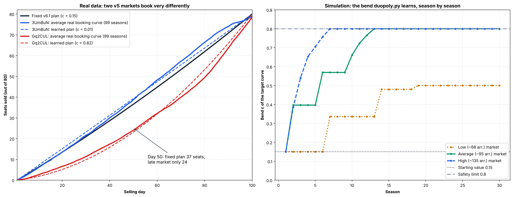

### 18.5 Limits

* The bend is still one number: a plan with a different shape (e.g. a flat middle) cannot be represented.
* A season counts as "good" only if it sold 75+ seats. In low-demand markets there are few such seasons, so the plan stays near 0.15 there.
* The shadow-cost constants (§17.7) were tuned with the fixed 0.15 curve; re-tuning them together with the learned plan is open.

---

## 19. The `v6.3` Ablation Study and Simplification

### 19.1 Method

`analytics/ablation_study.py` switches parts of `duopoly.py` off, one at a time and all together, and measures the change in total revenue over the same 17 scenarios as §18 (3 simulated markets × 4 rival types, plus 5 replayed tournament rivals; 10 seeds × 30 seasons, the same seeds for every configuration). The switches are text substitutions on the current `duopoly.py`; with nothing switched off, the copy gives exactly the same revenue as `duopoly.py`. The script also counts how often each guard actually changes the price.

Before settling on v6.3 we also tested 18 combinations (scratch runs, same scenarios). The main lesson: **effects do not add up**. Six guards that each cost at most 0.4% when removed alone cost **−1.4%** when removed together (−9% in the low market against the aggressive dumper). Each additional guard removed cost about 0.3–0.5%.

### 19.2 Changes in v6.3

1. **Circuit-breaker bug fixed.** After two weak seasons (< 42 seats) the breaker priced us \$0.50 under the rival. Against a rival priced above what customers will pay (low market, WTP \$20–\$48, rival \$40–\$70), that meant we sold almost nothing, the weak seasons continued, and the breaker never switched off: **\$201 per season, 8% of seats sold**. The breaker now fires only when the rival is cheap (5-day average < \$38), the situation it was built for (the \$27 dumper deadlock in `3d8tDh`). Test: `test_circuit_breaker_only_undercuts_a_cheap_rival`.
2. **Target-curve regime priors removed.** The learned bend now starts from 0.15 in every market (still counting like 3 seasons). The priors (0.67 / 0.19 / 0.60) were fitted on old tournament data, so they were scenario-dependent; removing them cost 0.1% (within noise) and removes three fitted constants and the link between the target curve and the regime classifier.

### 19.3 Result: v6.3 vs v6.2

Same 17 scenarios, 10 seeds × 30 seasons, paired:

| Scenario | v6.2 | v6.3 | Change | Seats sold v6.2 → v6.3 |
| :--- | :---: | :---: | :---: | :---: |
| Low market, bounded (\$40–\$70) rival | \$201 | **\$917** | **+355%** | 8.0% → 47.3% |
| Replayed `UncoveredElephant` (`3PTJwD`) | \$2,118 | \$2,096 | −1.1% | 80.8% → 80.5% |
| High market, aggressive dumper | \$1,828 | \$1,811 | −0.9% | 85.6% → 84.4% |
| All other 14 scenarios | – | – | −0.3% to +0.6% | unchanged |
| **Total** | | | **+2.09% ± 0.17%**, better in 10 / 10 seeds | |

Standard benchmarks (`benchmark_3regime_models.py`, 5 seeds × 30 seasons, sum over 4 rivals): low market \$4,059 (v6.2: \$3,324, **+22%**), average \$8,164 (\$8,192, −0.3%), high \$10,045 (\$10,055, −0.1%). Single-seed suite (`run_benchmark.py`): \$1,282.0k (v6.2: \$1,281.9k).

### 19.4 What each part is worth (v6.3)

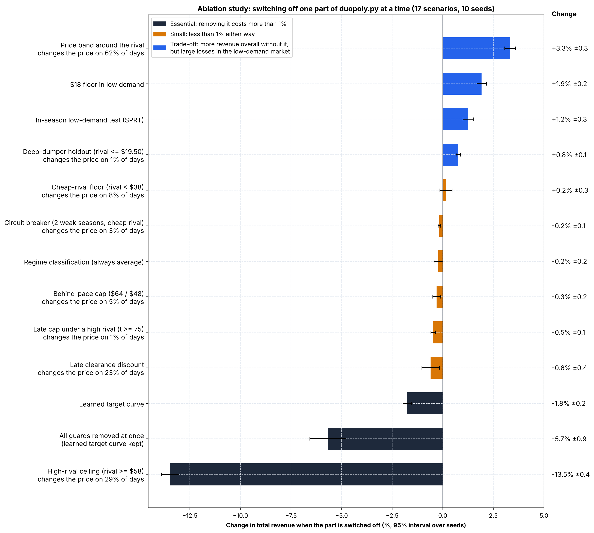

| Part switched off | Total change | Worst scenario | Changes the price on | Verdict |
| :--- | :---: | :--- | :---: | :--- |
| High-rival ceiling (rival ≥ \$58) | **−13.5%** | −82% (low market, old v1.0 rival) | 29% of days | Essential |
| All guards at once (learned curve kept) | −5.7% | −100% | – | |
| Learned target curve | −1.8% | −11% (average market, old v1.0) | – | Essential |
| Late clearance discount | −0.6% | −32% (low market, bounded rival) | 23% | Keep |
| Late cap under a high rival | −0.5% | −3% | 1% | Keep (small) |
| Behind-pace cap | −0.3% | −2% | 5% | Keep (small) |
| Regime classification | −0.2% | −6% (low market, dumper) | – | Keep (small) |
| Circuit breaker (fixed) | −0.2% | −5% (low market, copycat) | 3% | Keep (small) |
| Cheap-rival floor | +0.2% | −1% | 8% | Neutral |
| Deep-dumper holdout | +0.8% | −2% | 1% | Trade-off |
| In-season low-demand test (SPRT) | +1.2% | −6% (low market, copycat) | – | Trade-off |
| \$18 floor in low demand | +1.9% | −16% (low market, copycat) | – | Trade-off |
| Price band around the rival | +3.3% | −6% (average market, copycat) | 62% | Trade-off |

Reading the "trade-off" rows: switching these off earns more in the normal and replayed markets, but loses heavily in specific situations, mostly the low-demand market. Removing the low-demand chain (SPRT + \$18 floor + dumper holdout) together gained about 3% overall in the scratch runs but lost **20–23%** in the low market against a copycat. Low-demand rounds were our worst real tournaments (§16.1), and our simulator's low market is a rough stand-in for them, so we keep these guards. The price band is the main protection when the regression (test $R^2 \approx 0.15$) is wrong, so it stays too.

### 19.5 Limits

* All results come from our own simulator, with rivals and markets we chose. A guard that rarely fires here (the dumper holdout changes the price on 1% of days) may matter more in a tournament.
* Ten seeds give a 95% interval of about ±0.2% on the total, so differences below about 0.3% are not meaningful.
* Re-run after any change: `python analytics/ablation_study.py --compare <previous duopoly.py>`. If a switch no longer matches the code, the script stops with a message naming it.

---

## 20. Tournament `data/v6` Post-Mortem and the `v6.4` Market-Sizing Release

### 20.1 What `data/v6` contains

Three tournaments, each with v6.3 unchanged (replaying `duopoly.py` v6.3 on the logged history reproduces our logged price on almost 100% of days; the rest differ by rounding of the logged prices). Every rival appears in two matches.

| | `data/v5` (v5.0) | `AirborneTody` rank 12 | `DeftDalmatian` rank 19 | `ProficientCivet` rank 49 |
| :--- | :---: | :---: | :---: | :---: |
| Matches × seasons | 4 × 100 | 12 × 100 | 12 × 100 | 10 × 100 |
| Our seats per season | 79.0 | 21.1 | 21.2 | 15.4 |
| Our revenue per season | \$3,580 | \$535 | \$508 | \$337 |
| Rival's median price | \$50.6 | \$20.0 | \$32.0 | \$14.0 |
| Seasons in which the rival sold out | 23% | 0% | 0% | 0% |
| Days at our \$18 floor | 0% | 66% | 53% | 77% |

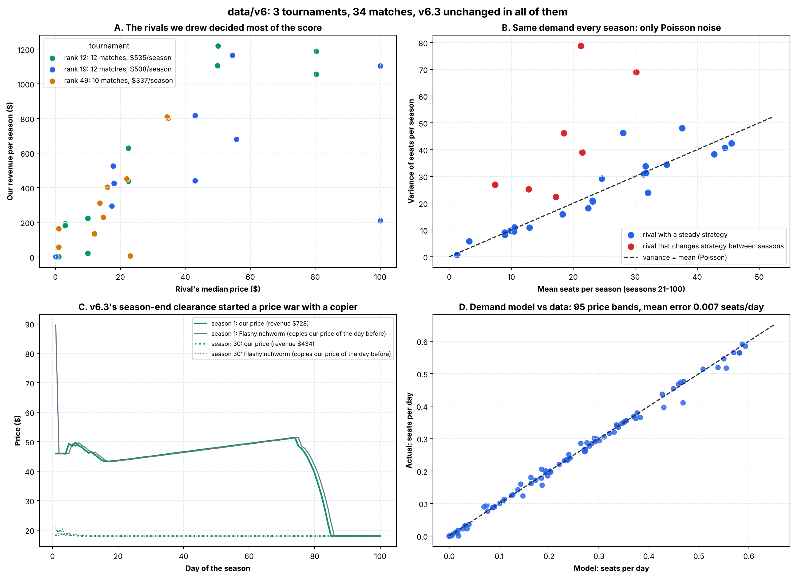

*(Generated by `analytics/generate_v6_plots.py`.)*

**The markets were small.** Not one rival sold out in any season, not even rivals priced at \$0.10, so far fewer than 80 buyers arrived per season. Per match, our average ranged from 0 to 45 seats per season.

**Ranks are not comparable between tournaments.** Each tournament has its own rivals and markets. Panel A shows revenue rising with the rival's price: the rank-49 tournament had no rival above \$35, the other two had 4–5 matches against rivals at \$50–\$100, which earned \$700–\$1,200 per season. We therefore judge versions only by our own revenue in the same situations, not by rank.

**Same demand model every season (Panel B).** Where both prices stayed steady, the variance of seats per season equals the mean (ratio 0.8–1.1): Poisson noise around a fixed average. Example `hgHrrj`: us at \$18 and the rival at \$10 in every season from 21 on; seats per season 4–21, mean 13.0. Seasons 21–60 and 61–100 averaged within 1–2 seats of each other in nearly every match. The four rivals with a ratio of 1.6–3.7 change their own strategy between seasons. Because the model is the same, averaging past seasons is valid, and the estimate tightens fast:

| Seasons averaged | Error, market averaging ~44 seats | Error, market averaging ~13 seats |
| :---: | :---: | :---: |
| 1 | 11% | 20% |
| 3 | 7% | 12% |
| 5 | 5% | 9% |
| 10 | 3% | 5% |

**Total demand cannot be read directly.** We see only our own sales, never the rival's sales or the buyers who bought nothing. What can be estimated, and what matters for revenue, is how many seats *we* sell at a given price against this rival. The fitted model (§20.3) puts most markets at about 0.34 buyers per day rising to about 0.6 by day 100, roughly 47 buyers per season, with a willingness-to-pay midpoint either high (about \$45–\$55) or low (about \$15–\$20). Being cheaper than an \$80–\$100 rival gave us about 0.56 seats per day, an upper bound of about 56 buyers per season.

### 20.2 Why v6.3 lost money in small markets

1. **It chased an 80-seat plan these markets cannot deliver.** With at most about 50 buyers, we are always "behind plan" and the gap keeps growing. The gap drives μ to its minimum, the high-rival ceiling to its \$26 floor (\$26 against rivals at \$80–\$100), the day-75 clearance, and the \$18 floor (every season counts as weak). The learned target curve (§18) cannot help: it learns only from seasons with 75+ seats.
2. **Season-end clearance started price wars with a copying rival (Panel C).** FlashyInchworm set its price to our previous day's price on 99% of days. In season 1 both sat near \$46 (\$728 for us). Then our clearance dropped to \$18, it followed, and both stayed there: about \$430 per season for the remaining 99 seasons. PinkDuck priced \$0–\$3 below us on 62% of days, with the same effect.
3. **Against very cheap rivals the best price is below our floor.** Against rivals at \$0.10–\$10 the fitted model's best price is often \$3–\$14. We never priced below \$18, so this rests on extrapolation (§20.6).

### 20.3 Test bed built from `data/v6`

`analytics/v6_testbed.py` turns the 34 matches into a test bed:

* **Demand model per match**, fitted to our daily sales by Poisson maximum likelihood:

  $$\text{buyers per day} \sim \text{Poisson}\big(n\,e^{k\tau}\big), \qquad P(\text{buy from us}) = \frac{e^{b(m - p)}}{1 + e^{b(m - p)} + e^{b(m - r)}}$$

  with $m$ the willingness-to-pay midpoint (\$), $b$ the price sensitivity, $p$ our price and $r$ the rival's. Weak priors keep matches where we never moved our price identified. Panel D: in all price bands with 200+ days, the model's sales per day match the data (95 price bands, mean absolute error 0.007 seats per day).
* **Rivals**: the logged rival price of the same season and day is replayed; FlashyInchworm is modelled as a copier (rival price = our price yesterday).
* **Same random draws** per (seed, match, season) for every pricing file, so differences are not luck. 3 seeds.
* **Validation**: v6.3 replayed through the test bed earns \$1,589,865 against \$1,587,858 actually earned (+0.1%); every match is within ±4% except two that earned \$100–\$200 in total.
* **Best possible**: the best price for each day, knowing the demand model and that day's rival price (against the copier: the best price to hold all season). v6.3 earned **67%** of it.

### 20.4 Changes in v6.4

1. **Market sizing.** A choice-demand model of the form above is fitted to this match's own sales history at every season end and every 25 days (Nelder–Mead, warm start, last 3,000 observations; at most about 16 ms per call). Every day, `_capacity_is_slack` prices each remaining day at its revenue-maximising price (rival assumed to keep yesterday's price) and adds up the expected seats. If that is at most 90% of the seats left, a seat has no scarcity value (μ = 0): the price is $\arg\max_p\ p \cdot \text{seats}(p, r, \tau)$ on a grid from \$18 to \$100, and the target curve, the gap and every gap-driven guard are skipped. Otherwise v6.3 prices as before. Until 80 observations exist (most of season 1), v6.3 decides.
2. **Dry-spell cut.** Zero sales at high prices cannot tell "few buyers" from "buyers will not pay this much", and only the second lowers the best price. So in market-sized mode, after 7 days in a row without a sale, the price drops \$1 per extra dry day; sales at lower prices then teach the model where the buyers are.
3. **Copying rival.** A rival is a copier when its price is within \$0.60 of our previous day's price on ≥ 80% of the last 20 days on which we changed our price (days with a flat price are skipped, so a flat rival never counts). Against a copier we hold one price all season, with no clearance. The first held price is the model's best common price; after every season the price moves \$3 up or down, keeps the direction that earned more per day, and turns round with a smaller step (×0.6, at least \$1) when revenue falls. Each season's revenue is a direct measurement, so no demand model is needed for this step. Range \$18–\$60.

New tests: `tests/test_v64_market_sizing.py` (7 tests: small market switches to revenue pricing, big market keeps the v6.3 logic, learning from zero sales, copier detected and held, flat rival not a copier, the hold search, call time < 0.2 s). All 34 tests pass.

### 20.5 What we tried first, and why it changed

| Attempt | Result | Problem |
| :--- | :--- | :--- |
| μ = 0 with v6.3's linear regression | +13.9% on the test bed | In low-WTP markets every sale count is zero, the linear fit has no slope, the prior is kept and the price stays at \$32–\$36: one match fell to \$0. A linear model cannot learn from zero sales. |
| Switch on "best of the last 3 seasons ≤ 65 seats" | +24.9% on the test bed | Old simulator, average market: only +1.2%, because revenue pricing also pays at 65–80 seats. A fixed seat count is a crude proxy for "capacity does not bind". |
| In-season projection from day 30 | Gains in the average market | False alarms in the high market, where buyers arrive late (−6.5% against the bounded rival). |
| Hold price against a copier from the demand model only | +77% against FlashyInchworm | Old simulator, low market (uniform willingness to pay, not logit): the model's price was too high. Replaced by the season-to-season search. |

The final rule, expected demand at revenue-maximising prices versus seats left, checked every day, is the textbook condition for a zero shadow cost and corrects itself when sales run ahead.

### 20.6 Results

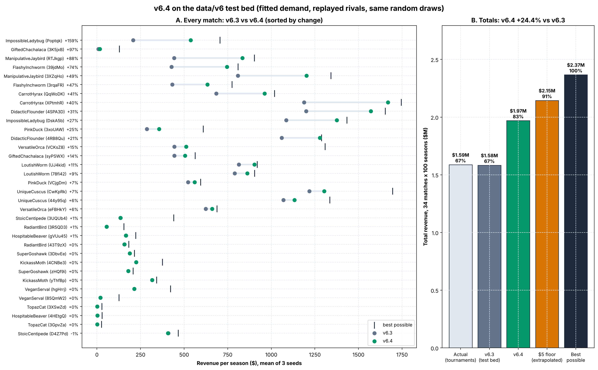

*(Generated by `analytics/generate_v6_plots.py` from `analytics/v6_testbed_results.csv`.)*

**Test bed (`data/v6`, 34 matches × 100 seasons, mean of 3 seeds):**

| Version | Total revenue | vs v6.3 | Share of best possible |
| :--- | :---: | :---: | :---: |
| v6.3 | \$1,583,201 | – | 66.9% |
| **v6.4** | **\$1,969,955** | **+24.4%** (seeds: +25.5%, +24.5%, +23.3%) | **83.2%** |
| v6.4 with a \$5 floor in market-sized mode | \$2,145,032 | +35.5% | 90.6% |
| Best possible | \$2,367,550 | | 100% |

No match loses more than 1%. Largest gains: the copier matches (+47% and +74%), expensive rivals (+21% to +41%, no more \$26 against rivals at \$80–\$100), low-WTP markets (ImpossibleLadybug `Poptqk`: \$20.7k → \$53.7k).

**Old simulator** (`benchmark_3regime_models.py`, 5 seeds × 40 seasons, sum over 4 rivals; uniform willingness to pay, so not the model v6.4 fits):

| Market | v6.3 | v6.4 | Change |
| :--- | :---: | :---: | :---: |
| Low (~68 arrivals) | \$4,082 | \$4,642 | +13.7% |
| Average (~95 arrivals) | \$8,215 | \$8,928 | +8.7% |
| High (~135 arrivals) | \$10,043 | \$10,245 | +2.0% |

v6.4 is equal or better against every rival in every market except the copycat in the low market (\$857 → \$734 ± 103). That simulated copycat never prices below \$25, so v6.3 could undercut it; the real copier followed us down to \$18.

**The \$18 floor.** Lowering the market-sized floor to \$5 adds another 11 points on the test bed, but we have never priced below \$18 in a tournament, so the gain is the model's extrapolation. v6.4 keeps \$18 (`UNCONSTRAINED_FLOOR`).

### 20.7 Limits

* The test bed's demand model is the same model family v6.4 fits, so the test bed favours v6.4. The old simulator, with a different demand model, still shows +2% to +14%, but the size of the gain in a tournament is uncertain.
* Rivals are replayed, so they do not react to v6.4's prices (except the copier). Many rivals are learning programs; their reaction to higher prices is unknown.
* Season 1 is unchanged: the model needs 80 observations, so v6.4 behaves like v6.3 for most of the first season.
* Run `python analytics/v6_testbed.py --compare <old duopoly.py>` after any change; `python analytics/generate_v6_plots.py` redraws the figures.
