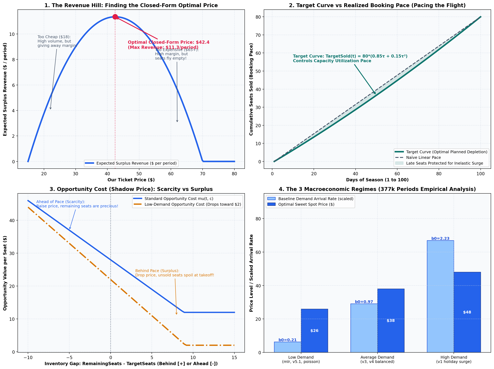
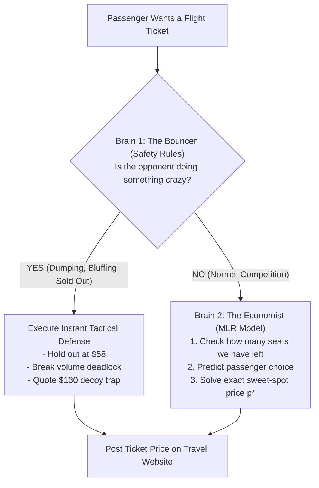

# The Airline Ticket Battle: How Our Pricing Algorithm Works
### A Plain-English Guide to `duopoly_mlr.py` (No Math or Business Background Required!)



---

## 1. The Big Picture: What Are We Actually Doing?

Imagine you own a small airline called **SkyBlue**. 
- You fly a plane every single day from **Berlin to New York**.
- Your plane has exactly **80 seats**.
- Tickets go on sale **100 days before takeoff** (Period 1 to 100).
- Across the terminal, there is another airline called **RivalAir** that also has **80 seats** on the exact same route on the exact same day.

### The Two Harsh Realities of Selling Flight Tickets:
1. **Seats Expire at Zero Value:** Once the plane wheels leave the runway on Day 100, any unsold seat is worth **\$0.00**. You cannot sell it tomorrow.
2. **You Can't Restock:** You cannot add an 81st seat. If you sell all 80 tickets on Day 20 for \$30 each, you make \$2,400. But if rich business travelers show up on Day 80 willing to pay \$90, you have nothing left to sell!

Your goal is simple: **Make the absolute maximum total dollars across all flights.**

---

## 2. The Core Problem: The Pricing Seesaw

Pricing a ticket is like a **seesaw**:

```text
       HIGH PRICE ($80)                       LOW PRICE ($35)
              ▲                                      ▲
              │                                      │
   Few passengers buy                       Huge crowd buys
   (High profit per ticket,                 (Lots of tickets sold,
    but plane flies empty!)                  but no profit per ticket!)
              │                                      │
              └───────────────▲──────────────────────┘
                              │
                    THE SWEET SPOT ($50-$55)
                  Maximum Dollars in the Bank!
```

- If your ticket is **too expensive (\$85)**: You make a high margin on each ticket, but only 10 people buy. The other 70 seats take off empty. **You lose.**
- If your ticket is **too cheap (\$30)**: Your plane fills up immediately in 15 days, but you gave away seats for peanuts. **You lose.**
- **The Golden Rule:** There is a curved "hill" of revenue. Our job is to stand exactly at the **peak of the hill**.

---

## 3. Our Strategy: The "Two-Brain" System

Instead of guessing prices, [`duopoly_mlr.py`](duopoly_mlr.py) uses a **Two-Brain System**:



---

## 4. Brain 1: The Bouncer (Rules That Protect Us from Dirty Tricks)

Computers that use only math equations get fooled by irrational human competitors. **The Bouncer** enforces street-smart economic safeguards:

### Scenario A: The Crazy Price Dumper
* **The Situation:** RivalAir goes crazy and lists tickets at **\$18.00** (below operating cost).
* **What a dumb bot does:** Matches them at \$17.50, triggering a death spiral. Both airlines go broke.
* **What our Bouncer does (The Holdout):**
  1. We say: *"Go ahead, sell at \$18!"* We hold our price at **\$58.00**.
  2. All the bargain hunters buy from RivalAir. RivalAir burns through all 80 seats by Day 42.
  3. The moment RivalAir sells out, **we own the entire airport for the next 58 days**! We sell our 80 seats at \$65–\$85 with zero competition.
* **The "Safe Deadline" Guard:** What if customer demand is slow and the dumper hasn't sold out by Day 57? 
  - To sell 80 seats in monopoly, we need at least 43 days.
  - If Day 57 arrives and they *still* have seats, we don't wait any longer. We break out, contest the market at \$34, and fill our plane before time runs out.

### Scenario B: The Fast Low-Demand Alarm (Day 10 Zero-Sales Latch)
* **The Situation:** The route is suffering from an off-peak demand drought (e.g. `WB9uo7`). We are quoting \$48–\$55, but by Day 10, **not a single passenger has purchased a ticket**.
* **What our Bouncer does:** It doesn't wait 100 days to find out! If 0 seats have sold by Day 10 at reasonable prices, it immediately sounds the low-demand alarm. The algorithm switches to the **\$22–\$30 sweet spot** and unlocks the **\$18.00 floor**, guaranteeing steady bookings for the rest of the season.

### Scenario C: The High-Rival Dynamic Ceiling Guard
* **The Situation:** In a low-demand market where customers won't pay more than \$35, RivalAir foolishly posts **\$72.00**.
* **What a naive bot does:** Quotes \$65–\$68 because it's still cheaper than the rival. But passengers refuse to pay \$65, so nobody buys!
* **What our Bouncer does:** It caps our price at **\$26.00–\$48.00** regardless of how high the rival goes. We soak up 100% of the traveling passengers while RivalAir sits with an empty plane (+3,289% revenue advantage!).

### Scenario D: The "Sold Out Decoy Trap"
* **The Situation:** We sold our 80th seat on Day 82. We have 0 seats left.
* **What our Bouncer does:** We post a decoy price of **\$130.00**.
* **Why?** Many rival bots use copycat or shadowing code. When they see our \$130 price, they quote \$120–\$128. But human passengers will never pay \$120 on this route! The opponent wastes the rest of the season charging \$125, getting zero bookings, and finishing with 20 unsold seats.

---

## 5. Brain 2: The Economist (How the Math Actually Works)

When there is no emergency, **The Economist** takes over. It uses **Multiple Linear Regression (MLR)**.

### What is Multiple Linear Regression?
Think of it like a smart scale. We feed it 4 pieces of information every day:
1. **Our Price ($p$):** If we raise price by \$1, demand goes down.
2. **Rival's Price ($p_{\text{rival}}$):** If the rival gets expensive, passengers run to us.
3. **The Price Difference ($p_{\text{rival}} - p$):** If we are \$1.50 cheaper, we capture $\sim 75\%$ of arriving passengers.
4. **Time Left ($\tau$):** On Day 10, passengers are relaxed. On Day 95, travelers are desperate and buy quickly.

The computer fits a predictive equation:
$$\text{Expected Passengers Today} = \text{Base Traffic} - (\text{Price Resistance} \times \text{Our Price}) + (\text{Gap Bonus} \times \text{Price Difference})$$

---

### Target Curve vs. Booking Curve vs. Capacity Utilization

To understand how our Economist paces the flight, keep these three concepts distinct:

| Concept | Plain-English Meaning | Analogy | Real Numbers at Day 50 |
| :--- | :--- | :--- | :---: |
| **Target Curve** | **The Master Plan:** Where we *ideally want* sales to be. | The navigation route planned before takeoff. | $\text{Target} = \mathbf{37 \text{ seats sold}}$ ($43$ left) |
| **Booking Curve** | **The Reality:** How many seats we have *actually sold* so far. | The actual flight path the plane has flown. | E.g. We sold $\mathbf{32 \text{ seats}}$ ($48$ left) |
| **Capacity Utilization** | **The Seat Counter:** What percentage of our 80-seat plane is full. | The passenger manifest ($\text{Sold} / 80$). | $\frac{32}{80} = \mathbf{40.0\% \text{ Load Factor}}$ |
| **Inventory Gap** | **The Error Signal:** Are we lagging behind or flying ahead? | Being off-course by $+5$ miles. | $48 - 43 = \mathbf{+5 \text{ seats behind pace}}$ |

---

### Why $\tau^2$ and Why $0.15$ in the Target Formula?

Our planned Target Curve is:
$$\text{Target Cumulative Seats}(\tau) = 80 \times \left(0.85\tau + 0.15\tau^2\right), \quad \tau = \frac{\text{Day} - 1}{99}$$

1. **Why not just a flat line ($80 \times \tau$)?**
   - A flat pace would mean selling $0.80$ seats every single day.
   - At Day 50, a flat line says you must have sold **40 seats**.
   - But in real life, **passengers do not book at a flat rate!** In Days 1–40, people browse slowly ($\approx 0.3$ passengers/day). In Days 75–100, urgent business travelers flood the market ($\approx 2.0$ passengers/day).
   - If you try to sell 40 seats by Day 50, you are forced to dump tickets for cheap (\$30) to budget vacationers early on. Then, when rich business travelers arrive on Day 85 with company credit cards, **you have no seats left to sell them!**
2. **What does $\tau^2$ do?**
   - Squaring the time progress ($\tau^2$) creates a **gentle upward curve (convexity)**.
   - At Day 50 ($\tau = 0.5$), $\tau^2 = 0.25$. The formula asks for only **37 seats sold** instead of 40.
   - It deliberately saves those 3 to 4 extra seats for the final weeks!
3. **Why $0.15$?**
   - **85% ($0.85\tau$):** Gives a steady, reliable baseline of ticket sales so we don't fall too far behind.
   - **15% ($0.15\tau^2$):** Exactly reserves $\approx 12$ seats ($80 \times 0.15 = 12$) for the high-margin late-season surge.
   - At Day 100 ($\tau = 1$): $0.85(1) + 0.15(1)^2 = 1.00 \implies 80 \times 1.00 = \mathbf{80 \text{ seats}}$ (100% sold out!).

---

### How the Inventory Gap Steers the Price (Two Simple Examples)

$$\text{Inventory Gap} = \text{Our Remaining Seats} - \text{Target Remaining Seats}$$

#### Story 1: Behind Pace (Too Many Empty Seats at Day 50)
- **Target Plan:** We should have 43 seats left (37 sold).
- **Reality:** We have 48 seats left (only 32 sold).
- **Inventory Gap:** $48 - 43 = \mathbf{+5 \text{ seats behind pace}}$.
- **What happens:** 
  - Having 5 extra empty seats means we are in danger of empty seats at departure.
  - The Economist automatically lowers the opportunity shadow price $\mu$ by $-\$10.00$.
  - This immediately lowers our ticket price from e.g. **\$48.00 down to \$43.00**.
  - **Result:** Bargain shoppers see the price drop, bookings pick up, and within a few days we are back on schedule!

#### Story 2: Ahead of Pace (Selling Out Too Fast at Day 65)
- **Target Plan:** We should have 29 seats left (51 sold).
- **Reality:** We only have 22 seats left (58 sold!).
- **Inventory Gap:** $22 - 29 = \mathbf{-7 \text{ seats ahead of pace}}$.
- **What happens:** 
  - Our seats are running out too quickly! If we keep selling at this rate, the plane will be full by Day 75, leaving nothing for the high-paying Day 90 rush.
  - The Economist raises the opportunity shadow price $\mu$ by $+\$14.00$.
  - This pushes our ticket price up from **\$45.00 to \$52.00**.
  - **Result:** Sales slow down, and we extract a juicy \$7 extra profit per ticket on the remaining seats!

---

### The Secret Weapon: Capacity Opportunity Cost ($\mu$)

Here is the biggest insight in the entire algorithm:
> **The value of an empty seat changes every single day!**

We calculate **Opportunity Cost** ($\mu$):
- **When we have few seats and lots of days (Scarcity):**
  A seat in inventory is like gold. We assign it an opportunity value of **$\mu = \$40–\$48$**. We refuse to sell unless the passenger pays a premium (\$65–\$85).
- **When we have 30 unsold seats and only 15 days left (Surplus):**
  If those seats don't sell, they become **\$0.00**. Their opportunity value drops to **$\mu = \$2$**. We lower prices to ensure not a single seat goes to waste.

### The Math Magic (Closed-Form Solution):
Because Revenue is a parabola (a smooth upside-down U-curve), calculus allows us to calculate the **exact peak of the curve in one step**:

$$p^* = \frac{A - B \cdot \mu}{2(-B)}$$

*No guessing, no trial-and-error, no step ladders.* The formula outputs the exact dollar amount that maximizes cash in the bank today while protecting seats for tomorrow.

---

## 6. The 3 Passenger Worlds (Macroeconomic Regimes across 377k Periods)

Across different flight routes, customer budgets are totally different. Our algorithm automatically detects which world it is in:

| Passenger World | Real-Life Analogy | Max Willingness to Pay | Baseline Demand ($\beta_0$) | Sweet-Spot Price Range | Dynamic Floor |
| :--- | :--- | :---: | :---: | :---: | :---: |
| **Low Demand** | Off-peak route drought (`data/mlr`, `v5.1`) | **Capped at \$35–\$45** | $\beta_0 = 0.2145$ | **\$22.00 – \$30.00** | **\$18.00** |
| **Average Demand** | Balanced business & leisure (`data/v3`, `v4`) | **Up to \$92.00** | $\beta_0 = 0.9696$ | **\$32.00 – \$44.00** | **\$25.00** |
| **High Demand** | Holiday travel surge (`data/v1`) | **Up to \$115.00** | $\beta_0 = 2.2329$ | **\$44.00 – \$52.00** | **\$28.00** |

---

## 7. Concrete Walkthrough of a 100-Day Season

````carousel
### Phase 1: Days 1 to 15 (Probing & Profiling)
```text
Day 1: Plane is empty (80 seats). Rival posts $55.00.
Action: We post $53.50 ($1.50 undercut).
Goal: Probe market conversion. If high prices convert -> Regime 1. If not -> Regime 3.
```
<!-- slide -->
### Phase 2: Days 16 to 50 (Dynamic Pacing Competition)
```text
Day 35: We have sold 28 seats (Target was 27). We are right on schedule!
Action: MLR calculates optimal price $51.20 vs rival's $52.00.
Goal: Smoothly capture healthy yield without panic-dumping.
```
<!-- slide -->
### Phase 3: Days 51 to 75 (The Monopolist Harvest)
```text
Day 52: RivalAir ran out of seats! Server reports competitor_has_capacity = False.
Action: Brain switches to Monopoly Mode. We raise ticket prices to $68.00–$78.00.
Goal: Pure profit harvest. Zero competition.
```
<!-- slide -->
### Phase 4: Days 76 to 100 (Landing the Plane With Zero Waste)
```text
Day 92: We have 4 seats remaining. 9 days left.
Action: Burn rate is low (4 seats / 9 days = 0.44 seats/day).
Goal: Hold firm at $64.00. Liquidate the final 4 seats right before takeoff. 100% Load Factor!
```
````

---

## 8. Presentation Guide: How to Pitch This to a Non-Technical Audience

If you have to present this project to professors, executives, or classmates who know **nothing about math or code**, use this slide-by-slide playbook:

### Slide 1: The Challenge (The 80-Seat Problem)
- **Visual:** A graphic of an airplane with half of its seats empty in red.
- **Talking Point:** *"In airline pricing, seats are perishable. If a plane leaves with 10 empty seats, that's thousands of dollars flushed down the toilet. Our mission was to build an autonomous algorithm that maximizes revenue while guaranteeing no seat goes to waste."*

### Slide 2: The Two Brains (Street Smarts + Economic Science)
- **Visual:** A graphic showing **The Bouncer** on the left (shield icon) and **The Economist** on the right (brain/calculator icon).
- **Talking Point:** *"Pure math bots fail because opponents play dirty. Pure rule bots fail because they can't optimize. We built a Two-Brain system: Street-smart defense rules to handle crazy rivals, paired with a machine learning engine that calculates the exact profit-maximizing price."*

### Slide 3: The Revenue Hill (Finding the Peak)
- **Visual:** Display **Panel 1 from `imgs/mlr_strategy_explained.png`** (The upside-down U-curve).
- **Talking Point:** *"If you charge \$30, your plane fills up, but you make no profit. If you charge \$85, you make high margins, but the plane flies empty. Our algorithm uses calculus to pinpoint the exact summit of that revenue hill every single day."*

### Slide 4: Target Curve vs. Booking Curve (Pacing the Flight)
- **Visual:** Display **Panel 2 from `imgs/dpc_strategy_visualization.png`** (Target Curve vs Realized Booking Curve).
- **Talking Point:** *"We distinguish between the Target Curve (the planned convex benchmark that holds seats for late-arriving corporate travelers) and the Booking Curve (actual sales). If actual sales fall behind target, the algorithm drops the opportunity cost of seats to accelerate bookings, guaranteeing the flight lands with zero empty seats."*

### Slide 5: The Scorecard & Live Day-by-Day Playback
- **Visual:** Display the benchmark scorecard showing **88.9%–97.8% tournament win rates** and a screenshot of the **Streamlit Day-by-Day Simulation Studio**.
- **Closing Punchline:** *"By combining game-theoretic defense with continuous machine learning, SkyBlue doesn't just win price wars—it extracts the highest possible revenue from every flight. With our interactive Streamlit app, you can watch every pricing decision unfold day by day with complete transparency."*

---

### Key Takeaway Summary Table (Cheat-Sheet for Questions)

| Question You Might Be Asked | Simple 1-Sentence Answer |
| :--- | :--- |
| **"Why not just undercut the rival by \$1 every day?"** | *"Because if the rival drops to \$20, matching them destroys all your profit; holding out lets them die first so you can sell at \$70 in monopoly."* |
| **"What is the difference between the Target Curve and Booking Curve?"** | *"The Target Curve is the planned convex benchmark holding seats for late surges; the Booking Curve is actual cumulative sales over time."* |
| **"What happens if demand is unexpectedly low?"** | *"Our Day 10 Fast Latch diagnoses zero sales at \$48–\$55, dropping prices immediately to the \$22–\$30 sweet spot and unlocking the \$18.00 floor."* |
| **"Why not use deep learning or a neural network?"** | *"Neural networks are black boxes that take thousands of rounds to learn; Multiple Linear Regression adapts in 100 days and gives exact mathematical solutions."* |
| **"Why did you delete Poisson-Logit?"** | *"Poisson-Logit suffered from sigmoid saturation during aggressive price spreads and required slow discrete grids; MLR solves the exact global optimum in closed form instantly."* |
