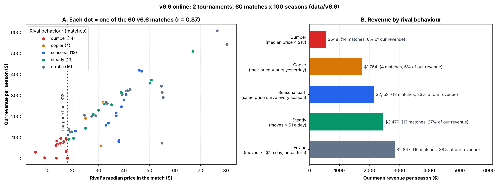
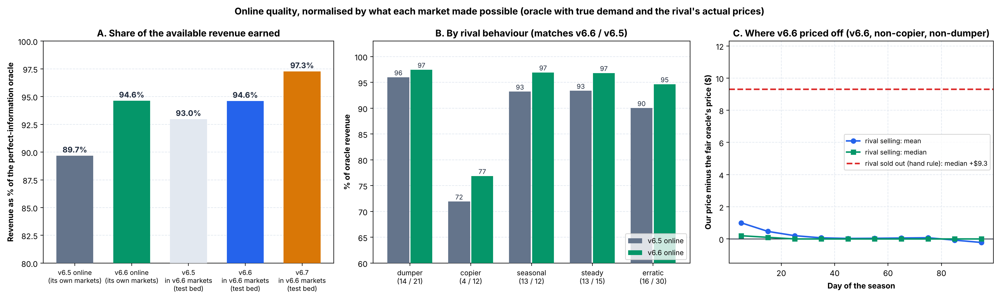
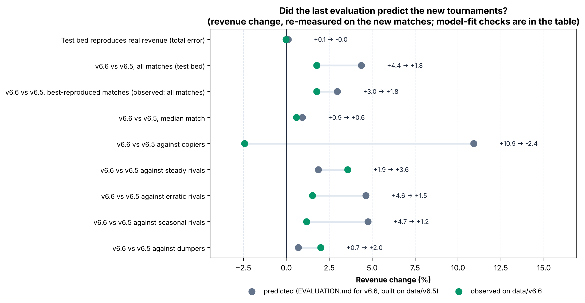
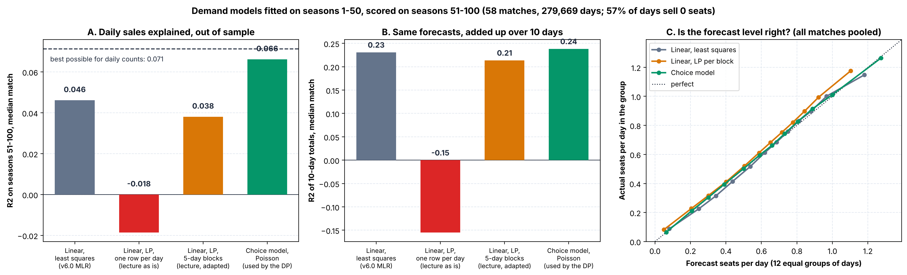
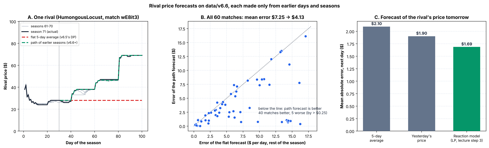
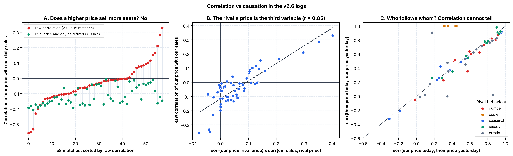
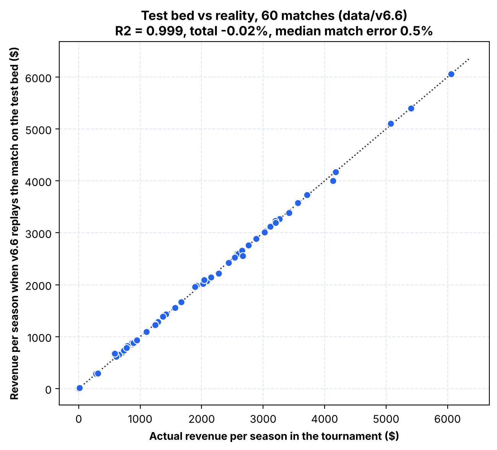
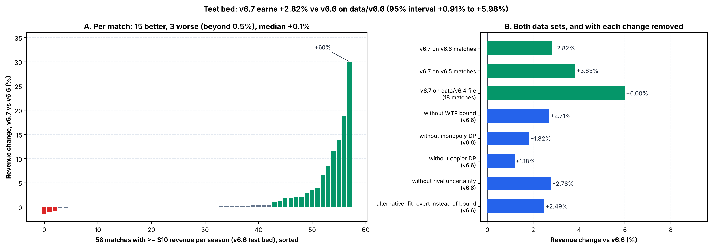

# Evaluation of the current algorithm (`duopoly.py` v6.7)

> **This file always describes the current `duopoly.py`, evaluated on the latest tournament logs (`data/v6.6`, played by v6.6).** What the algorithm does, how it is measured, how good its models are, what is correlation and what is cause, how the offline simulation works and how far to trust it, where the weak points are and how they were found, and **how accurate the previous evaluation was** (section 5).
>
> Every number and figure is produced by `analytics/evaluate.py` and `analytics/oracle.py`, stored in `analytics/evaluation_v6.6.json`, and written into this file by `analytics/write_evaluation_md.py`. The evaluation of v6.6 written before its tournaments is archived in [`EVALUATION_v6.6.md`](EVALUATION_v6.6.md). History of all versions: [`ALGORITHM_CHANGES.md`](ALGORITHM_CHANGES.md).

## 1. Summary

| Question | Answer |
| :--- | :--- |
| How did v6.6 do online? | Ranks 1, 2 and 7 in three tournaments (the rank-2 log was lost to a platform bug; 60 matches analysed). v6.5 had ranks 4, 8, 9. |
| Better than v6.5, fairly measured? | Yes, by **+1.8%** (v6.5 replayed in the same v6.6 markets; 33 matches better / 4 worse), not by the +4.4% the last evaluation headlined. Online, v6.6 earned 94.6% of what its markets made possible (v6.5: 89.7%), but most of that jump is easier markets: replayed in the *same* v6.6 markets, v6.5 reaches 93.0% and v6.6 94.6% (section 4.2). |
| Was the last evaluation accurate? | The measurement tools were: the test bed reproduces v6.6's real revenue to −0.02%, the rival-forecast and demand-model scores replicate on the new data. The *forecast of the gain* was too high (+4.37% predicted, +1.76% measured on the new matches), and the copier gain reversed. Its stated tournament expectation, 0% to +3%, was right. Section 5. |
| What changed in v6.7? | Four changes to the optimised price and the dynamic programme, all found in the v6.6 logs or in an out-of-sample replay of old logs: monopoly days priced by the DP (capped at the hand rule), copiers priced by the DP (and a bug in the copier search fixed), a bound on the fitted willingness to pay, and today's price optimised over the rival's likely prices instead of one guess. Section 2. |
| One quality number | Test bed, all 60 v6.6 matches x 100 seasons, same rivals and buyers for both versions: **+2.82%** vs v6.6 (95% interval +0.91% to +5.98%), 15 matches better / 3 worse, worst match −1.5%. **Concentrated:** median match +0.1%, without the 5 biggest winners +0.68%; the 4 copier matches gain +26.9%, the other rival types +0.2% to +1.7%. |
| Does it hold elsewhere? | data/v6.5 matches: +3.83% (30 / 1). data/v6.4 file: +6.00% (3 / 0); the other 8 data/v6.4 files, never used for a decision: +5.07% over 208 matches (66 / 14). Old simulator (different demand model): +1.7%. Per rival bot: 17 of 29 better, 0 worse (section 9.4). |
| Honest expectation for the next tournament | +1% to +3%, depending mostly on how many copiers we meet (about +1% with none). Section 11. |

## 2. The algorithm

The lecture's four steps (*A learning approach to dynamic pricing using nonlinear and linear optimization*, after Bertsimas & Perakis 2001), where each one lives in `duopoly.py`, and what v6.7 changed:

| Step | In `duopoly.py` | Optimisation | Changed in v6.7 |
| :--- | :--- | :--- | :--- |
| 1. Estimate our demand | Choice model: buyers/day $\sim$ Poisson$(n e^{k\tau})$, each buys from us with probability $\frac{e^{b(m-p)}}{1+e^{b(m-p)}+e^{b(m-r)}}$; Poisson maximum likelihood on our own days, first on day 50 of season 1, then every 25 days and every season end | Nonlinear (Nelder–Mead) | **$m \le \$150$** in the fit (the course model's highest willingness to pay) |
| 2. Coefficients for the next period | Refit on the last 3,000 days | – | – |
| 3. Estimate the rival | Tomorrow: $r_t = a + c\,r_{t-1} + b\,p_{t-1}$ by least absolute deviations (**linear programme**, used only if it beats "same as yesterday" by 30%). Rest of the season: median price per day of the last 10 seasons + AR(1) | LP + time series | **Its last 60 forecast errors are kept** |
| 4. Our optimal price | $\max_p E[\,p\min(D,s) + V(t+1, s-\min(D,s))\,]$ by a bounded scalar solver every day (**nonlinear programme**) | NLP | **Expectation also over the rival's price today** (forecast + each kept error), not one guess |
| Dynamic programme | $V(t,s)$ by backward induction, 100 days x 80 seats x \$18–\$100, on the forecast rival path; rebuilt every 10 days | DP | **Also used when the rival is sold out** (no rival; its price may only lower the hand-made monopoly price) **and against copiers** (rival price = ours) |

Other rules unchanged from v6.6: market sizing (seat value 0 when the market cannot fill the plane), regime priors and the regression before the first fit, sold-out-rival days left out of the demand data.

## 3. How we measure

| Item | Definition |
| :--- | :--- |
| Quality measure | Revenue per season (the competition ranks by total revenue). |
| **Online, normalised** (new) | Revenue / revenue of an **oracle** that knows the match's demand model and the rival's actual prices and sold-out days in advance and plays the optimal DP (`analytics/oracle.py`). A tournament with rich markets and one with poor markets become comparable. A **fair oracle** knows the demand and the rival's *typical* path only; the gap between the two oracles is the part of the rival nobody can predict. |
| Offline | The test bed (section 8): each version plays every logged match against the logged rival, with the same random buyers. Differences are caused by the code. Reported: total change, 95% interval (bootstrap over matches), better / worse matches (beyond ±0.5%), worst match. |
| With / without | Each change is removed from the full version, everything else equal. |
| Out of sample | Changes were found on data/v6.6. They are also measured on data/v6.5, on one data/v6.4 file, and on the old simulator, whose buyers do not follow our demand model. |
| Prediction check | The previous evaluation's numbers against the same measurements on data/v6.6 (section 5). |

## 4. Online: what happened with v6.6



| Tournament | Rank | Matches | Revenue / season (mean) | (median) | Seats sold of 80 | We sold out | Rival sold out | Our / rival median price |
| :--- | :---: | :---: | :---: | :---: | :---: | :---: | :---: | :---: |
| `AirborneTody_rank_1` | 1 | 30 | \$2,134 | \$1,955 | 61.8 | 38% | 23% | \$28 / \$33 |
| `DeftDaltmanian_rank_7` | 7 | 30 | \$1,879 | \$1,846 | 58.9 | 39% | 23% | \$26 / \$31 |
| `ProficientCivet` | 2 | – | log lost (platform bug) | | | | | |
| **v6.6, all logged** | – | 60 | \$2,006 | \$1,955 | 60.3 | 38% | 23% | – |
| v6.5 (data/v6.5) | 4, 8, 9 | 90 | \$1,948 | \$1,743 | 49.5 | 28% | 25% | – |

| Rival behaviour (rules: section 4.1 of EVALUATION_v6.6.md) | Matches | Our revenue / season | Share of our revenue | Seats | We sold out | Rival sold out | Our / rival median price |
| :--- | :---: | :---: | :---: | :---: | :---: | :---: | :---: |
| dumper | 14 | \$548 | 6% | 28.6 | 0% | 14% | \$18 / \$15 |
| copier | 4 | \$1,764 | 6% | 62.6 | 52% | 40% | \$28 / \$28 |
| seasonal | 13 | \$2,153 | 23% | 67.9 | 53% | 16% | \$29 / \$38 |
| steady | 13 | \$2,470 | 27% | 70.6 | 45% | 21% | \$33 / \$32 |
| erratic | 16 | \$2,847 | 38% | 73.0 | 50% | 34% | \$38 / \$41 |

18 of the 20 v6.6 rivals had also played v6.5, so the opponents are largely the same students; the markets are new random draws. v6.6 sold more seats (+10.8 per season) and priced further below the rival (median gap −\$3.60 vs −\$0.14 for v6.5). Sell-outs still came late (median day 98; 2% of seasons before day 85), so this is not underpricing that empties the plane early.

### 4.1 How much of the available revenue did we earn?



| | v6.5 online (data/v6.5) | v6.6 online (data/v6.6) |
| :--- | :---: | :---: |
| Revenue / perfect-information oracle | 89.7% | **94.6%** |
| Revenue / fair oracle (knows the rival's typical path only) | 93.1% | 97.8% |
| Fair / perfect oracle (= the rival's unpredictable part) | 96.3% | 96.7% |
| Season 1 only | 69.3% | 77.1% |
| Same 18 rivals in both | 91.9% | 94.9% (12 of 18 rivals better) |
| Left on the table per season (vs perfect oracle) | \$224 | \$114 |
| What a \$1 instead of \$18 floor would add (inside the model) | +1.7% | +2.1% |

### 4.2 Questioning the online jump

89.7% → 94.6% looks like a large step. But the oracle only normalises for market size, not for how *hard* a market is: copiers and dumpers are hard, and v6.5 met 12 copiers in 90 matches, v6.6 only 4 in 60. The test bed answers it directly: every version replayed in the same v6.6 markets earns

| Version in the v6.6 markets (test bed) | Share of the perfect-information oracle |
| :--- | :---: |
| v6.5 | 93.0% |
| v6.6 | 94.6% |
| v6.7 | 97.3% |

So of the 4.9-point jump, about 1.6 points are v6.6's code and the rest are easier markets and rivals. The matched-rival comparison has the same problem (same rival, different random market).

### 4.3 Where the rest was lost (this found the v6.7 changes)

- **Copiers:** 31% of everything left on the table came from the 4 copier matches. Against FlashyInchworm (copies our previous price on 100% of days) v6.6 held ~\$30 and sold out every season, often by day 64–88; the oracle charges ~\$49–53. Cause: the season-to-season search ranked prices by revenue per day held, and days after selling out were never counted, so selling out early at a low price looked as good as selling all season at a higher one. And the season noise is larger than the difference between \$1 steps.
- **Monopoly days:** with the rival sold out, the hand-made monopoly rule priced a median \$9.30 above the fair oracle (7,982 days). On duopoly days the median difference is \$0.00 on every day of the season: the DP's optimisation is right, given the model.
- **Season 1:** 77% of the oracle (later seasons 95%); prices \$5.2 above the fair oracle on average.
- **Erratic rivals:** 38% of the loss, but mostly the unpredictable part (fair-oracle gap).

## 5. Was the last evaluation accurate?

`EVALUATION_v6.6.md` was written on data/v6.5 before v6.6 played. Here every number it predicted is measured again on data/v6.6. For the gains, the test bed was rebuilt from the v6.6 logs and v6.5 replayed in the new markets, so "observed" is v6.6 vs v6.5 in matches neither was tuned on.



| Claim in EVALUATION_v6.6.md | Predicted | Observed on data/v6.6 | Verdict |
| :--- | :---: | :---: | :--- |
| Test bed reproduces real revenue (total error) | +0.1% | −0.0% | **held** (now with the version that actually played) |
| v6.6 vs v6.5, all matches (test bed) | +4.4% | +1.8% | **too high** by a factor of ~2.5 |
| v6.6 vs v6.5, best-reproduced matches (observed: all matches) | +3.0% | +1.8% | too high |
| v6.6 vs v6.5, median match | +0.9% | +0.6% | held |
| v6.6 vs v6.5 against copiers | +10.9% | −2.4% | **wrong sign**: the copier gain was path-dependent luck of the search |
| v6.6 vs v6.5 against steady rivals | +1.9% | +3.6% | better than predicted |
| v6.6 vs v6.5 against erratic rivals | +4.6% | +1.5% | lower |
| v6.6 vs v6.5 against seasonal rivals | +4.7% | +1.2% | lower |
| v6.6 vs v6.5 against dumpers | +0.7% | +2.0% | better than predicted (small \$) |
| Rival path forecast: error reduction vs flat | 42.6% | 43.0% | **held exactly** |
| Reaction model: next-day error reduction | 14.8% | 11.3% | slightly lower; useful in fewer matches |
| Choice model: share of the achievable daily R2 | 98.3% | 99.1% | **held** |
| Server call time, mean (ms) | 28.9 ms | 19.5 ms | better than predicted |
| Honest expectation for the tournament | 0% to +3% | +1.76% | **held** |
| "The day-50 fit is the one change with evidence in both directions; first to switch off" | risk | it caused the 446Pbr collapse (section 9) | **held**; repaired by the m bound |
| Old simulator: "one cell outside the 95% intervals" (old v1.0 rival, average market) | – | \$3,330 ± 91 vs \$3,439 ± 41 overlap | **was wrong**: no cell was outside |

**Why the gain was over-predicted.**

1. *Match mix:* on data/v6.5 the 5 biggest winners were 54% of the gain, and 12 of 90 matches were copiers (the biggest per-type gain). data/v6.6 has 4 copiers in 60, and there v6.6 lost to v6.5 (−2.43%). Without copiers v6.6 gains +2.04% on the new data.
2. *Selection:* the changes were chosen because they won on the data/v6.5 test bed; some of that win is the noise of those particular matches (a winner's curse). The held-out check matches limited this but could not remove the match-mix effect.
3. *What did replicate:* everything measured on the logs themselves (test-bed fidelity, forecast errors, model fit). What did not replicate are *differences between versions* that rest on few matches.

Consequence for this evaluation: v6.7's number is reported with its spread over three data sets and the simulator, and section 11 gives a range, not the headline.

## 6. Are the models good? (data/v6.6)



Fitted on seasons 1–50, scored on seasons 51–100 (58 matches, 279,669 days; 57% of days sell no seat, 0.62 seats per day).

| Model | $R^2$ daily (median match) | Adjusted $R^2$ | Share of the achievable $R^2$ | $R^2$ of 10-day totals | Level error | Best in (matches) |
| :--- | :---: | :---: | :---: | :---: | :---: | :---: |
| Linear, least squares | 0.046 | 0.046 | 78% | 0.23 | 2.0% | 7 |
| Linear, LP per day (lecture step 1 as written) | -0.018 | -0.019 | -21% | -0.15 | 26.0% | 0 |
| Linear, LP on 5-day blocks | 0.038 | 0.037 | 64% | 0.21 | 5.8% | 1 |
| **Choice model (used)** | 0.066 | 0.065 | 99% | 0.24 | 2.1% | 50 |

A daily $R^2$ of 0.066 is close to the maximum: with Poisson buyers even the true model explains at most 0.071 (median match). The LP-per-day model fits the median day, which sells 0 seats: all coefficients 0 in 18 of 58 matches.

**A weakness the fit scores do not show.** The choice model predicts daily sales well, but its *absolute* willingness to pay $m$ is weakly identified while the rival is present (demand then depends mostly on price differences). Fitted on duopoly days only, $m$ came out above \$150 in 12 of 60 v6.6 matches and 9 of 90 v6.5 matches (\$160–\$446). That is harmless for duopoly pricing and fatal once the rival is gone: it caused the monopoly-DP failure in 48gs8r and the 446Pbr collapse. v6.7 bounds $m$ at \$150.



| Rival forecast (each from earlier days/seasons only) | Mean abs. error | Median match |
| :--- | :---: | :---: |
| Rest of season: flat 5-day average | \$7.25 | \$6.17 |
| Rest of season: path (used) | \$4.13 | \$2.46 |
| Tomorrow: 5-day average | \$2.10 | \$1.23 |
| Tomorrow: yesterday's price | \$1.90 | \$0.56 |
| Tomorrow: reaction model (LP) | \$1.69 | \$0.59 |

The path cuts the rest-of-season error by 43% (40 matches better, 5 worse). For erratic rivals it barely helps (\$8.37 → \$7.91): their prices cannot be predicted, which is why v6.7 prices against the spread of their likely prices.

## 7. Correlation or causation? (data/v6.6)



- **Our price and our sales:** a higher price goes with *more* sales in 15 of 58 matches. The third variable is the rival's price (we charge more *and* sell more when the rival is expensive; product of the two links vs raw correlation: r = 0.85). With rival price and day held fixed the price effect is negative in 58 of 58.
- **Who follows whom:** their price today vs ours yesterday 0.61, ours today vs theirs yesterday 0.57 (medians). The logs cannot separate the directions; only the 4 copiers are certain (exact copies). The reaction model is therefore used as a forecast, not as proof that we can steer the rival.
- **Online efficiency vs version:** v6.6's higher efficiency online is partly market mix (section 4.2), a correlation that the test bed separates into cause (code) and confounder (markets).
- **Inside the test bed** both versions face the same rivals and buyers, so a difference is caused by the code. Whether the test bed resembles the tournament is section 8.

## 8. Offline simulation: how it works and how far to trust it

`analytics/testbed.py --data v6.6`: per match the choice model fitted to all 10,000 logged days (8 starting points); the rival replays its logged prices and sold-out days (copiers copy us); every version plays 100 seasons with the same random number per (match, season, day).



| Check | Result |
| :--- | :--- |
| v6.6 replayed vs v6.6 in the tournament, total | \$12,035,684 vs \$12,038,408 (−0.02%) |
| Per match | $R^2$ = 0.999; median error 0.5% in the 55 matches above \$500 per season; 54 within ±10% |
| Last time | v6.5 replayed vs v6.5 actual: +0.1%. Now validated with the version that actually played, on data the test bed had never seen |
| All switches of the new code off | identical to v6.6 to the cent |

| Limit | Consequence |
| :--- | :--- |
| Buyers come from the same model family the algorithm fits | Gains are upper estimates; the old simulator (uniform willingness to pay) is the counter-check |
| Rivals are recordings (except copiers) | Reactions to our new prices are not simulated |
| Prices never tried (below \$18, above logged prices) | Extrapolation; the \$18 floor stays (section 9) |
| Differences between versions rest on few matches | Section 5: the last gain forecast was ~2.5x too high |

## 9. Results: v6.7 against v6.6



| Data | Matches x seasons | Change vs v6.6 | 95% interval | Better / worse | Worst match |
| :--- | :---: | :---: | :---: | :---: | :---: |
| **data/v6.6** (latest) | 60 x 100 | **+2.82%** | +0.91% to +5.98% | 15 / 3 | −1.5% |
| data/v6.5 | 90 x 60 | +3.83% | +2.14% to +6.01% | 30 / 1 | −1.3% |
| data/v6.4 day 1, Tody_Rank_33 | 18 x 100 | +6.00% | +0.12% to +15.14% | 3 / 0 | −0.4% |
| (same file: v6.5 vs v6.6) | | +3.64% | | 2 / 7 | |

Revenue per season on data/v6.6: \$2,006 → \$2,062; seasons sold out 39.4% → 43.8%. Median match +0.1%. Without the 5 biggest winners: +0.68%; on the 54 matches the test bed reproduces within ±10%: +2.86%.

| By rival behaviour (data/v6.6) | Matches | Change | Per season |
| :--- | :---: | :---: | :---: |
| dumper | 14 | +0.25% | +\$1 |
| copier | 4 | +26.86% | +\$482 |
| seasonal | 13 | +1.35% | +\$29 |
| steady | 13 | +1.71% | +\$42 |
| erratic | 16 | +1.14% | +\$32 |

### 9.1 With / without each change (data/v6.6, 60 x 100)

| Version | Change vs v6.6 | Better / worse | Worst match | Contribution of the change |
| :--- | :---: | :---: | :---: | :---: |
| **v6.7** | **+2.82%** | 15 / 3 | −1.5% | – |
| v6.7 without WTP bound | +2.71% | 14 / 3 | −1.5% | +0.11 points |
| v6.7 without monopoly DP | +1.82% | 6 / 2 | −1.1% | +1.00 points |
| v6.7 without copier DP | +1.18% | 12 / 3 | −1.5% | +1.63 points |
| v6.7 without rival uncertainty | +2.78% | 15 / 2 | −1.0% | +0.04 points |
| alternative: fit revert instead of bound | +2.49% | 15 / 10 | −3.1% | – |

Copier matches alone: +26.86% on the 4 v6.6 copiers, +21.71% on the 12 v6.5 copiers. The rival-uncertainty change is worth little on data/v6.6 because few of its rivals are random from day to day; it repairs matches like data/v6.4 LvrJkv (+10% there, step 11 below).

### 9.2 How v6.7 was built (and what was rejected)

| # | Change / question | Data | Result | Decision |
| :---: | :--- | :--- | :--- | :--- |
| 1 | All new switches off | 10 matches x 30 seasons | identical to v6.6 to the cent | check passed |
| 2 | Monopoly DP (no cap), copier search on season revenue, copier DP, DP over rival scenarios | development half, 30 matches x 50 seasons | +1.50% (9 better / 0 worse), +0.01%, −0.01%, +0.00% | monopoly DP continues; scenario DP rejected (no effect) |
| 3 | Copier search on season revenue / copier DP | all 4 v6.6 copier matches x 100 seasons | +18.2% (3 / 0) / +26.9% (3 / 1) | both continue |
| 4 | Same | all 12 v6.5 copier matches x 60 seasons | +1.3% (1 / 2, worst −4.0%) / +21.7% (9 / 0) | copier DP preferred |
| 5 | Monopoly DP (no cap) | check half, 30 v6.6 matches x 50 seasons | −0.60% (4 / 1); one match −20.2% (48gs8r) | investigated (step 6) |
| 6 | 48gs8r: why? | trace | the algorithm's fitted willingness to pay m = $447 (true $52): fine with a rival, but alone the DP charges $100 | cap the monopoly DP at the hand rule |
| 7 | Monopoly DP capped / uncapped / days logged as "no rival" | 4 matches x 40 seasons | +4.24% (3 / 0) / −2.46% / −2.15% (worst −19.1%) | cap adopted |
| 8 | Out-of-sample check on old data | data/v6.4 day 1, 18 matches x 100 seasons | v6.5 beats v6.6 by 3.6%: match 446Pbr +40.6%, LvrJkv +13.0% | investigated (steps 9-11) |
| 9 | Which v6.6 part? | the 2 matches x 40 seasons, v6.6 minus one part | 446Pbr: the day-50 fit ($190,824 without it vs $52,322); LvrJkv: dropping sold-out days ($138,157 vs $121,202) |  |
| 10 | 446Pbr repairs | same | fit back on day 100: $190,790; m bounded at $150 (day-50 fit kept): $191,135 | both repair it; step 12 decides |
| 11 | LvrJkv: rival at a random $5-$87 every day | same | price against forecast errors: $133,623; + DP over scenarios: $131,768; old "posted price" logging: $138,614 | uncertainty pricing adopted; posted-price logging not (wrong data that happens to help here) |
| 12 | Fit revert vs m bound, with all other v6.7 parts | all 60 v6.6 matches x 100 seasons | revert +2.49% (15 / 10, worst −3.1%); bound +2.82% (15 / 3, worst −1.5%) | bound adopted |

### 9.3 Check with a different demand model (old simulator)

`analytics/benchmark_3regime_models.py`: buyers with uniform willingness to pay, 4 scripted rivals, 5 seeds x 30 seasons; sum over the rivals of mean revenue per season.

| Market | v6.6 | v6.7 | v6.7 vs v6.6 |
| :--- | :---: | :---: | :---: |
| Average (~95 arr.) | \$8,940 | \$9,219 | +3.1% |
| High (~135 arr.) | \$10,665 | \$10,729 | +0.6% |
| Low (~68 arr.) | \$4,627 | \$4,696 | +1.5% |

Total +1.7%. Cells whose 95% intervals do not overlap: 1: Copycat (Average (~95 arr.)): \$1,702 ± 108 vs \$1,424 ± 22.

### 9.4 How general is the gain?

Two of the four changes started from single matches (monopoly cap: 48gs8r; rival uncertainty: LvrJkv; the m bound: 48gs8r and 446Pbr). Three checks of whether the result rests on a few scenarios:

**1. Per rival bot** (data/v6.6 and data/v6.5 pooled, 150 matches, 29 distinct bots, `analytics/per_rival_v67.py`). v6.7 is better against 17 bots, worse against 0, and unchanged (within ±0.5%) against 12. Leaving out any one bot, the total gain stays between +2.72% (without FlashyInchworm) and +3.74%. The top 3 bots carry 50% of the gain: FlashyInchworm (copier, +47.5%), SaffronDolphin (erratic, +24.6%), BlueFalcon (copier, +30.1%).

**2. Imperfect copiers.** The test bed simulates copiers as exact copies of our price the day before (the real copiers in the logs copy exactly). Stress test on all copier matches, 40 seasons, `--copier-mode`:

| Copier behaviour | v6.6 copiers (4 matches) | v6.5 copiers (12 matches) |
| :--- | :---: | :---: |
| exact copy of our price yesterday (as above) | +26.9% | +21.7% |
| copies our price of 2 days ago | +0.7% | +0.1% |
| copies with ±\$2 noise | +0.3% | +0.3% |
| halfway between our price and its own logged price | +19.2% | +1.2% |

v6.7 is never worse than v6.6. The large gain needs an exact copier: copier detection asks for our previous price within \$0.60 on 80% of days, so lagging or noisy copiers are treated as ordinary rivals by both versions (no gain, and no exposure to the copier DP). The half-copier gain on the v6.6 matches comes from the other v6.7 changes.

**3. Data never used for a decision:** the other 8 data/v6.4 files (208 matches x 10 seasons, rivals of the v6.4 tournaments): v6.7 vs v6.6 **+5.07%**, 66 matches better / 14 worse (beyond ±0.5%), worst match −2.6%, median match +0.1%, without the 5 biggest winners +2.75%.

## 10. Weak points: how they were found, what was done

| # | Weak point | How it was found | Status in v6.7 |
| :---: | :--- | :--- | :--- |
| 1 | Copier search ranked prices by revenue per day held; sold-out days uncounted → drifted to ~\$30 | Oracle regret by rival type (31% from 4 copier matches), then a day-by-day trace of the worst match | **Fixed**; and copiers now priced by the DP |
| 2 | Hand-made monopoly price a median \$9.30 above the oracle | Our price vs the fair oracle's, per day | **Fixed**: DP, capped at the hand price |
| 3 | Fitted willingness to pay $m$ can be implausible (\$160–\$446) | A −20% match in the check set, traced to $m$ = \$447; then counted in all matches | **Fixed**: $m \le \$150$ in the fit |
| 4 | v6.6's day-50 fit could collapse against a rival parked at \$100 (1 in 8 random replays of 446Pbr) | Replaying an old data file (data/v6.4) out of sample | **Fixed** by #3 (the fit date stays) |
| 5 | Today's price used one guess of a random rival's price | LvrJkv trace: the right model earned less than a wrong one | **Fixed**: expectation over recent forecast errors |
| 6 | The rival's unpredictable part: fair / perfect oracle = 96.7% | Two oracles | **Open**: a DP over rival scenarios added nothing (tested twice) |
| 7 | \$18 floor vs dumpers: 14 matches, 6% of revenue; a \$1 floor would add +2.1% inside the model | Oracle with floor \$1 | **Open**: never priced below \$18, so the gain is extrapolation; needs one online experiment |
| 8 | Season 1: 77% of the oracle | Oracle by season | Open; 1% of revenue |
| 9 | Rival reactions to our price | Section 7 | Open; not identifiable from logs |
| 10 | The oracle and the test bed share the algorithm's model family | By construction | The simulator check (9.3) and the out-of-sample data sets are the counterweight |

## 11. What we do not know, and what to expect

- **Next tournament:** +1% to +3% over v6.6. The test bed says +2.82% on the latest matches and +3.83% on the older ones; last time the test bed over-predicted the gain about 2.5x, and the simulator (wrong model on purpose) shows +1.7%. The gain is concentrated: median match +0.1%, +0.68% without the 5 biggest winners, most of it in copier matches. A tournament without copiers should give about +1% (monopoly days); one with several copiers more. Unlike v6.6's copier gain, this one is supported by the simulator's copycat (\$1,424 → \$1,702), which uses a different demand model.
- **Copier DP prices far above anything we held** (~\$50 vs \$25–33). The test bed's copier demand at \$50 is itself extrapolated from the same logs. The simulator's copycat does not contradict it; an online result will.
- **Speed:** v6.6 online 19.5 ms per call on average, 0.72 s slowest, 0 errors (limits 200 ms / 5 s). v6.7 adds a few DP runs (copier, monopoly) and an expectation over 60 rival scenarios in the price solver.

## 12. Reproduce

```bash
python -m pytest tests -q                                 # 55 tests (+6 that need data/v6.4 and the analytics data)
python analytics/testbed.py --data v6.6 --out analytics/testbed_v6.6_all.csv --compare analytics/experiments/duopoly_v65.py
python analytics/testbed.py --data v6.6 --out work/all66_mbound.csv --compare analytics/experiments/v67_mbound_fit45.py
# ... with/without runs, data/v6.5, data/v6.4: see work/run*.sh; then
python analytics/merge_testbed_v67.py      # version-named result tables
python analytics/oracle.py --data v6.6 && python analytics/oracle.py --data v6.5
python analytics/benchmark_3regime_models.py --compare analytics/experiments/v67_mbound_fit45.py ... > work/sim_v67.log
python analytics/parse_simulator_v67.py
python analytics/evaluate.py               # numbers -> analytics/evaluation_v6.6.json, figures -> imgs/v67_*.png
python analytics/write_evaluation_md.py    # this file
```

Sources: D. Bertsimas, G. Perakis, *Dynamic Pricing: A Learning Approach* (2001); T. Winter, *A learning approach to dynamic pricing using nonlinear and linear optimization* (Learning Optimization, BHT, lecture slides).
