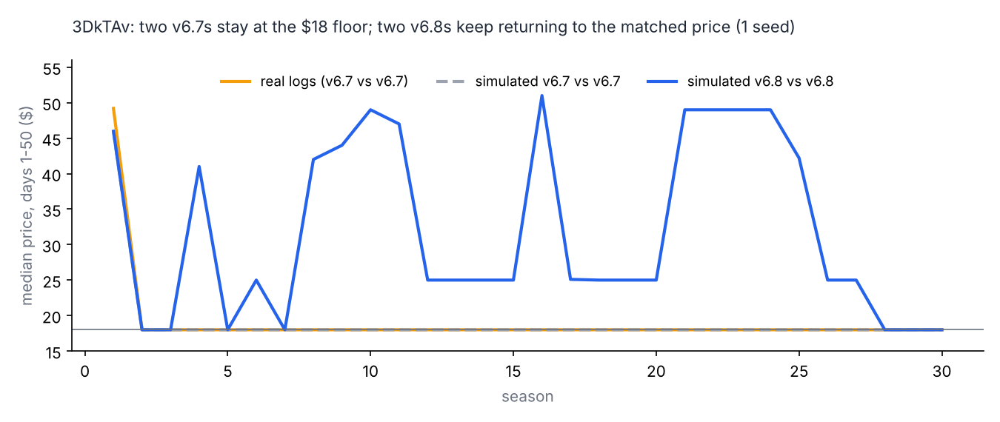
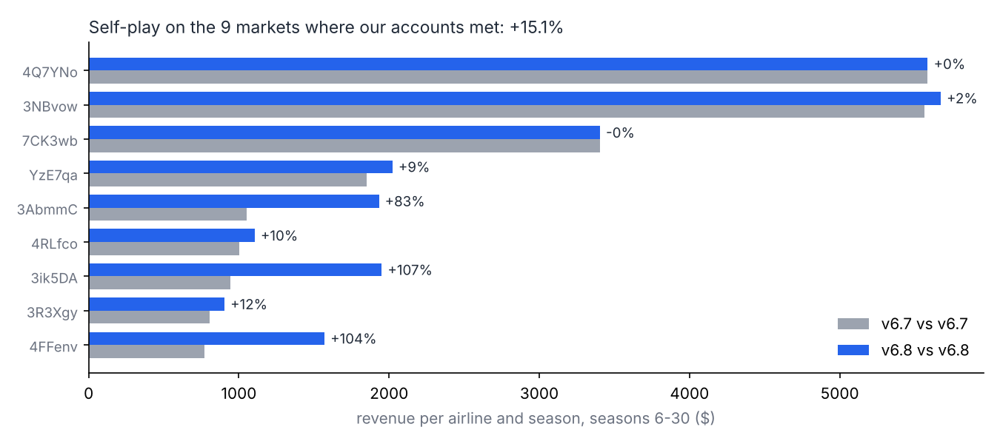
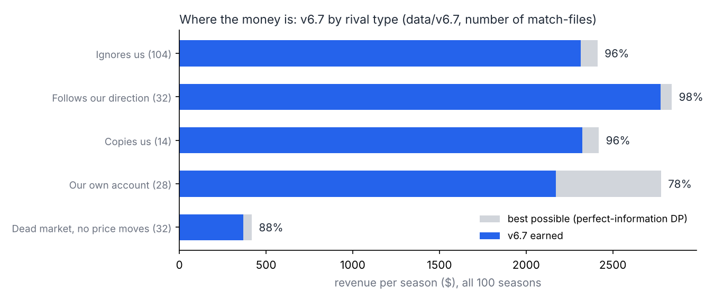

# Evaluation of the current algorithm (`duopoly.py` v6.8)

> **This file always describes the current `duopoly.py`, evaluated on the latest tournament logs (`data/v6.7`, played by v6.7 under three accounts: AirborneTody, DeftDalmatian, ProficientCivet; 6 files, 210 matches × 100 seasons).** It covers what changed, how it is measured, how accurate the previous evaluation was (section 5), what is correlation and what is cause (section 7), how far the two simulations can be trusted (sections 8–9), the weak points and how they were found (section 10), every situation with revenue against the optimum (section 12), and which rivals react to our price (section 13).
>
> Numbers come from `analytics/oracle.py`, `analytics/testbed.py`, `analytics/selfplay.py` / `analytics/selfplay_markets.py` and the scripts in `analytics/review_v67/`. The evaluation of v6.7, written before its tournaments, is archived in [`EVALUATION_v6.7.md`](EVALUATION_v6.7.md). History: [`ALGORITHM_CHANGES.md`](ALGORITHM_CHANGES.md) §25.

## 1. Summary

| Question | Answer |
| :--- | :--- |
| How did v6.7 do online? | Ranks 2, 6, 7 (day 1) and 3, 4, 7 (day 2). Rank is noisy; the quality measure is revenue relative to what the market allowed: **93.1%** of the perfect-information DP, **96.8%** of the fair DP (section 4). |
| Is selling out in ~36% of seasons a problem? | **No.** The perfect-information DP sells out in 38.7% of the same seasons and leaves as many seats unsold (24.9 vs our 25.3). 21% of our sell-outs are on day 100; we are out of seats on 1.46% of season-days (section 4.2). |
| Was the last evaluation accurate? | Direction yes, size too low: it expected +1% to +3% over v6.6; replaying v6.6 on the new matches gives **+4.86%** for v6.7. The test bed over-predicts v6.7's own revenue on the new data by 3.2% (v6.6 data: −0.02%) (section 5). |
| Where was money lost? | **Price wars to the $18 floor** against rivals that react to us: 16 of the 28 match-files where our own accounts met sat at $18 for ~100 seasons, at about half of what a matched price earns. Plus a copier flag that could never clear (2 matches, −18% to −22% per season) and a $60 cap on the copier price (section 6). |
| What changed in v6.8? | A copier flag that clears, a copier price up to $80, and a **cooperative offer**: with evidence of a price war, each season starts at the price that is best if the rival matches us, and keeps it while the rival does not undercut (section 2). Leader pricing on the rival's reaction model was tested and **not adopted**. |
| One quality number | **Self-play** on the 9 markets where our accounts met (simulator reproduces the real logs to −0.7%): **+15.1%** revenue, floor-war markets +10% to +104%, high-demand markets 0% to +2% (section 9). |
| Cost against rivals that ignore us | Test bed with logged rivals: **+0.02%** on data/v6.7, −0.05% on data/v6.6, −0.01% on data/v6.5 (20 seasons each) (section 8). |
| Where is the money? | 96–98% of the perfect-information DP against every rival type except our own accounts (78%); medium markets between our own accounts 54% (section 12). Reaction rule: copiers, followers and non-reactors are separable, but cooperating with followers does not pay (section 13). |
| Honest expectation | Against rivals that ignore our price: nothing changes. Against our own accounts: large gains in poor markets. Against classmates that follow us: unknown until tested online (section 11). |

## 2. The algorithm

The lecture's four steps (*A learning approach to dynamic pricing*, after Bertsimas & Perakis 2001) and what v6.8 changed:

| Step | In `duopoly.py` | Optimisation | Changed in v6.8 |
| :--- | :--- | :--- | :--- |
| 1. Estimate our demand | Choice model: buyers/day ~ Poisson$(n e^{k\tau})$, P(buy from us) $= \frac{e^{b(m-p)}}{1+e^{b(m-p)}+e^{b(m-r)}}$; Poisson ML from day 50 of season 1, $m \le \$150$ | Nonlinear | – |
| 2. Coefficients for the next period | Refit every 25 days and every season end | – | – |
| 3. Estimate the rival | Tomorrow: $r_t = a + c\,r_{t-1} + b\,p_{t-1}$ by least absolute deviations (**LP**); season path: per-day median + AR(1); last 60 forecast errors | LP + time series | The reaction slope $b/(1-c)$ is now used as **evidence of a price war** |
| 4. Our optimal price | $\max_p E[p\min(D,s) + V(t+1,s-\min(D,s))]$ by a scalar solver (**NLP**) | NLP | Posted price $= \max(\text{normal price}, \text{cooperative offer})$ while cooperation holds |
| Dynamic programme | $V(t,s)$, 100 days × 80 seats × \$18–\$100, on the forecast rival path; no rival when it is sold out; rival price = ours against copiers | DP | The **matched-price DP** (rival price = ours) also gives the cooperative offer; copier price may go to \$80 |

The four v6.8 changes (flags in `duopoly.py`):

| # | Change | Flag | Adopted |
| :---: | :--- | :--- | :---: |
| 1 | A day on which we held our price and the rival posted a different one counts against "copier" (before, only days on which our price moved were checked, so a flat copier price could never clear a false flag) | `COPIER_UNLATCH` | yes |
| 2 | Copier DP price up to \$80 (was \$60) | `COPIER_PRICE_MAX` | yes |
| 3 | **Cooperative offer.** If (a) the rival follows us (reaction slope ≥ 0.3), or (b) both of us sat at the floor last season, or (c) cooperation held last season: start the season at the matched-price DP price with 80 seats (one offer per season). Match a rival between halfway (normal price → offer) and the offer. After 3 days below halfway, best reply for the rest of the season. Cooperative seasons must earn at least as much as best-reply seasons (2 of each first), else retried every 10th season. | `COOP_PRICING` | yes |
| 4 | Leader pricing: DP and market-sized price with the rival at its reaction $r(p) = \alpha + \beta p$ when $\beta \ge 0.5$ | `LEADER_PRICING` | **no** (section 9.2) |

## 3. How we measure

| Item | Definition |
| :--- | :--- |
| Quality measure | Revenue per season. |
| Online, normalised | Revenue / revenue of the **perfect-information DP** (knows the match's fitted demand and this season's rival prices; `analytics/oracle.py`). **Fair DP**: knows the demand and the rival's typical path only. |
| Offline, rivals that ignore us | **Test bed** (`analytics/testbed.py`): each version plays every logged match against the logged rival prices, same random buyers. Measures what a change costs or gains when the rival does not react. |
| Offline, rivals that react | **Self-play** (`analytics/selfplay.py`, new): two algorithms play each other in a match's fitted market; both airlines face the same choice model, buyers by Poisson thinning, 80 seats each. The only way to measure a strategy whose value lies in the rival's reaction. |
| With / without | Each change is removed from the full version, everything else equal. |
| Prediction check | The previous evaluation's statements against the new logs (section 5). |

## 4. Online: what happened with v6.7

### 4.1 How much of the available revenue did we earn?

| All 210 matches × 100 seasons | Value |
| :--- | :---: |
| Actual / perfect-information DP | **93.1%** |
| Actual / fair DP (typical rival path) | **96.8%** |
| Fair DP / perfect-information DP (the rival's unpredictable part) | 96.2% |
| Perfect-information DP with a \$1 floor / with \$18 | 101.8% |

v6.6 reached 94.6% on data/v6.6. The two numbers are not a comparison of versions: the markets differ (section 5 replays both versions on the same markets).

### 4.2 Selling out


| Seasons 1–20, same markets | v6.7 (logs) | Perfect-information DP | Fair DP |
| :--- | :---: | :---: | :---: |
| Seasons sold out | 37.6% | 38.7% | 37.8% |
| Sold out by day 90 | 2.6% | 0.3% | 3.8% |
| Days out of seats per season | 1.22 | 0.62 | 1.65 |
| Unsold seats per season | 25.3 | 24.9 | 25.3 |

- All 100 seasons: sold out in 36.2% of seasons. Median sell-out day 98; 1,603 of 7,594 sell-outs on day 100 (the last seat sold on the last day). Out of seats on 1.46% of all season-days.
- Per match, our sell-out rate tracks the perfect-information DP's with correlation **0.94**. Matches where we sell out ≥ 25 points more often than it explain 5% of the revenue gap to it; matches where we sell out ≥ 25 points less often explain 5.4%.
- Unsold seats are worth \$0 at the end; a policy that never sells out prices too high. 44% of seasons end with ≥ 20 unsold seats, and in seasons that do not sell out our median price over days 91–100 is the \$18 floor. On 96% of the days we sit at \$18 the fair DP prices ≤ \$19 too: weak demand, not bad pricing.
- The 3.4% of seasons that sell out before day 90 concentrate in 8 matches (73% of them). Two are the false copier flag (section 6).

### 4.3 Where our prices differ from the fair DP

| Situation | Our price − fair DP price |
| :--- | :--- |
| Rival selling, any day of the season | median \$0.0, mean +\$0.1 to +\$1.5 |
| Rival sold out, days 50–100 (2.5% of priced days) | about +\$10 (we ~\$48, fair DP ~\$37) |
| Seasons 1–2 (learning) | mean +\$4.1 |

The daily duopoly price is where the DP should be. The losses are in **which game** we play, not in the daily optimisation (section 6).

## 5. Was the last evaluation accurate?

| Statement in EVALUATION_v6.7.md | New evidence (data/v6.7) | Verdict |
| :--- | :--- | :--- |
| Expected tournament effect over v6.6: +1% to +3% | Test bed on the 210 new matches, 20 seasons, same rivals and buyers: v6.7 **+4.86%** over v6.6 (v6.6 better in 29 matches, worse in 75) | Direction right, size too cautious |
| The test bed reproduces real revenue (−0.02% on data/v6.6) | v6.7 replayed on data/v6.7: test bed **+3.2%** above the logs (seasons 1–20) | Weaker on new data; differences between versions are still exact (same buyers), levels are 3% optimistic |
| The copier gain needs an exact copier | 8 rivals copied exactly (slope 1.0); the copier DP held \$60 against them, the cap now lifted (+2.8% to +2.9% in 49XLgV and 3Cn7kh) | Right; the cap was too low |
| Weak point "rival reactions to our price: not identifiable from logs" | 40 of 140 matches with price variation have a rival that follows our price changes the next day (slope > 0.3); the self-play simulator measures reactions without logs | **It was the biggest loss** (section 6) |
| Rival's unpredictable part: fair / perfect DP = 96.7% | 96.2% | Held |

## 6. Where the rest was lost

| # | Flaw | How it was found | Cost in data/v6.7 |
| :---: | :--- | :--- | :--- |
| 1 | **Price war to the \$18 floor** | Gap to the fair DP by match: in the matches with the largest gaps the fit flags a "copier" (rival price = our price, both at \$18) and the fair DP earns about twice our revenue. Most of them are matches between two of our accounts. Reproduced in self-play (section 9). | 16 of 28 match-files between our accounts at \$18 for ~100 seasons, at about half of a matched price's revenue |
| 2 | **Copier flag could never clear** | Matches sitting at exactly \$60.00 for 48 days: the copier-mode cap. The rival copied only 15% (qPw7uh, FierceDuck) and 37% (3Ppuun, two v6.7s) of the informative days. | −18% to −22% per season after seasons 22 and 44 (~0.4% of all revenue) |
| 3 | **Copier price capped at \$60** | The copier DP on each copier match's fitted model wants \$64–\$67 in 4 matches | +3.3% to +5.5% in those matches inside the model; test bed +2.8% to +2.9% |
| 4 | Rival sold out: we price ~\$10 above the fair DP | Section 4.3 | 2.5% of priced days; open (section 10) |

**Why the price war happens.** After the day-50 fit, capacity is slack in these markets, so v6.7 prices at the static best reply to the rival's last price. With the fitted price sensitivity ($b \approx 0.23$–$0.27$, $m \approx 51$–$57$), the one-shot equilibrium price of the choice model lies **below \$18**: two best-repliers undercut each other to the floor within 10 days. The matched-price optimum is \$45–\$50. v6.7's own reaction model had learned that the rival follows ($r_t = -0.11 + 0.11\,r_{t-1} + 0.90\,p_{t-1}$), but the price decision ignored it. Once both prices sit at \$18, prices are flat, and the reaction model fails its own quality gate.



## 7. Correlation or causation?

| Observation | Correlation or cause? | How we know |
| :--- | :--- | :--- |
| Matches between our own accounts earn less | **Cause: the strategy pair.** | Self-play reproduces the logged revenue of these 9 markets to −0.7% (per market −3.1% to +3.6%) with nothing but the fitted demand and two copies of v6.7. Replacing both with v6.8 changes only the code. |
| Matches with a high sell-out rate earn more | Correlation (demand). | Rich markets sell out and pay more. Per match, our sell-out rate equals the perfect-information DP's (r = 0.94), so selling out is a consequence of demand, not a lever. |
| \$18 prices go with low revenue | Mostly correlation. | On 96% of our \$18 days the fair DP also prices ≤ \$19 (weak markets). Only in the floor wars is \$18 the cause (section 6). |
| Cooperation helps against classmates who follow us | **Not shown.** | Logged rivals cannot react in the test bed; the self-play rival is a copy of our own code. |

## 8. Test bed: what v6.8 costs against rivals that ignore us

The test bed replays the logged rival prices, so a rival never answers our price. A cooperative offer can only lose here: it is the honest worst case.

| Data, 20 seasons | v6.8 vs v6.7 | Better / worse matches (beyond ±0.5%) | Worst match |
| :--- | :---: | :---: | :---: |
| data/v6.7, 210 matches | **+0.02%** (95%: −0.05% to +0.11%) | 7 / 17 | −4.4% |
| data/v6.6, 60 matches | −0.05% (95%: −0.10% to 0.00%) | 1 / 8 | −63.6% (\$198 → \$72 in 20 seasons; next −1.2%) |
| data/v6.5, 90 matches | −0.01% (95%: −0.06% to +0.06%) | 2 / 12 | −8.4% |
| data/v6.7 copier matches, 100 seasons | +0.8% (6 matches) | 2 / 0 | 0.0% |

Without the price-war evidence gate (an earlier draft), cooperation attempts cost **−2.99%** on the 12 matches most hurt and −0.23% overall; with the gate −0.44% and +0.02%. The gate is what keeps v6.8 harmless against non-reacting rivals.

## 9. Self-play: rivals that react

### 9.1 How it works and how far to trust it

Two algorithms are loaded as separate modules with separate states. Each day both post a price; each sells Poisson(rate(own price, rival price)) seats from the match's fitted choice model, capped at seats left; a sold-out airline faces no rival. Same random numbers for every pair of versions (seed per season).

**Fidelity:** two copies of v6.7 in the 9 fitted markets where our accounts met reproduce the real logged revenue (seasons 6–30) to **−0.7%** in total, −3.1% to +3.6% per market. The floor war in 3DkTAv appears in the same season as in the logs (figure in section 6).

**Limit:** the rival is our own code. Classmates' bots are not modelled.

### 9.2 Results (9 markets, seasons 6–30, 2 seeds)



| Pair (revenue per airline and season) | Mean | vs v6.7 vs v6.7 |
| :--- | :---: | :---: |
| v6.7 vs v6.7 | \$2,331 | – |
| **v6.8 vs v6.8** | **\$2,683** | **+15.1%** |
| v6.8 without the cooperative offer | \$2,355 | +1.0% |
| v6.8 with leader pricing (not adopted) | \$2,606 | +11.8% |
| v6.8 (A) vs v6.7 (B): one side upgraded | A \$2,327, B \$2,337 | −0.2% / +0.3% |

- Floor-war markets: 3ik5DA +107%, 4FFenv +104%, 3AbmmC +83%, 3R3Xgy +12%, 4RLfco +10%, YzE7qa +9%. High-demand markets (4Q7YNo, 3NBvow, 7CK3wb): 0% to +2%.
- 3Ppuun market, 60 seasons: v6.7 vs v6.7 \$5,475, v6.8 vs v6.8 \$5,972 (**+9.1%**). This comes from the copier fixes: either one alone removes the false \$60 lock; both off brings back \$5,475.
- **Leader pricing was rejected:** it lowers the self-play gain from +15.1% to +11.8%. A leader following its reaction model drifts down with a best-replying rival and breaks the cooperative price. It had no measurable effect in the test bed.
- **Cooperation is unstable:** in 3DkTAv it breaks and re-forms (plateaus at \$25, figure in section 6). The two copies fit slightly different models, so their offers differ by \$3–\$14. Matching a rival above halfway closes most of that gap.

## 10. Weak points: how they were found, what was done

| # | Weak point | How it was found | Status in v6.8 |
| :---: | :--- | :--- | :--- |
| 1 | Price war to the \$18 floor against rivals that react | Gap to the fair DP's copier variant by match → all in matches between our accounts → reproduced in self-play | **Fixed** (cooperative offer) for copies of our code; classmates unknown |
| 2 | Copier flag never cleared | Flat \$60.00 prices for 48 days → copier cap → copy share of informative days 15% / 37% | **Fixed** |
| 3 | Copier price capped at \$60 | Copier DP on each copier match's fit | **Fixed** (\$80) |
| 4 | Cooperation unstable, partial (\$22–\$28 in some markets where the matched price is ~\$45) | Self-play traces | Open: a common focal price (e.g. rounded to \$5) could help |
| 5 | Rival sold out: ~\$10 above the fair DP on days 50–100 | Oracle day table | Open; logging those days as "no rival" was tested and rejected in v6.7 |
| 6 | Seasons 1–2: \$4 above the fair DP | Oracle day table by season | Open; learning cost |
| 7 | The test bed is 3.2% optimistic on data/v6.7 | v6.7 replayed against its own logs | Version differences remain exact; levels need care |
| 8 | No model of classmates' reactions | – | Open; only an online run can show whether followers (FierceDuck, WonderfulOxpecker, HumongousLocust, BenevolentSwan: slope 0.4–0.8) hold a matched price |

## 11. What we do not know, and what to expect

- **Against rivals that ignore our price** (most of the field): v6.8 = v6.7 (test bed +0.02%).
- **Against our own accounts:** large gains in poor markets (+10% to +100%), none in rich ones. If only one account plays per tournament, this does not apply.
- **Against classmates that follow us:** the gate lets cooperation start; it either holds (gain) or breaks after 3 days (small loss, then retried at most every 10th season if it keeps losing). Size unknown.
- DPC rank is noisy; compare revenue per match against the same rivals, not ranks.

## 12. Situations at a glance

**What the algorithm does, in one paragraph.** Every day it (1) estimates our demand from our own sales with a choice model (how many buyers come, and how they split between us, the rival and no purchase at given prices), (2) forecasts the rival's price for today and the rest of the season, (3) solves a **dynamic programme** over days left × seats left. That DP tells it what one more seat is worth tomorrow, so today's price balances selling now against keeping a seat for later. Special cases: when the rival is sold out it prices as a monopolist; when the rival copies us it prices as if the rival will match; and since v6.8, when two bots are stuck undercutting each other, it offers a matched price and keeps it while the rival does.

**Two benchmarks.** *Perfect-information DP*: knows the match's demand and this season's rival prices in advance (an upper bound nobody can reach). *Fair DP*: knows the demand and the rival's typical prices only.



### 12.1 By rival type (data/v6.7, all 100 seasons; type from section 13)

| Rival type | Match-files | Share of our revenue | We earned / season | Perfect-info DP | Efficiency | Share of the gap to the fair DP | v6.8 vs v6.7 |
| :--- | :---: | :---: | :---: | :---: | :---: | :---: | :--- |
| Ignores our price | 104 | 55.4% | \$2,316 | \$2,413 | 96.0% | −12% (we beat the fair DP) | +0.02% (test bed) |
| Follows the direction of our price | 32 | 20.4% | \$2,776 | \$2,841 | 97.7% | −6% (we beat the fair DP) | +0.04% (simulated rivals) |
| Copies our price | 14 | 7.5% | \$2,326 | \$2,420 | 96.1% | 9% | +0.8% (copier matches, 100 seasons; up to +2.9%) |
| **Our own account** | 28 | 14.0% | **\$2,170** | \$2,779 | **78.1%** | **107%** | **+15.1% (self-play)** |
| Dead market (prices hardly move) | 32 | 2.7% | \$367 | \$419 | 87.8% | 2% | ~0 |

Against every rival type except our own accounts we earn 96–98% of the perfect-information DP. The rest of the gap there is the rival's unpredictable part (fair DP / perfect DP = 96.2%). We beat the fair DP against rivals that ignore or follow us because our forecast reacts to this season's rival prices, while the fair DP only knows the typical path. The missing money is almost all in matches between our own accounts.

### 12.2 By market size (match's perfect-info revenue per season: poor < \$1,116 < medium < \$2,924 < rich)

| Market | Match-files | Share of our revenue | We earned / season | Perfect-info DP | Efficiency | Typical situation |
| :--- | :---: | :---: | :---: | :---: | :---: | :--- |
| Rich | 70 | 66.0% | \$4,098 | \$4,280 | 95.8% | Seats sell out late; price \$45–\$75 |
| Medium | 70 | 28.2% | \$1,753 | \$2,009 | 87.3% | Capacity slack; this is where price wars happen |
| Poor | 70 | 5.8% | \$359 | \$381 | 94.2% | Few buyers; \$18 is often optimal |

**Medium markets × our own account: 54% efficiency** (12 match-files, \$1,219 vs \$2,263 per season): the floor wars. Rich markets × our own account: 92%. Poor × our own account: 78%.

### 12.3 By time and day type

| Situation | Share | Efficiency / what happens |
| :--- | :---: | :--- |
| Season 1 | 1% of seasons | 81% of perfect-info: the demand model is fitted on day 50, guesses before that |
| Season 2 | 1% | 90% |
| Seasons 3–100 | 98% | 93–94% |
| Days 1–30 / 31–70 / 71–90 / 91–100 | revenue 22% / 43% / 25% / 11% | – |
| Rival sold out | 3.3% of days, 7.3% of revenue (avg price \$44.5) | We price ~\$10 above the fair DP on days 50–100 (open, section 10) |
| We sit at the \$18 floor | 40.8% of days, 10.0% of revenue | On 96% of those days the fair DP also prices ≤ \$19 |
| We are sold out | 1.5% of days | Sell-out rate equal to the perfect-info DP's (section 4.2) |

### 12.4 Where suggestions would pay most

1. **Our own accounts in medium markets** (54%): stabilise cooperation (section 9.2: plateaus at \$25 instead of ~\$45). Upper bound ≈ +\$1,000 per season in those 12 match-files.
2. **Season 1** (81%): an earlier or better first demand fit. Small total: one season in 100.
3. **Rival sold out** (7% of revenue, ~\$10 too high): small, and one fix was already rejected.
4. Everything else is at 96–98% of the perfect-information DP, close to the 96% ceiling set by the rival's unpredictability.

## 13. Does the rival react? (reaction rule)

**Rule** (`analytics/review_v67/reaction_rule.py`). Only days on which our price moved by more than 2% count. On those days:
- **copy**: is the rival's next price within 2% of our price yesterday?
- **direction**: did it move the way we moved?
- **best reply**: is it within 2% of the price that maximises its own revenue against our price (match's fitted choice model)?
- **placebo**: the same checks with our price on the same day of another season. A rival that ignores us scores the placebo rate; reaction = score − placebo.

Bands of 1%, 2% and 3% were tried. Copy excess: +0.08 / +0.09 / +0.08, so 2% is used (1% misses copies through rounding).

| Type | Rivals | Copy − placebo | Direction − placebo |
| :--- | :--- | :---: | :---: |
| Exact copiers | BlueFalcon, UncoveredSwift, FlashyInchworm | +0.70 to +0.83 | +0.48 to +0.59 |
| Partial copier | StirringWombat | +0.35 | +0.22 |
| Our own accounts | AirborneTody, DeftDalmatian, ProficientCivet | +0.13 to +0.18 | +0.23 |
| Follow our direction | RealLion, SuperGoshawk, CrystalTamarin, WonderfulOxpecker, ChirpyPython, FierceDuck, CautiousWaxbill, HumongousLocust | ≈ 0 | +0.17 to +0.29 |
| Ignore us | KickassMoth, NiceFinch, DaringVole, ConvivialCrane, IntrepidBeluga, … | ≈ 0 | ≈ 0 |

- **Nobody plays the best reply:** best-reply hits equal the placebo (0.7% vs 0.8% at 1%). Under our demand model the best reply is often below \$18; no bot goes there.
- **Does acting on it pay?** Each rival was simulated from its logs: next price = f(its price, our price, our last change, day of season) plus its own residuals (`analytics/rival_bot.py`). Against these simulated rivals, v6.7 reproduces its logged revenue to a median of 2.1% per match (0.1% in total).

| Simulated rivals, seasons 6–30, 2 seeds | v6.8 now | v6.8 with the reaction rule as the cooperation gate | Cooperation always allowed |
| :--- | :---: | :---: | :---: |
| Follow our direction (24 matches) | +0.04% | −0.10% | +0.01% |
| Ignore us (13 matches) | −0.05% | −0.08% | −0.07% |

Followers move the way we move but do not hold a matched price, so a cooperative offer earns nothing against them. The rule was therefore **not added to `duopoly.py`**. It is kept as an analysis tool.

A first rival simulation that reacted only to the level of our price showed +1.24% for cooperation. That was an artifact: those simulated rivals followed our direction far less than the real ones did (0.04 vs 0.24–0.40). Adding the "our last change" term brought them to 0.15–0.25 and removed the gain.

## 14. Reproduce

```bash
python analytics/oracle.py --data v6.7                                   # oracle efficiency, day table
python analytics/testbed.py --data v6.7 --seasons 20 --compare analytics/experiments/duopoly_v67.py
python analytics/selfplay.py duopoly.py duopoly.py --fit "AirborneTody_rank_7.csv/3DkTAv" --seasons 30 --seeds 4
python analytics/selfplay_markets.py out.csv duopoly.py:duopoly.py analytics/experiments/duopoly_v67.py:analytics/experiments/duopoly_v67.py \
    --markets "3AbmmC,4RLfco,3ik5DA,4FFenv,YzE7qa,3R3Xgy,4Q7YNo,3NBvow,7CK3wb"
python analytics/review_v67/v67_sellout.py; python analytics/review_v67/oracle_sellout.py   # section 4.2
python analytics/review_v67/copycheck.py; python analytics/review_v67/reaction.py           # sections 5, 6
python analytics/review_v67/reaction_rule.py v6.7                                           # section 13
python analytics/review_v67/fit_bots.py                                                     # simulated rivals
python analytics/review_v67/bot_eval.py out.csv analytics/experiments/duopoly_v67.py duopoly.py --keys keys.txt
python analytics/review_v67/situations.py                                                   # section 12
```
