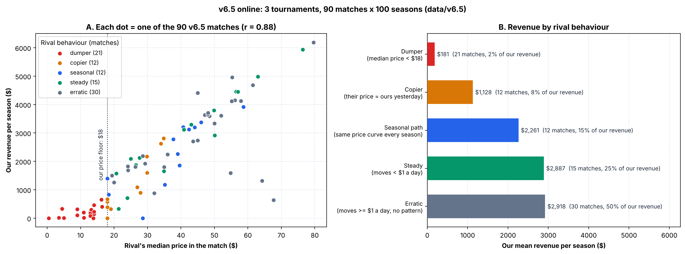
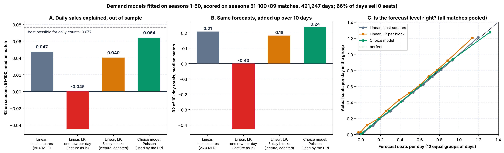
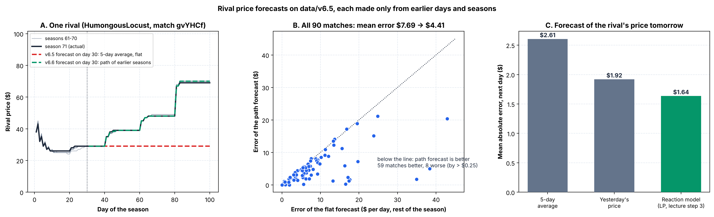
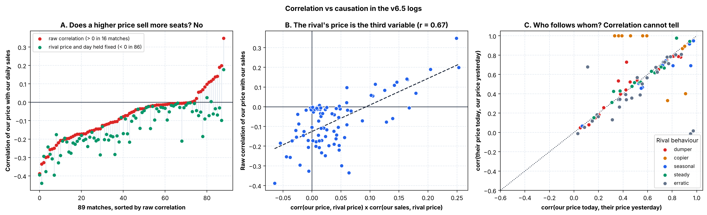
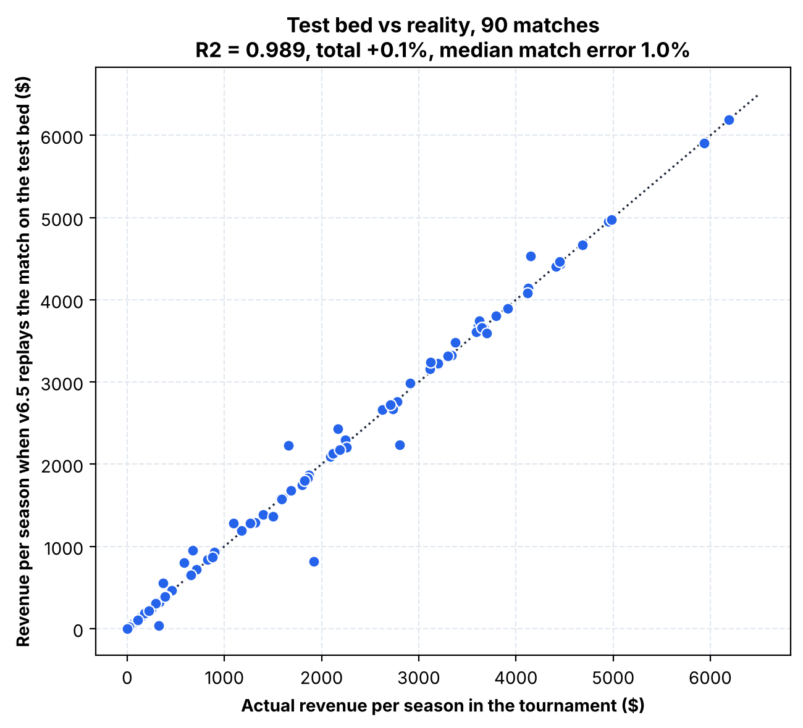
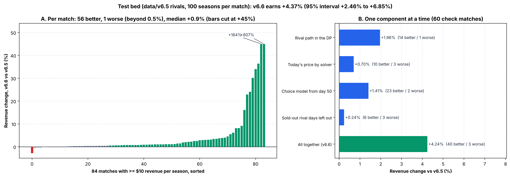

# Evaluation of the current algorithm (`duopoly.py` v6.6)

> **Archived evaluation of v6.6 (written before the v6.6 tournaments). The current evaluation is [`EVALUATION.md`](EVALUATION.md); section 5 there checks these predictions against data/v6.6.**
>
> This file described the version of `duopoly.py` current at the time. It answers: what does the algorithm do, how do we measure it, how good are its models, what is correlation and what is cause, how does the offline simulation work and how far can it be trusted, where are the weak points and how were they found. History of all versions: [`ALGORITHM_CHANGES.md`](ALGORITHM_CHANGES.md).
>
> Every number and figure below is produced by `analytics/evaluate_v66.py` from `data/v6.5` and the test-bed result files, stored in `analytics/v66_evaluation.json`, and written into this file by `analytics/write_evaluation_md.py`. Text and plots therefore show the same numbers. To refresh: section 11.

## 1. Summary

| Question | Answer |
| :--- | :--- |
| What changed in v6.6? | The method of Bertsimas & Perakis (2001) / the lecture: forecast the rival's price (linear programme + time series), put the forecast into the dynamic programme, solve today's price as a one-dimensional nonlinear programme. Plus two data fixes found on the way. |
| One quality number | Revenue on the offline test bed, same rivals and same random buyers for both versions: **+4.37%** vs v6.5 over 90 matches x 100 seasons (95% interval +2.46% to +6.85%). |
| How consistent? | 56 matches better, 1 worse (beyond ±0.5%), worst match −2.8%, median match +0.9%. |
| On matches not used to choose the changes | **+4.24%** on the 60 check matches (40 better / 3 worse). |
| How robust is that number? | +2.97% on the 57 matches where the test bed reproduces v6.5's real revenue within ±10%; +2.16% without the 5 matches that gain most (they are 54% of the gain); median match +0.9%. |
| With a different demand model (old simulator) | **−0.5%**: no gain. Three of the four changes are neutral there; fitting the choice model on day 50 costs revenue when the model family is wrong (section 8.4). |
| Honest expectation for the tournament | Between the two offline worlds: somewhere from about 0% to +3%. |
| Is the offline number a forecast of the tournament? | No. It is an upper estimate: the test bed draws buyers from the same model family the algorithm fits, and its rivals replay logged prices and do not react to us (section 7). |
| Biggest open weak point | 21 of 90 matches (23%) are against rivals below our \$18 floor; they bring 2% of our revenue (section 9). |

## 2. The algorithm in one table

The four steps of the lecture *A learning approach to dynamic pricing using nonlinear and linear optimization* and where each one lives in `duopoly.py`:

| Lecture step | In the lecture | In `duopoly.py` v6.6 | Optimisation type | Since |
| :--- | :--- | :--- | :--- | :---: |
| 1. Estimate our demand model | Linear $d = \beta_0 + \beta_1 p_1 + \beta_2 p_2$, least absolute deviations by LP, coefficients vary slowly | Choice model: buyers/day $\sim$ Poisson$(n e^{k\tau})$, each buys from us with probability $\frac{e^{b(m-p)}}{1+e^{b(m-p)}+e^{b(m-r)}}$. Fitted by maximum likelihood on all our days. **The lecture's linear LP model was tested and not adopted (section 5.1).** | Nonlinear (Nelder–Mead on the likelihood) | v6.4, first fit now day 50 of season 1 |
| 2. Coefficients for the next period | Average of the last $N$ periods | Refit every 25 days and every season end on the last 3,000 days | – | v6.4 |
| 3. Estimate the rival | Assume the rival maximises revenue, fit its model by LP | **Rival price forecast.** Tomorrow: $r_t = a + c\,r_{t-1} + b\,p_{t-1}$ fitted by **least absolute deviations as a linear programme** (`scipy.linprog`, last 3 seasons, $b, c \ge 0$). Rest of the season: $r_d = \text{profile}_d + \varphi^{\,d-t}(r_t - \text{profile}_t)$, profile = median price per day over the last 10 seasons, $\varphi$ = AR(1) | **Linear programme** + time series | **v6.6** |
| 4. Our optimal price | $\max_p\ p\,(\beta_0+\beta_1 p+\beta_2 \hat p_2)$, one-dimensional, standard solver | $\max_p\ E[\,p\min(D,s) + V(t+1, s-\min(D,s))\,]$ with $D \sim$ Poisson(rate$(p, \hat r_t)$): the same one-dimensional problem plus the value of the seats kept. Solved every day with a bounded scalar solver (`scipy.minimize_scalar`) | **Nonlinear programme** | **v6.6** |
| (paper, section 2) Dynamic programming | $J_s(c_s) = \max_p E[p\min(d,c_s) + J_{s+1}(c_s - \min(d,c_s))]$ | $V(t,s)$ by backward induction over 100 days x 80 seats x prices \$18–\$100. v6.5 held the rival at its 5-day average until day 100; **v6.6 uses the forecast path** | Dynamic programme | v6.5, path in v6.6 |

Unchanged from v6.5: market sizing (seat value 0 when the market cannot fill the plane), the copier rule, the monopoly rule when the rival is sold out, the first-season regression with regime priors (now only until day 50).

## 3. How we measure

| Item | Definition |
| :--- | :--- |
| Quality measure | **Revenue per season** (the competition ranks by total revenue). Selling out is not a goal: selling out early means the price was too low, unsold seats mean it was too high. |
| Baseline | v6.5, the version that played the `data/v6.5` tournaments (`analytics/experiments/duopoly_v65.py`). Every change is measured **with and without** it, everything else equal. |
| Pairing | Both versions play the same match, same rival prices, same random number per (match, season, day). A difference is therefore caused by the code, not by luck in the draw. |
| Reported per comparison | Total revenue change in %, matches better / worse (beyond ±0.5%), worst match, and a 95% interval from resampling matches 4,000 times (bootstrap). |
| Choosing vs checking | Changes were chosen on set A (every 3rd match, seasons 1–40, 30 matches). They were then checked on the other 60 matches, which had not been looked at until then (section 8.2; one late choice between two near-equal variants did use them and is marked there). |
| Model quality | Out of sample only: fit on seasons 1–50, score on seasons 51–100. $R^2$, adjusted $R^2$, and $R^2$ as a share of the best value Poisson noise allows (section 5). |
| Sanity check of the switches | With all new switches off the file must reproduce v6.5 to the cent. It does. |

## 4. Online: what happened with v6.5

`data/v6.5`: 3 tournaments, 90 matches, 100 seasons x 100 days each. Our ranks: 4, 8, 9.



| Tournament | Rank | Matches | Revenue / season (mean) | (median) | Seats sold of 80 | We sold out | Rival sold out | Our / rival median price |
| :--- | :---: | :---: | :---: | :---: | :---: | :---: | :---: | :---: |
| `AirborneTody_rank_4` | 4 | 30 | \$2,021 | \$2,104 | 50.6 | 24% of seasons | 26% | \$29 / \$30 |
| `DeftDalmatian_rank_8` | 8 | 30 | \$1,934 | \$1,538 | 51.0 | 30% of seasons | 23% | \$26 / \$28 |
| `ProficientCivet_rank_9` | 9 | 30 | \$1,889 | \$1,811 | 46.8 | 30% of seasons | 28% | \$29 / \$31 |
| **All** | – | 90 | \$1,948 | \$1,743 | 49.5 | 28% | 25% | – |

**Comparison with the market.** The logs contain our sales only, never the rival's sales or revenue, so "our revenue vs the rival's revenue" cannot be computed from them. What can be compared is the price position (our median price is within about \$1.50 of the rival's in all three tournaments) and the sell-out rate (ours 28% of seasons, rivals 25%). The only direct market comparison is the tournament rank itself. Ranks of different days are not comparable either: the rivals and the random markets change every day (v6.4 ranked 1 to 33 with the same code).

### 4.1 Rival behaviour and what it did to our revenue

Each rival is labelled from its logged prices only (rules in `classify_rival`, checked in this order): **copier** = its price equals our price of the day before on ≥ 80% of days; **dumper** = median price below our \$18 floor; **seasonal** = the median price per day of seasons 1–50 explains ≥ 50% of its price variance in seasons 51–100; **steady** = moves less than \$1 per day on average; **erratic** = the rest.

| Rival behaviour | Matches | Our revenue / season | Share of our total revenue | Seats sold | We sold out | Rival sold out | Our / rival median price | Days at our \$18 floor |
| :--- | :---: | :---: | :---: | :---: | :---: | :---: | :---: | :---: |
| dumper | 21 (23%) | \$181 | 2% | 8.9 | 0% | 3% | \$18 / \$11 | 94% |
| copier | 12 (13%) | \$1,128 | 8% | 40.2 | 12% | 12% | \$23 / \$23 | 42% |
| seasonal | 12 (13%) | \$2,261 | 15% | 61.5 | 30% | 15% | \$36 / \$39 | 20% |
| steady | 15 (17%) | \$2,887 | 25% | 67.1 | 42% | 40% | \$42 / \$41 | 14% |
| erratic | 30 (33%) | \$2,918 | 50% | 68.0 | 46% | 43% | \$46 / \$48 | 7% |

**What caused what?**

- Our revenue per season rises with the rival's median price (r = 0.88, panel A). This is not "an expensive rival makes us rich". Both follow the market: each match has its own random demand level and willingness to pay, and both players adapt to it (our median price and the rival's: r = 0.88).
- Dumpers: the rival's low price is not what takes our revenue away. A rival at a median of \$11 sold out in only 3% of seasons. If many buyers existed, 80 seats at that price would be gone every season. So these are small markets with low willingness to pay; the rival's price and our low revenue are both effects of that. Lowering our floor could win a part of these few buyers, not create a normal season (section 9).
- 26 matches earn less than \$500 per season and together bring 2.6% of our revenue. The ranking is decided in the other matches: steady and erratic rivals are 45 matches and 75% of our revenue. v6.6 changes mostly those.

## 5. Are the models good?

### 5.1 Demand model



Four models, each fitted per match on seasons 1–50 and scored on seasons 51–100 (89 matches, 421,247 days). One day sells 0.49 seats on average and 66% of days sell none.

| Model | $R^2$ daily (median match) | Adjusted $R^2$ | Middle half of matches | Share of the best possible $R^2$ | $R^2$ of 10-day totals | Level error (median) | Best model in (matches) |
| :--- | :---: | :---: | :---: | :---: | :---: | :---: | :---: |
| Linear, least squares (the v6.0 regression) | 0.047 | 0.047 | 0.014 to 0.088 | 72% | 0.21 | 2.8% | 17 |
| Linear, LP, one row per day (lecture step 1 as written) | -0.045 | -0.046 | -0.181 to 0.025 | -69% | -0.43 | 74.5% | 1 |
| Linear, LP, 5-day blocks (lecture, adapted) | 0.040 | 0.040 | 0.003 to 0.080 | 60% | 0.18 | 7.6% | 2 |
| **Choice model, Poisson (used by the DP)** | 0.064 | 0.064 | 0.022 to 0.128 | 98% | 0.24 | 2.4% | 69 |

How to read this:

- **A daily $R^2$ of 0.06 looks terrible and is close to the maximum.** Buyers arrive at random (Poisson). Even a model that knew the true expected sales of every day could not explain more than $1 - \text{mean}/\text{variance}$ of daily sales, which is 0.077 in the median match. The choice model reaches 98% of that limit, the least-squares line 72%. Adjusted $R^2$ equals $R^2$ to three digits because each test set has thousands of days and 3–4 parameters.
- Added up over 10 days the noise shrinks and $R^2$ rises to 0.24 (panel B). Panel C: when the choice model forecasts x seats per day, x seats are sold (points on the diagonal).
- **The lecture's LP model as written fails on this data.** Least absolute deviations fits the median. The median of daily sales is 0, so in 43 of 89 matches the LP returns all coefficients = 0 and forecasts no sales at all ($R^2$ -0.045). The paper's example sells about 50 units per period; we sell 0.5. Summing 5 days per row repairs it ($R^2$ 0.040) but it stays behind the choice model, and a line cannot learn from days without sales where the price was too high.
- Consequence: the LP is used where its strength counts, on the rival's prices (step 3: prices are never mostly zero, and they have spikes that least squares would chase). The demand model stays the choice model.

### 5.2 Rival price forecast



Every forecast uses only earlier days and earlier seasons of the same match.

| Forecast | Mean absolute error | Median match |
| :--- | :---: | :---: |
| **Rest of the season**, flat 5-day average (v6.5's DP assumption) | \$7.69 | \$5.71 |
| **Rest of the season**, profile + AR(1) path (v6.6) | **\$4.41** | \$3.03 |
| Tomorrow, 5-day average | \$2.61 | \$1.40 |
| Tomorrow, yesterday's price (v6.1–v6.5) | \$1.92 | \$0.70 |
| Tomorrow, reaction model by LP (v6.6) | **\$1.64** | \$0.70 |

- The path forecast cuts the error for the rest of the season by 43%: better in 59 matches, worse in 8 (by more than \$0.25). For seasonal rivals the error falls from \$11.60 to \$2.42, for erratic rivals from \$12.37 to \$8.00.
- The reaction model cuts the next-day error by 15% on average, but the median match does not improve: the gain comes from the rivals that follow our price. `duopoly.py` therefore uses it only when its error is at most 70% of the error of "same price as yesterday"; that is the case in about 24 of 90 matches.

## 6. Correlation or causation?



Three places where a correlation in the logs must not be read as a cause:

**1. Our price and our sales (panels A, B).** In 16 of 89 matches a higher price goes with *more* seats sold. Nobody buys more because it is dearer. First guess: the day of the season (we charge more late, when more buyers come). **That guess was wrong**: holding the day fixed, 15 matches still show a positive correlation, and across matches the day explains nothing (r = -0.23). Holding the *rival's price* fixed leaves 3. The third variable is the rival's price: when the rival is expensive we charge more (median correlation 0.51) *and* we sell more (positive in 71 matches). The product of these two links predicts the raw correlation with r = 0.67 (panel B). With rival price and day held fixed the price effect is negative in 86 of 89 matches. This is why every demand model here contains the rival's price, and why a model with our price alone would recommend raising prices for the wrong reason.

**2. Their price and ours (panel C).** The rival's price today correlates with our price yesterday (median 0.62). Our price today correlates just as much with their price yesterday (median 0.55); both are above 0.5 in 44 matches. Our algorithm is built to respond to the rival, and both respond to the same market, so the logs cannot tell who follows whom. Only the 12 copiers are certain: their price *equals* ours of the day before (top of panel C), which no common cause produces. The reaction coefficient $b$ of step 3 is therefore used as a **forecast** of tomorrow's price, not as proof that we can steer the rival. Proof would need an experiment: change our price on random days and watch.

**3. Rival price level and our revenue (section 4.1).** r = 0.88 across matches, caused by the market behind both.

What makes the test-bed result causal *inside the test bed*: both versions face identical rivals and identical random buyers, so the code is the only difference. Whether the test bed resembles the tournament is a separate question (next section).

## 7. Offline simulation: how it works and how far to trust it

`analytics/v65_testbed.py`, same method as the v6 and v6.4 test beds:

1. **Demand** per match: the choice model fitted to all 10,000 logged days of that match (8 starting points, best likelihood kept).
2. **Rival**: replays its logged price and its logged sold-out days, day by day. Copiers are simulated as copiers (their price = our price the day before).
3. **Play**: a pricing file plays every match for 100 seasons. Sales per day are drawn from the fitted model with a fixed random number per (match, season, day), identical for every file.



| Check | Result |
| :--- | :--- |
| v6.5 replayed on the test bed vs v6.5 in the tournament, total revenue | \$17,550,522 vs \$17,532,485 (+0.1%) |
| Same, per match | $R^2$ = 0.989; median error 1.0% in the 64 matches above \$500 per season; 57 of them within ±10%; worst 58% |
| Demand model out of sample (section 5.1) | 98% of the achievable daily $R^2$, level error 2.4% |

What the test bed can and cannot show:

| | |
| :--- | :--- |
| Can | Rank two versions against the real rival price paths and sold-out days of 90 matches, without luck. Find matches where a change hurts. |
| Cannot: rival reactions | The rival's prices are a recording. If our new prices would make a real rival answer differently, the test bed does not see it (only copiers react). |
| Cannot: wrong model family | Buyers are drawn from the model family the algorithm itself fits, so the algorithm's model is "right" by construction. Real gains are smaller. The simulator check in section 8.4 uses a different family. |
| Cannot: prices never tried | Below \$18 and far above the logged prices the demand curve is the model's extrapolation, not data. |
| Fit is in-sample here | The validity row above compares with the same logs the demand model was fitted on. The out-of-sample evidence is section 5.1. |

One error was found in the test bed itself while questioning a result: with a single starting point the fit of 7 of 90 matches ended in a flat region ("price does not matter below \$1,000") with a much worse likelihood; in such a match any version that prices higher wins. The fit now uses 8 starting points; no match is degenerate (largest willingness-to-pay midpoint \$83).

## 8. Results: v6.6 against v6.5



### 8.1 All 90 matches x 100 seasons

| | v6.5 | v6.6 | Change |
| :--- | :---: | :---: | :---: |
| Total revenue | \$17,550,522 | \$18,316,760 | **+4.37%** (95%: +2.46% to +6.85%) |
| Revenue per season | \$1,950 | \$2,035 | +\$85 |
| Seasons sold out | 29.7% | 32.7% | |
| Matches better / worse (beyond ±0.5%) | | | 56 / 1 |
| Median / worst / best match | | | +0.9% / −2.8% / +807.2% |

**Questioning the headline.** The gain is not spread evenly:

| Cut | Matches | Change vs v6.5 |
| :--- | :---: | :---: |
| All matches | 90 | +4.37% |
| Matches where the test bed reproduces v6.5's real revenue within ±10% (and ≥ \$500 per season) | 57 | **+2.97%** (95%: +1.62% to +4.62%; 38 better / 1 worse; median +0.9%) |
| Without the 5 matches that gain most | 85 | +2.16% |

- The 5 biggest winners are 54% of the total gain. The biggest one (`43gtYC`, 17% of the gain) is also the match the test bed reproduces worst (−58% against reality), so its gain should not be believed.
- The +807% match is a copier match in which v6.5 earned \$40 per season on the test bed. The one match that gets worse (−2.8%) is against a steady rival; the cause has not been traced.
- Read the result as: **about +3% where the test bed can be trusted, +1% in a typical match**, driven by a minority of matches with large gains.

By rival behaviour:

| Rival behaviour | Matches | Change | Per season |
| :--- | :---: | :---: | :---: |
| dumper | 21 | +0.70% | +\$1 |
| copier | 12 | +10.91% | +\$126 |
| seasonal | 12 | +4.75% | +\$108 |
| steady | 15 | +1.86% | +\$54 |
| erratic | 30 | +4.63% | +\$134 |

The copier gain comes entirely from the earlier fit of the choice model (8.2) and depends on the test bed's copier (an exact copy of our price of the day before, every day). Dumper matches hardly change: the \$18 floor still binds.

### 8.2 With / without each component, on the 60 check matches

These 60 matches were not used to build the version (60 seasons each). "Alone" = v6.5 plus this one component. "Removed" = v6.6 minus this one component; the last column is what v6.6 loses without it.

| Component | Alone: revenue vs v6.5 | Better / worse | Worst match | v6.6 without it: revenue vs v6.5 | Contribution inside v6.6 |
| :--- | :---: | :---: | :---: | :---: | :---: |
| Rival path forecast in the DP and in market sizing | +1.96% | 14 / 1 | −3.5% | +2.89% | +1.35 points |
| Today's price by scalar solver, rival from the reaction model | +0.70% | 10 / 3 | −3.7% | +3.95% | +0.29 points |
| Choice model fitted from day 50 of season 1 | +1.41% | 23 / 2 | −1.2% | +2.48% | +1.76 points |
| Sold-out rival days left out of the demand data | +0.24% | 6 / 3 | −6.3% | +3.46% | +0.78 points |
| **All four = v6.6** | **+4.24%** (95%: +2.19% to +6.82%) | 40 / 3 | −0.8% | – | – |

**A result that had to be questioned.** On set A, logging sold-out-rival days as "no rival" looked like the best single change (+1.7 points). Looking at the matches: almost all of it came from one match (`khLeM2`, +\$34,501 of +\$39,923). On the check matches repairing these days is worth only +0.24% alone. Is it noise? Taking it out of the full version lowers the check-match result by 0.78 points, so it is real but mostly works together with the other parts (why exactly has not been isolated). Two ways to repair the data were then compared on both sets: log the day as "no rival" (+4.14%, worst match −1.5%) or leave the day out (+4.24%, worst match −0.8%). Leaving it out is as good and loses less in the worst match, and the choice model is known to be poor without a rival (section 9, point 8), so v6.6 leaves these days out. This last choice between two near-equal variants used the check matches; the headline number is therefore very slightly optimistic.

### 8.3 How the version was built (set A, 30 matches, seasons 1–40)

| Variant | Revenue vs v6.5 | Better / worse (vs v6.5) | Worst match | Decision |
| :--- | :---: | :---: | :---: | :--- |
| All new switches off (must equal v6.5) | +0.00% | 0 / 0 | 0.0% | check passed: identical revenue |
| Rival path in the DP | +1.45% | 12 / 0 | −0.1% | adopted |
| Today's price by solver (yesterday's rival price) | +0.73% | 11 / 1 | −0.8% | adopted |
| Path + solver | +1.86% | 14 / 0 | −0.1% | adopted |
| Path + solver + choice model from day 50 | +2.26% | 24 / 0 | −0.1% | adopted |
| ... + reaction model for today's rival price (used only if error <= 70% of naive) | +2.27% | 24 / 0 | −0.1% | adopted, worth ~0 here |
| ... + reaction model always used | +2.27% | 20 / 0 | −0.4% | rejected: more matches unchanged or slightly down |
| ... + rival path also in market sizing | +2.49% | 23 / 0 | −0.2% | adopted |
| ... + sold-out rival days logged as "no rival" | +4.17% | 23 / 0 | −0.2% | replaced by the next row after the check described in 8.2 |
| ... + sold-out rival days left out of the demand data (= v6.6) | +4.15% | 22 / 0 | −0.3% | adopted |
| Rival sell-out share inside the DP | −0.49 points vs the same build without it | 10 / 4 | −5.9% | rejected |
| Several starting points for the choice-model fit | −0.33% | 0 / 1 | −4.1% | rejected |
| DP table rebuilt every 5 days instead of 10 | +0.05 points vs the same build with 10 days | 12 / 2 | −2.0% | rejected: no gain |
| Lecture's linear demand model by LP in season 1 | +0.11 points vs the same build without it | 16 / 2 | −3.6% | rejected: within noise, larger worst case |
| Price floor \$10 instead of \$18 | +2.11 points vs the same build with \$18 | 19 / 3 | −4.5% | not adopted: extrapolation below any price we ever charged (section 9) |

### 8.4 Check with a different demand model (old simulator)

`analytics/benchmark_3regime_models.py` draws buyers with uniform willingness to pay (not the choice model) against four scripted rivals; 5 seeds x 30 seasons; the number is the sum over the four rivals of mean revenue per season. Here the algorithm's demand model is wrong on purpose.

| Market (simulated) | v6.5 | v6.6 | Change | v6.6 without the day-50 fit | without path | without solver | without the data fix |
| :--- | :---: | :---: | :---: | :---: | :---: | :---: | :---: |
| Low (~68 arrivals) | \$4,610 | \$4,626 | +0.3% | \$4,603 | \$4,626 | \$4,625 | \$4,626 |
| Average (~95 arrivals) | \$9,020 | \$8,940 | −0.9% | \$9,019 | \$8,937 | \$8,950 | \$8,940 |
| High (~135 arrivals) | \$10,728 | \$10,665 | −0.6% | \$10,727 | \$10,680 | \$10,672 | \$10,665 |

- **v6.6 does not gain here (−0.5% in total).** The differences per rival are inside the 95% intervals of the seeds except one cell: Old v1.0 rival, average market: \$3,330 ± 91 (v6.6) vs \$3,439 ± 41 (v6.5).
- Which change is responsible? Removing the day-50 fit returns v6.5's numbers almost exactly; removing any of the other three changes nothing. So the path forecast, the solver and the data fix are neutral in this world (its scripted rivals have no season path worth learning), and **the early fit is the one change with evidence in both directions**: +1.4% alone on the test bed, of which the 10 copier matches carry +11.4% and the other 50 matches +0.4%; −0.9% and −0.6% in the average and high simulated markets, where a choice model fitted on 48 days of data from a different kind of buyer prices the rest of season 1 worse than the priors did.
- It stays on: real sales fit the choice model well (section 5.1), unlike these simulated buyers, and the possible loss is limited to season 1 of 100 (the simulator has 30 seasons, so one bad season weighs three times more there). It is the first thing to switch off if a tournament disappoints: `LOGIT_MIN_OBS = 80` in `duopoly.py`.

## 9. Weak points: how they were found, what was done

| # | Weak point | How it was found | Evidence | Status |
| :---: | :--- | :--- | :--- | :--- |
| 1 | The DP assumed the rival keeps one price until day 100 | Scored that assumption against the logs | Error \$7.69 per day; a path from earlier seasons: \$4.41 | **Fixed in v6.6** |
| 2 | The DP price was up to 10 days old | Read the code: the price table is rebuilt every 10 days from the 5-day average at that moment | Next-day error of the 5-day average is \$2.61, of yesterday's price \$1.92 | **Fixed in v6.6** (price solved every day) |
| 3 | A sold-out rival's posted price was treated as competition in the demand data | Checked what the server logs on days with `competitor_has_capacity = False`: the rival still posts prices from \$0.10 to \$999 | Rivals sold out in 25% of seasons. Worth 0.78 points inside v6.6 (8.2) | **Fixed in v6.6** (days left out) |
| 4 | The whole first season ran on priors | Counted: the fit needed 80 days and was tried on days 25/50/75/100, so it first succeeded on day 100 | Fit on day 50: +1.41% alone on the check matches (8.2), but a loss on the old simulator (8.4) | **Changed in v6.6, evidence mixed** |
| 5 | Test-bed fits degenerate in 7 matches | A match lost 10% for no visible reason; traced it day by day: sales did not depend on price at all | Section 7 | **Fixed** (test bed) |
| 6 | \$18 price floor against dumpers | Online scoreboard by rival behaviour | 21 matches, 94% of days at the floor, \$181 per season. Test bed with a \$10 floor: +2.1% total revenue | **Open.** We have never charged less than \$18, so the gain is the model's guess. Needs one tournament with a lower floor to know. The loss is bounded: these matches are 2% of revenue |
| 7 | Rival reactions are not in the DP | Section 6, point 2 | Cannot be measured offline | **Open.** Copiers are handled by their own rule |
| 8 | The choice model without a rival (monopoly days) prices too high | v6.5 tests (ALGORITHM_CHANGES §22) and again here: rival sell-out share inside the DP loses | 8.3 | **Kept off**; the hand-made monopoly rule stays |

## 10. What we do not know

- **The tournament effect.** +4.37% is an offline number with the limits of section 7. v6.5 was +10.9% on its test bed; its tournaments cannot be compared with v6.4's because rivals and markets differ by day. A clean online comparison would need both versions in the same tournament.
- **Whether rivals will repeat their season paths against different prices of ours.** The path forecast assumes the rival's curve mostly depends on the day; for copiers and reactive rivals it does not, and the forecast then falls back on the AR(1) part and the reaction model.
- **Demand below \$18 and above the prices we tried.**
- **Speed on the server.** Locally v6.6 needs 1.1 ms per call on average (v6.5: 0.7 ms) and 35 ms for the slowest call (v6.5: 19 ms), measured on 4 matches x 20 seasons on the test bed, 8,080 calls per version. Limits: 200 ms on average, 5 s per call. v6.5 online: 18 ms on average, 0.61 s slowest call, so about 1.6 times that is expected.

## 11. Reproduce

```bash
python -m pytest tests -q                                   # 51 tests
# test bed: all 90 matches, then one component at a time on the 60 check matches
python analytics/v65_testbed.py --out analytics/v66_testbed_all.csv --compare analytics/experiments/duopoly_v65.py
python analytics/v65_testbed.py --sample 3 --holdout --seasons 60 --out analytics/v66_testbed_ablation.csv \
    --compare analytics/experiments/duopoly_v65.py $(for f in only without; do for c in path nlp early skip; do \
      echo --compare analytics/experiments/${f}_$c.py; done; done) --compare analytics/experiments/logged_as_no_rival.py
python analytics/benchmark_3regime_models.py --compare analytics/experiments/duopoly_v65.py \
    $(for c in path nlp early skip; do echo --compare analytics/experiments/without_$c.py; done)
# then copy the simulator totals into analytics/v66_simulator_check.json
python analytics/evaluate_v66.py          # numbers -> analytics/v66_evaluation.json, figures -> imgs/v66_*.png
python analytics/write_evaluation_md.py   # this file
```

Do not edit `duopoly.py` while the test bed runs (it reloads the file per match).

| File | Content |
| :--- | :--- |
| `duopoly.py` | v6.6. New code: section "v6.6: rival price forecast" at the end, `_solve_price_today`, `_dp_values` |
| `tests/test_v66_learning_approach.py` | 11 tests for the new parts |
| `analytics/v65_testbed.py`, `v65_demand_fits.json` | Test bed built from `data/v6.5` |
| `analytics/evaluate_v66.py`, `v66_evaluation.json`, `v66_match_table.csv` | All numbers and figures of this file |
| `analytics/experiments/` | `duopoly_v65.py` (baseline), `only_*.py` (v6.5 + one component), `without_*.py` (v6.6 minus one component) |

Sources: D. Bertsimas, G. Perakis, *Dynamic Pricing: A Learning Approach* (2001); T. Winter, *A learning approach to dynamic pricing using nonlinear and linear optimization* (Learning Optimization, BHT, lecture slides).
