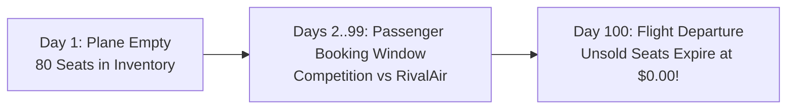
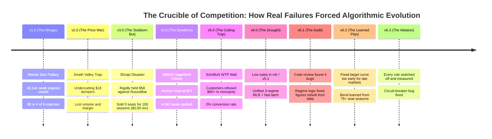
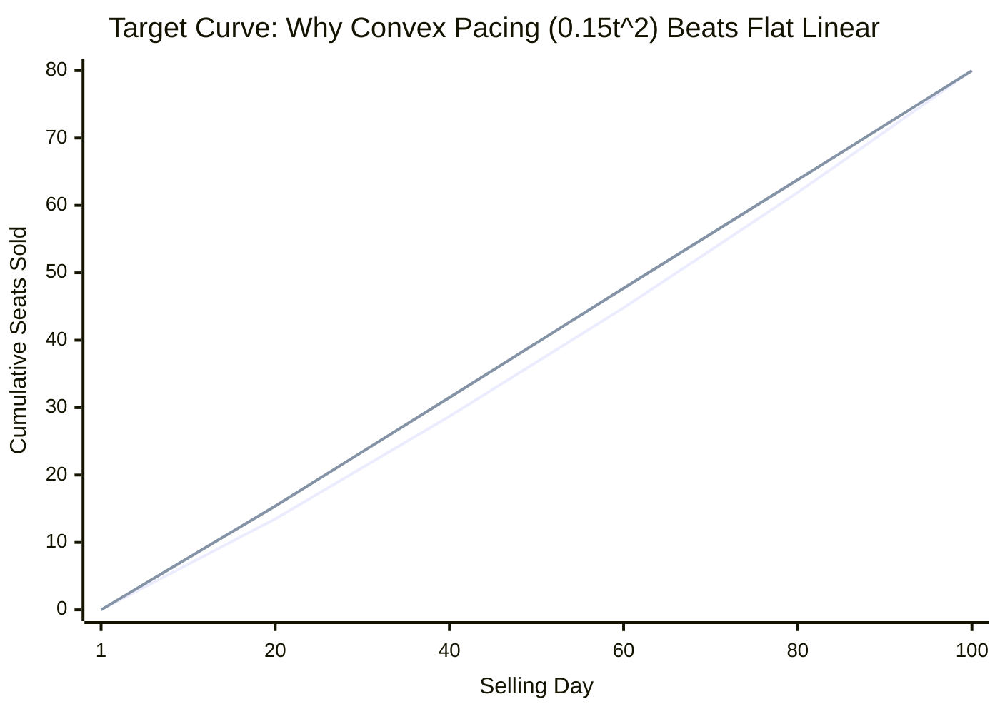
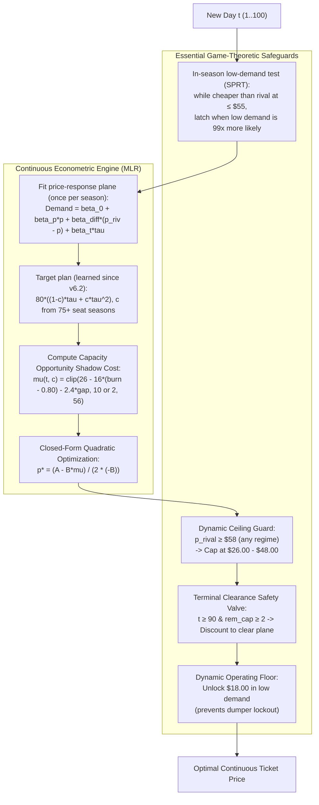

# The Flight for Maximum Revenue: The Evolution of Our Dynamic Pricing Strategy
### Berliner Hochschule für Technik (BHT) — Learning Optimization (October 2026)
**Author:** Ramez Chreide  
**Course:** Learning Optimization — Duopoly Pricing Challenge (DPC)  
**Codebase:** [`duopoly.py`](duopoly.py) (v6.3 MLR Engine) & [`analytics/app.py`](analytics/app.py) (Streamlit Simulation Studio)


---

## Executive Summary: The Journey from Naive Hope to Mathematical Precision

Every airline pricing agent begins with a simple dream: *"What if we just hold our prices high and force the opponent to sell out, leaving us with a pure, uncontested monopoly?"*

In real competitive markets, this naive dream led to **catastrophic bankruptcies**: planes flying with 70 empty seats, $\$0.00$ revenue seasons, and competitors that never ran out of stock. 

This presentation tells the story of our journey across 6 major generations of algorithmic evolution, over 377,000 empirical competition periods, and against ruthless real-world competitor archetypes. It explains how painful failures led us to develop our two core mathematical pillars:
1. **The Continuous Target Depletion & Booking Pacing Curves** (pacing perishable capacity smoothly across 100 days).
2. **Unified Econometric Multiple Linear Regression (MLR)** (replacing fragile heuristic step-ladders with first-principles continuous marginal revenue optimization across 3 macroeconomic regimes).

---

# Act 1: The Innocent Beginning & The Myth of "Forcing a Monopoly"

### The Stage: The Berlin-to-New York Route
- Two airlines (**SkyBlue** [us] and **RivalAir** [opponent]) each operate an identical **80-seat aircraft**.
- Tickets go on sale **100 days before takeoff** ($t = 1 \dots 100$).
- **The Golden Rule of Aviation:** Unsold seats at departure time $T=100$ expire with **$\$0.00$ salvage value**. You cannot sell yesterday's empty flight.
- **Goal:** Maximize cumulative revenue ($\sum \text{price} \times \text{demand}$) across 100 consecutive seasons.



### Our Original Naive Hypothesis (v1.0):
> *"Why fight in the mud? Let's price high at \$85 early on, and \$105 late. The competitor will price cheap, sell all their 80 seats, and leave the market. Once they sell out, we will have a pure monopoly to sell our 80 seats at \$105 each (80 × \$105 = \$8,400 per flight)!"*

It sounded brilliant on paper. In our first tournament, it proved to be an **absolute disaster**.

---

# Act 2: The Hall of Post-Mortem Failures (What Didn't Work and Why)

Every upgrade in [`ALGORITHM_CHANGES.md`](ALGORITHM_CHANGES.md) was born directly from a real-world tournament tragedy.



### Failure 1: The Market Size Fallacy (v1.0 $\to$ 43,141 Spoiled Seats)
* **What Happened:** We assumed the passenger pool had $200+$ travelers. In reality, total seasonal arrivals averaged only **$75–105$ passengers across the entire market**!
* **The Fatal Flaw:** Combined airline capacity was $80 + 80 = 160$ seats. Because total market demand was smaller than 160, the competitor **never sold out**! 
* **The Result:** RivalAir sold 75 seats at $\$50$ ($\$3,750$). SkyBlue sold 5 seats at $\$85$ ($\$425$). **75 of our seats expired at $\$0.00$**. In 4 out of 6 tournaments, our algorithm finished with $\$0.00$ revenue.

### Failure 2: The "Death Valley" Trap (v2.0 vs. `FuturisticSalamander`)
* **What Happened:** An irrational rival dumped tickets at **$\$18.40$**. We panicked and tried to compete by undercutting to $\$28–\$35$.
* **The Fatal Flaw:** At $\$28$, we were still more expensive than their $\$18$, so they still captured all the bargain hunters. But the few tickets we did sell were at dirt-cheap prices. We lost both margin and volume ($\approx \$980$/season).

### Failure 3: The Passive Holdout Blowout (v3.0 $\to$ The `35zapi` $\$0.00$ Catastrophe)
* **What Happened:** We designed a "Holdout Rule": when a rival prices $\le \$20$, hold firm at $\$58.00$ until they sell out. Against fast dumpers, this worked. But in tournament `35zapi`, competitor `RussetBat` priced at $\$12$, and total customer arrival volume was abnormally slow.
* **The Fatal Flaw:** `RussetBat` sold out in only 72 of 100 seasons, and late: **day 98 at the median**. By the time we were the only seller, about 5 days remained on average, and at $\$64$ nobody bought in those days either. In the other 28 seasons the rival never sold out.
* **The Horror Result:** **0 seats sold across 100 seasons (\$0.00 total revenue)**! The bot stubbornly waited for a monopoly that arrived too late.

### Failure 4: The Dumper Deadlock (v4.0 $\to$ `3d8tDh` 4,342 Spoiled Seats)
* **What Happened:** Against `SageSloth` (median price $\$25.80$), our algorithm classified them as a dumper, snapped our anchor price to $\$35.00$, and undercut down to the $\$27.00$ floor.
* **The Fatal Flaw:** `SageSloth` only sold $\sim 0.65$ seats/day and never reached 80 sales. Because our bot had no circuit breaker, it remained frozen at $\$27.00$ for all 100 seasons, spoiling **4,342 seats** (74.6% of all round 4 spoilage).

### Failure 5: The Willingness-to-Pay Ceiling Wall (`data/v5` & `3UmBuN`)
* **What Happened:** In Tournament 5, the simulator generated a market where customer reservation prices strictly capped at **$\$78.00$**.
* **The Fatal Flaw:** When the rival sold out, our monopoly engine posted its standard high-tier monopoly fares ($\$84, \$92$).
* **The Result:** Passengers refused to buy. Over 245 monopoly periods, quoting $\ge \$80.00$ produced **0.0% conversion (100% zero demand)**, turning an uncontested monopoly into a self-inflicted disaster.

### Failure 6: The Low-Demand Macroeconomic Drought (`data/mlr` & `WB9uo7`)
* **What Happened:** In `data/mlr`, `data/v5.1` and `data/poisson_logit` our sales fell to 28–47 seats per season. In `WB9uo7`, the rival `RadiantMussel` priced around \$18.80, below our \$25 floor, and we sold **0 seats in 100 seasons**.
* **The Fatal Flaw:** Our floor stopped us from contesting a rival priced below it, and we only adapted after whole seasons. (We only see our own sales, so we can't tell how much of this was low demand and how much was being undercut.)
* **The Solution:** An \$18 floor once low demand is detected, an in-season statistical test for low demand, and a ceiling guard for the opposite case (rivals at \$58+).

---

# Act 3: The Great Awakening — What Worked & What We Changed

To survive, we stopped relying on wishful thinking and built three foundational mathematical control concepts:

```text
       OLD MISTAKE (v1 - v4)                          NEW SOLUTION (v5 - v6.3)
  "Always wait for a monopoly"        ──►      "Continuously pace capacity against the Target Curve"
  "Rigid $58 holdout forever"         ──►      "Holdout with a safe deadline + in-season low-demand test"
  "Freeze when rival prices low"      ──►      "Dynamic floor ($18 vs $25) & volume breakers"
  "Follow expensive rivals up"        ──►      "Dynamic Ceiling Guard capping price at $26–$48"
  "One fixed plan for every market"   ──►      "Plan learned from each market's booking curves"
```

---

## 1. The Target Curve: The Optimal Benchmark Depletion Pace

Why can't an airline just sell at a flat rate of $0.80$ seats per day ($80 \text{ seats} / 100 \text{ days}$)?
Because **customers do not arrive at a flat rate**: far more of them show up in the last weeks. In our own tournament data (`v3` + `v4`), the seats we sold per day roughly doubled from about 0.4 on day 1 to about 0.9 around day 85.

If you force a flat 0.80 seats/day from the start, you must price low early on and have fewer seats left for the busy final weeks. (Note: the data show *more* buyers late, not buyers who pay much more; over 99% of `v5` sales were at \$55 or less.)



### The Target Curve Formula:
We model target cumulative sales using normalized progress $\tau = \frac{t - 1}{99} \in [0, 1]$:
$$\text{Target Cumulative Sold}(\tau) = 80 \times \left(0.85\tau + 0.15\tau^2\right)$$

- **The Linear Term ($0.85\tau$):** Establishes steady base pace.
- **The Quadratic Term ($0.15\tau^2$):** Holds back up to 3 seats compared with a linear pace (most at mid-season) for the late arrival surge. The value 0.15 was chosen by hand, not fitted.

### v6.2: learning the plan from the market
The tournament data showed that one fixed bend does not fit every market. Written with a bend $c$, the plan is $80 \times ((1-c)\tau + c\tau^2)$. In `data/v5`, `3UmBuN` booked almost in a straight line ($c \approx 0.01$), while `Gq2CUL` booked late ($c \approx 0.82$): by day 50 it had sold only 24 seats on average against the plan's 37, yet still sold out. Being "behind" the fixed plan made us discount for nothing.

v6.2 therefore learns $c$ per match:
1. After every season with **75+ seats sold** (high capacity utilization), fit that season's bend to its booking curve.
2. Average these bends with the starting value 0.15, which counts like 3 seasons: $c = (3 \cdot 0.15 + \sum c_i)/(3 + n)$, kept between 0 and 0.8. (v6.2 started from a different value per demand regime; v6.3 removed that because it added nothing measurable and depended on old data.)
3. Until the first such season, keep 0.15.

In simulation this earns **+1.95%** more than v6.1 (better in 10 of 10 seeds) at the same capacity utilization.


---

## 2. Target Curve vs. Booking Curve vs. Capacity Utilization

In revenue management, confusing what you *plan* with what you *achieve* is fatal:

1. **Target Curve (The Planned Depletion Benchmark):**
   The theoretical optimal cumulative trajectory $\text{TargetSold}(t) = 80 \cdot (0.85\tau + 0.15\tau^2)$. This is the goal line.
2. **Booking Curve (Realized Cumulative Bookings):**
   The actual count of tickets sold up to day $t$: $\text{RealizedSold}(t) = \sum_{s=1}^{t-1} \text{Demand}(s)$.
3. **Capacity Utilization Curve (Load Factor Trajectory):**
   The real-time percentage of aircraft capacity utilized: $\text{Utilization}(t) = \frac{\text{RealizedSold}(t)}{80}$, with remaining seats $c(t) = 80 - \text{RealizedSold}(t)$.

---

## 3. The Inventory Gap: The Feedback Control Signal

At every single period $t \in [1, 100]$, we measure our **Inventory Gap**:
$$\text{Target Remaining Capacity}(t) = 80 - \text{Target Cumulative Sold}(t)$$
$$\text{Inventory Gap}(t) = \text{Actual Remaining Seats}(t) - \text{Target Remaining Capacity}(t)$$

```text
              INVENTORY GAP > 0                             INVENTORY GAP < 0
               (Behind Pace)                                  (Ahead of Pace)
  Actual remaining > Planned remaining           Actual remaining < Planned remaining
         (Excess unsold stock)                          (Inventory is scarce!)
                   ▼                                              ▼
       Shadow cost mu drops                           Shadow cost mu escalates
       Formula discounts price                        Formula adds scarcity margin
```

- **If $\text{Inventory Gap} > 0$:** We have more unsold seats than planned. The capacity shadow cost $\mu(t, c)$ drops automatically, lowering optimal price $p^*$ to accelerate booking pace.
- **If $\text{Inventory Gap} < 0$:** We have fewer seats left than planned. The capacity shadow cost $\mu(t, c)$ escalates, prompting higher prices to protect yield.

---

# Act 4: The Climax — Unified Econometric Dynamic Pricing (v6.0 → v6.3)

### Why Master Wasn't Enough & Why Poisson-Logit Was Retired
Our previous bot was stuck between two extremes:
1. **The Heuristic Rule Forest:** Arbitrary step-ladders (e.g., if burn rate $\le 0.35 \implies \$92$; if $> 1.25 \implies \$52$) created artificial price cliffs and could not adapt dynamically to demand shocks.
2. **Poisson-Logit Instability:** The experimental Poisson discrete-choice formulation suffered from numerical sigmoid saturation when price spreads widened, and its iterative grid search failed to scale within runtime constraints. (These two reasons were not re-tested later; a direct comparison of MLR with a Poisson regression on our data is in ALGORITHM_CHANGES §17.5.)

The breakthrough is our **Unified v6.0 Econometric Engine** in [`duopoly.py`](duopoly.py):
- **Closed-Form Quadratic Revenue Optimization:** Computes the price that maximizes $(p - \mu)\cdot\hat d(p)$ under the fitted linear demand model in one step, $p^* = \frac{A - B \cdot \mu(t, c)}{2(-B)}$, then keeps it within a band around the rival.
- **Pruned the Rule Forest:** Eliminated arbitrary step-ladders, rigid undercutting tables, and micro-probing pulses.
- **Retained Essential Guards:** Kept in-season low-demand detection, the high-rival dynamic ceiling guard, terminal clearance at $t \ge 90$, and dynamic floors (\$18 vs \$25).

### v6.1: the audit
A code review of v6.0 found that its regime logic collapsed to "always low demand" from mid-season 1 onward:
1. A phantom 0-seat season was recorded at the start of every season, permanently latching low demand.
2. The in-season latch ("4 zero-sale days while cheaper") fired in 44% of good seasons, because 4 empty days are normal early on. It was replaced by a statistical test (SPRT) with 4% false alarms on past data.
3. The monopoly price was stuck at its floor (\$50) because of a sign error. It now falls smoothly with the burn rate inside a regime band.
4. The regression's features were linearly dependent (`p_riv − p` next to `p` and `p_riv`). Only the identified slopes are used now.

The simulator also ignored its arrival setting, so the "low-demand" benchmark actually had the most customers. With everything fixed, v6.1 matches v6.0 in average and high demand (+0.3% / −0.8%) and earns 9% more in low demand; see the scorecard below.



### v6.3: switching every part off
To see which rules earn their place, we switched each part of the algorithm off, one at a time and together, across 17 scenarios and 10 seeds (`analytics/ablation_study.py`):
- Two parts are essential: the ceiling against expensive rivals (−13.5% without it) and the learned target curve (−1.8%).
- Most guards are each worth only 0.2–0.6%, but removed together they cost far more, so they stay.
- Four guards are trade-offs: the simulator earns a bit more without them, but loses up to 23% in a low-demand market, our worst real-tournament situation.
- The study found a bug: after two weak seasons, the circuit breaker priced just below a rival that was more expensive than customers would pay, so we sold almost nothing (\$201 per season). Fixed in v6.3: **+2.09%** total, better in 10 of 10 seeds.


---

## The Mathematics of Unified MLR in Plain English

### 1. Estimating Customer Choice (The Demand Plane)
Our regression model (refit once per season on the current competition) uses 3 forces:
$$\hat{d}(p) = \beta_0 + \beta_p \cdot p + \beta_{\Delta} \cdot (p_{\text{rival}} - p) + \beta_t \cdot \tau$$

(v6.0 also included $p_{\text{rival}}$ on its own, but then the three price terms are linearly dependent and the individual coefficients can't be estimated.)

- **Own price ($B = \beta_p - \beta_{\Delta} < 0$):** As our price rises, demand drops. The code requires $B \le -0.006$.
- **Rival price ($C = \beta_{\Delta} \ge 0$):** As the rival gets more expensive, passengers switch to us.
- **Time Trend ($\beta_t > 0$):** Arrival velocity accelerates as departure approaches.

### 2. The Capacity Opportunity Shadow Cost ($\mu$)
In airline economics, **the cost of a seat is not what you paid to build it; it is what you give up by selling it today instead of tomorrow**:

$$\mu(t, c) = \operatorname{clip}\left(26 - 16 \cdot (\text{burn\_rate} - 0.80) - 2.4 \cdot \text{inventory\_gap}, \; \mu_{\min}, \; 56\right), \quad \mu_{\min} = \$10 \; (\$2 \text{ under low WTP})$$

- **Scarcity State (Few seats, lots of days):** $\mu$ rises toward \$56, pushing the price up.
- **Surplus State (Many seats, few days):** $\mu$ drops to its floor. Unsold seats expire at \$0, so the algorithm discounts to reduce spoilage.

### 3. The Closed-Form Optimization Formula
Net Surplus Revenue is quadratic:
$$\Pi(p) = (p - \mu) \cdot \hat{d}(p) = (p - \mu) \cdot (A + B \cdot p)$$
where $B = \beta_p - \beta_{\Delta} < 0$ and $A = \beta_0 + \beta_{\Delta} \cdot p_{\text{rival}} + \beta_t \tau$.

Because $B < 0$ the objective is concave, so setting $\frac{d\Pi}{dp} = 0$ gives its maximum in one step:

$$p^* = \frac{A - B \cdot \mu(t, c)}{2(-B)}$$

This is the optimum **of the model**, and the model is rough (test $R^2 \approx 0.15$). So the code keeps $p^*$ in a band around the rival's price from yesterday (from \$1.20 below when on pace up to \$7.50–\$8.50 below when far behind, and at most \$12 above), and in simulation that band changes the price on about 60% of days.

---

## The 3 Demand Regimes (377,570 duopoly periods, 7 data files)

The regime is re-evaluated at the end of every season (v6.1; v6.0 latched it permanently):

| Regime | Detected when | Price floor | Monopoly band | Regression prior fitted on |
| :--- | :--- | :---: | :---: | :--- |
| **Low demand** | last season < 42 seats, or the in-season test fires | \$18 | \$28–\$44 | `data/mlr`, `v5.1`, `poisson_logit` |
| **Average demand** | default | \$25 | \$48–\$72 | `data/v3`, `v4` |
| **High demand** | last 2 seasons ≥ 72 seats on average, no sales at ≥ \$55 | \$25 | \$50–\$66 | `data/v1` |

The priors are only used for roughly the first season; after that the model is refit on the current competition.

---

# Act 5: The Empirical Scorecard & Streamlit Simulation Studio

### 1. Multi-seed simulation benchmark

`python analytics/benchmark_3regime_models.py` (3 simulated markets × 4 rivals × 5 seeds × 30 seasons; mean revenue per season, summed over rivals):

| Simulated market | v6.3 | v6.2 | v6.1 (with A2) | v6.0 | Naive "rival − \$1" |
| :--- | :---: | :---: | :---: | :---: | :---: |
| Low (~68 arrivals, WTP \$20–\$48) | **\$4,059** | \$3,324 | \$3,328 | \$3,035 | \$1,425 |
| Average (~95 arrivals, WTP \$35–\$92) | \$8,164 | **\$8,192** | \$7,840 | \$7,787 | \$5,286 |
| High (~135 arrivals, WTP \$25–\$78) | \$10,045 | **\$10,055** | \$9,758 | \$9,838 | \$5,547 |

*Earlier drafts listed 88.9%–97.8% win rates and "+3,289% vs a \$72 rival". No script in the repository reproduces those numbers, so they have been withdrawn.*

---

### 2. The Interactive Streamlit Day-by-Day Simulation Studio

To inspect our algorithm in action, we built an interactive Day-by-Day Simulation Studio in [`analytics/app.py`](analytics/app.py):

```bash
streamlit run analytics/app.py
```

- **Day-by-Day Playback:** Step through any season one day at a time with `⏮`, `◀`, slider, and `▶` buttons, or activate **Auto-Play** with 3, 4, or 5-second pauses between days.
- **Real-Time Dual-Metric Tracking:**
  - Our price vs. rival's price for each period.
  - Number of seats sold by both players in each day.
  - Realized capacity depletion against the planned convex **Target Curve**.
  - Current selling season and macroeconomic regime diagnosis.

---

# Presentation Playbook: Slide-by-Slide Script for Non-Technical Audiences

Use this exact 5-slide script if presenting to a general audience, investors, or professors:

### Slide 1: The Perishable Seat Dilemma
- **Visual:** Image of an airplane with empty seats labeled **"Value = \$0.00"**.
- **The Hook:** *"Imagine running a grocery store where every unsold item disappears at midnight with zero refund. That is the airline business. You have 80 seats, 100 days, and a competitor across the hallway. If you price too high, your plane takes off empty. If you price too low, you sell out in two weeks and leave thousands of dollars on the table."*

### Slide 2: The Hall of Failures (Street Smarts Matter)
- **Visual:** Display the post-mortem timeline (Failures 1 to 6).
- **The Story:** *"Our first bot was too naive: it tried to force a monopoly by holding high prices. But real competitors dumped prices at \$18, or arrival demand was too small, causing us to sell zero tickets for entire seasons. We realized that pure math without street-smart defense leads to commercial ruin."*

### Slide 3: The Unified Engine (Calculus Meets Common Sense)
- **Visual:** `imgs/mlr_strategy_explained.png` (revenue hill, shadow cost, monopoly band) next to the safeguards.
- **The Concept:** *"Instead of step-ladders or a black-box neural network, our algorithm uses calculus on a demand model it refits every season: $p^* = \frac{A - B\mu}{2(-B)}$. Because that model is rough, safeguards keep the price sensible against dumpers and overpriced rivals."*

### Slide 4: Target Curve vs. Booking Curve (Pacing the Flight)
- **Visual:** Display **Panel 2 from `imgs/dpc_strategy_visualization.png`** (Target Curve vs Realized Booking Curve).
- **The Breakthrough:** *"We distinguish between the Target Curve (the planned selling pace, slightly back-loaded for the late arrival surge) and the Booking Curve (actual sales). The gap between them moves the shadow value of a seat between its floor and \$56, which pushes prices down when we're behind and up when we're ahead."*

### Slide 5: The Scorecard & Live Day-by-Day Simulation
- **Visual:** The multi-seed scorecard above, the ablation chart (`imgs/ablation_study.png`), and a screenshot of the **Streamlit Day-by-Day Simulation Studio**.
- **Closing Punchline:** *"Every rule came from a real tournament failure, and every figure can be regenerated from 377,570 periods of tournament data or from the code itself. In the Streamlit studio you can watch each pricing decision day by day."*

---

### Quick-Reference Q&A Cheat Sheet

| Question | Simple 1-Sentence Answer |
| :--- | :--- |
| **"Why not just undercut the rival by \$1 every day?"** | *In our simulations that earns 35–65% less overall. It does about as well against a cheap dumper, which is why we follow cheap rivals too.* |
| **"What is the difference between the Target Curve and the Booking Curve?"** | *The Target Curve is the planned, slightly back-loaded selling pace; the Booking Curve is the actual empirical sales trajectory.* |
| **"Is the target curve still fixed?"** | *No: since v6.2 its bend is learned from the booking curves of this match's seasons with 75+ seats sold, starting from 0.15 in every market.* |
| **"What happens if market demand is unexpectedly low?"** | *A statistical test runs during the season; once low demand is 99× more likely than normal (about 4% false alarms on past data), we unlock an \$18 floor and lower monopoly prices.* |
| **"Why linear regression and not a Poisson model?"** | *We tested both on each competition's own data: with ~25 seasons they are about equally accurate, but after one season (the first refit) the Poisson model's predictions explode, while the linear model stays stable and gives the price in one formula.* |
| **"Do you need all those rules?"** | *We switched each one off and measured: two are essential, most are each worth under 1% but protect each other, and the test found one bug, fixed in v6.3 (+2.1%).* |
