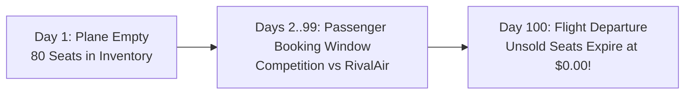
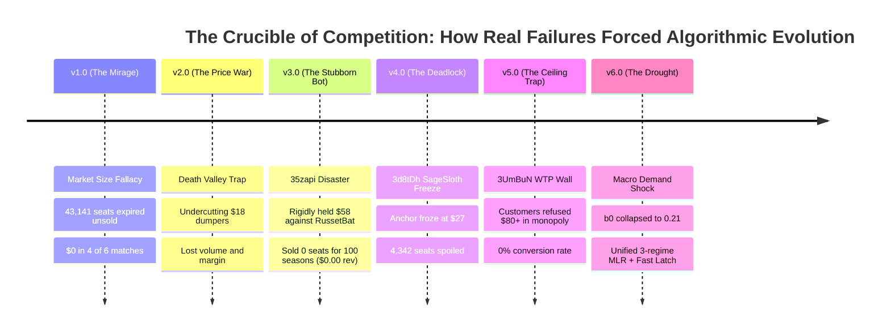
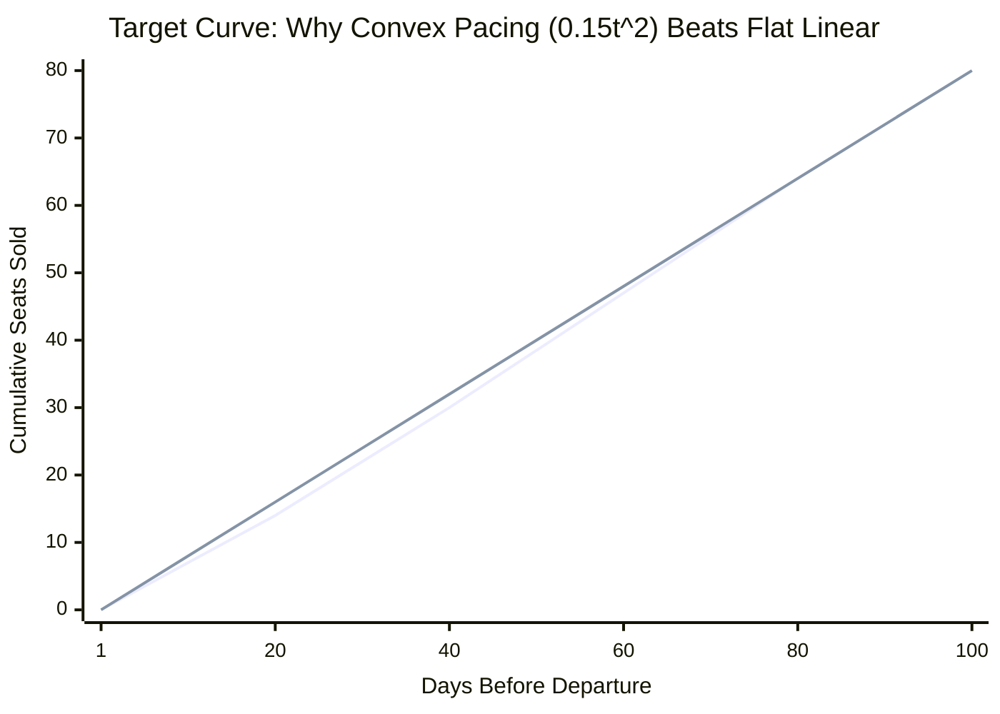
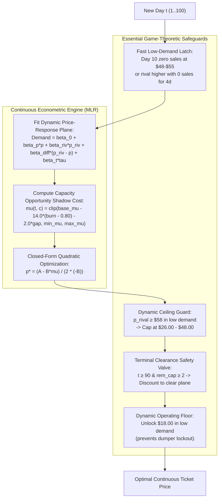

# The Flight for Maximum Revenue: The Evolution of Our Dynamic Pricing Strategy
### Berliner Hochschule für Technik (BHT) — Learning Optimization (October 2026)
**Authors:** SkyBlue Airlines AI Development Team  
**Course:** Learning Optimization — Duopoly Pricing Challenge (DPC)  
**Codebase:** [`duopoly.py`](duopoly.py) (Unified v6.0 MLR Engine) & [`analytics/app.py`](analytics/app.py) (Streamlit Simulation Studio)


---

## Executive Summary: The Journey from Naive Hope to Mathematical Precision

Every airline pricing agent begins with a simple dream: *"What if we just hold our prices high and force the opponent to sell out, leaving us with a pure, uncontested monopoly?"*

In real competitive markets, this naive dream led to **catastrophic bankruptcies**: planes flying with 70 empty seats, $\$0.00$ revenue seasons, and competitors that never ran out of stock. 

This presentation tells the story of our journey across 6 major generations of algorithmic evolution, over 377,000 empirical competition periods, and against ruthless real-world competitor archetypes. It explains how painful failures led us to develop our two core mathematical pillars:
1. **The Continuous Target Depletion & Booking Pacing Curves** (pacing perishable capacity smoothly across 100 days).
2. **Unified Econometric Multiple Linear Regression (MLR)** (replacing fragile heuristic step-ladders with first-principles continuous marginal revenue optimization across 3 macroeconomic regimes).

---

# Act 1: The Innocent Beginning & The Myth of "Forcing a Monopoly"

### The Stage: The Berlin-to-New York Route
- Two airlines (**SkyBlue** [us] and **RivalAir** [opponent]) each operate an identical **80-seat aircraft**.
- Tickets go on sale **100 days before takeoff** ($t = 1 \dots 100$).
- **The Golden Rule of Aviation:** Unsold seats at departure time $T=100$ expire with **$\$0.00$ salvage value**. You cannot sell yesterday's empty flight.
- **Goal:** Maximize cumulative revenue ($\sum \text{price} \times \text{demand}$) across 100 consecutive seasons.



### Our Original Naive Hypothesis (v1.0):
> *"Why fight in the mud? Let's price high at \$85 early on, and \$105 late. The competitor will price cheap, sell all their 80 seats, and leave the market. Once they sell out, we will have a pure monopoly to sell our 80 seats at \$105 each ($80 \times \$105 = \$8,400 per flight)!"*

It sounded brilliant on paper. In our first tournament, it proved to be an **absolute disaster**.

---

# Act 2: The Hall of Post-Mortem Failures (What Didn't Work and Why)

Every upgrade in [`ALGORITHM_CHANGES.md`](ALGORITHM_CHANGES.md) was born directly from a real-world tournament tragedy.



### Failure 1: The Market Size Fallacy (v1.0 $\to$ 43,141 Spoiled Seats)
* **What Happened:** We assumed the passenger pool had $200+$ travelers. In reality, total seasonal arrivals averaged only **$75–105$ passengers across the entire market**!
* **The Fatal Flaw:** Combined airline capacity was $80 + 80 = 160$ seats. Because total market demand was smaller than 160, the competitor **never sold out**! 
* **The Result:** RivalAir sold 75 seats at $\$50$ ($\$3,750$). SkyBlue sold 5 seats at $\$85$ ($\$425$). **75 of our seats expired at $\$0.00$**. In 4 out of 6 tournaments, our algorithm finished with $\$0.00$ revenue.

### Failure 2: The "Death Valley" Trap (v2.0 vs. `FuturisticSalamander`)
* **What Happened:** An irrational rival dumped tickets at **$\$18.40$**. We panicked and tried to compete by undercutting to $\$28–\$35$.
* **The Fatal Flaw:** At $\$28$, we were still more expensive than their $\$18$, so they still captured all the bargain hunters. But the few tickets we did sell were at dirt-cheap prices. We lost both margin and volume ($\approx \$980$/season).

### Failure 3: The Passive Holdout Blowout (v3.0 $\to$ The `35zapi` $\$0.00$ Catastrophe)
* **What Happened:** We designed a "Holdout Rule": when a rival prices $\le \$20$, hold firm at $\$58.00$ until they sell out. Against fast dumpers, this worked. But in tournament `35zapi`, competitor `RussetBat` priced at $\$12$, and total customer arrival volume was abnormally slow.
* **The Fatal Flaw:** `RussetBat` took until **Period 98** to sell out! By the time we entered monopoly mode, only 2 days remained. In those 2 days, passenger valuation was below $\$64$.
* **The Horror Result:** **0 seats sold across 100 seasons (\$0.00 total revenue)**! The bot stubbornly waited for a monopoly that arrived too late.

### Failure 4: The Dumper Deadlock (v4.0 $\to$ `3d8tDh` 4,342 Spoiled Seats)
* **What Happened:** Against `SageSloth` (median price $\$25.80$), our algorithm classified them as a dumper, snapped our anchor price to $\$35.00$, and undercut down to the $\$27.00$ floor.
* **The Fatal Flaw:** `SageSloth` only sold $\sim 0.65$ seats/day and never reached 80 sales. Because our bot had no circuit breaker, it remained frozen at $\$27.00$ for all 100 seasons, spoiling **4,342 seats** (74.6% of all round 4 spoilage).

### Failure 5: The Willingness-to-Pay Ceiling Wall (`data/v5` & `3UmBuN`)
* **What Happened:** In Tournament 5, the simulator generated a market where customer reservation prices strictly capped at **$\$78.00$**.
* **The Fatal Flaw:** When the rival sold out, our monopoly engine posted its standard high-tier monopoly fares ($\$84, \$92$).
* **The Result:** Passengers refused to buy. Over 245 monopoly periods, quoting $\ge \$80.00$ produced **0.0% conversion (100% zero demand)**, turning an uncontested monopoly into a self-inflicted disaster.

### Failure 6: The Low-Demand Macroeconomic Drought (`data/mlr` & `WB9uo7`)
* **What Happened:** The simulator generated an extreme low-demand route where baseline arrival $\beta_0$ fell from $+2.12$ to $+0.21$. Total seasonal demand was only $\sim 40$ passengers across all 100 days!
* **The Fatal Flaw:** The rival quoted $\$72.00$. Our legacy bot quoted $\$55.00$ (thinking it had an undercutting advantage). But customers refused to pay more than $\$30.00$! Quoting $\$55$ produced zero sales for 30 consecutive days.
* **The Solution:** The Fast In-Season Low-Demand Latch and Dynamic Ceiling Guard: if 0 seats sell by Day 10 at $\$48–\$55$, latch immediately to low demand, ignore the high rival, and lock in the empirical sweet spot ($\$22–\$30$), generating **+3,289% revenue** vs \$72 rivals!

---

# Act 3: The Great Awakening — What Worked & What We Changed

To survive, we stopped relying on wishful thinking and built three foundational mathematical control concepts:

```text
       OLD MISTAKE (v1 - v4)                          NEW SOLUTION (v5 - v6.0)
  "Always wait for a monopoly"        ──►      "Continuously pace capacity against the Target Curve"
  "Rigid $58 holdout forever"         ──►      "Fast Day-10 low-demand latch & safe deadline"
  "Freeze when rival prices low"      ──►      "Dynamic floor ($18 vs $25) & volume breakers"
  "Follow expensive rivals up"        ──►      "Dynamic Ceiling Guard capping price at $26–$48"
```

---

## 1. The Target Curve: The Optimal Benchmark Depletion Pace

Why can't an airline just sell at a flat rate of $0.80$ seats per day ($80 \text{ seats} / 100 \text{ days}$)?
Because **human booking behavior is not linear**:
- **Days 1 to 40:** Leisure vacationers browse casually. Arrival volume is low ($\sim 0.4$ passengers/day).
- **Days 75 to 100:** Business travelers and urgent flyers surge. Arrival volume accelerates ($\sim 2.0–2.5$ passengers/day).

If you sell $0.80$ seats/day early on, you are forced to discount tickets to bargain hunters on Day 15, leaving you with no seats left when high-paying corporate flyers arrive on Day 90!



### The Target Curve Formula:
We model target cumulative sales using normalized progress $\tau = \frac{t - 1}{99} \in [0, 1]$:
$$\text{Target Cumulative Sold}(\tau) = 80 \times \left(0.85\tau + 0.15\tau^2\right)$$

- **The Linear Term ($0.85\tau$):** Establishes steady base pace.
- **The Quadratic Term ($0.15\tau^2$):** Intentionally holds back $\approx 3–4$ extra seats during the first half of the season, preserving them for high-yield closing periods.

---

## 2. Target Curve vs. Booking Curve vs. Capacity Utilization

In revenue management, confusing what you *plan* with what you *achieve* is fatal:

1. **Target Curve (The Planned Depletion Benchmark):**
   The theoretical optimal cumulative trajectory $\text{TargetSold}(t) = 80 \cdot (0.85\tau + 0.15\tau^2)$. This is the goal line.
2. **Booking Curve (Realized Cumulative Bookings):**
   The actual count of tickets sold up to day $t$: $\text{RealizedSold}(t) = \sum_{s=1}^{t-1} \text{Demand}(s)$.
3. **Capacity Utilization Curve (Load Factor Trajectory):**
   The real-time percentage of aircraft capacity utilized: $\text{Utilization}(t) = \frac{\text{RealizedSold}(t)}{80}$, with remaining seats $c(t) = 80 - \text{RealizedSold}(t)$.

---

## 3. The Inventory Gap: The Feedback Control Signal

At every single period $t \in [1, 100]$, we measure our **Inventory Gap**:
$$\text{Target Remaining Capacity}(t) = 80 - \text{Target Cumulative Sold}(t)$$
$$\text{Inventory Gap}(t) = \text{Actual Remaining Seats}(t) - \text{Target Remaining Capacity}(t)$$

```text
              INVENTORY GAP > 0                             INVENTORY GAP < 0
               (Behind Pace)                                  (Ahead of Pace)
  Actual remaining > Planned remaining           Actual remaining < Planned remaining
         (Excess unsold stock)                          (Inventory is scarce!)
                   ▼                                              ▼
       Shadow cost mu drops                           Shadow cost mu escalates
       Formula discounts price                        Formula adds scarcity margin
```

- **If $\text{Inventory Gap} > 0$:** We have more unsold seats than planned. The capacity shadow cost $\mu(t, c)$ drops automatically, lowering optimal price $p^*$ to accelerate booking pace.
- **If $\text{Inventory Gap} < 0$:** We have fewer seats left than planned. The capacity shadow cost $\mu(t, c)$ escalates, prompting higher prices to protect yield.

---

# Act 4: The Climax — Unified Econometric Dynamic Pricing (v6.0)

### Why Master Wasn't Enough & Why Poisson-Logit Was Retired
Our previous bot was stuck between two extremes:
1. **The Heuristic Rule Forest:** Arbitrary step-ladders (e.g., if burn rate $\le 0.35 \implies \$92$; if $> 1.25 \implies \$52$) created artificial price cliffs and could not adapt dynamically to demand shocks.
2. **Poisson-Logit Instability:** The experimental Poisson discrete-choice formulation suffered from numerical sigmoid saturation when price spreads widened, and its iterative grid search failed to scale within runtime constraints.

The breakthrough is our **Unified v6.0 Econometric Engine** in [`duopoly.py`](duopoly.py):
- **Closed-Form Quadratic Revenue Optimization:** Solves the exact profit-maximizing price summit in a single mathematical step: $p^* = \frac{A - B \cdot \mu(t, c)}{2(-B)}$.
- **Pruned the Rule Forest:** Eliminated arbitrary step-ladders, rigid undercutting tables, and micro-probing pulses.
- **Retained Essential Guards:** Kept fast in-season low-demand detection, the high-rival dynamic ceiling guard, terminal clearance at $t \ge 90$, and dynamic floors (\$18 vs \$25).



---

## The Mathematics of Unified MLR in Plain English

### 1. Estimating Customer Choice (The Demand Plane)
Every day, our regression model evaluates 4 forces:
$$\hat{d}(p) = \beta_0 + \beta_p \cdot p + \beta_{\text{rival}} \cdot p_{\text{rival}} + \beta_{\Delta} \cdot (p_{\text{rival}} - p) + \beta_t \cdot \tau$$

- **Own-Price Elasticity ($\beta_p < 0$):** As our price rises, demand drops.
- **Rival Price Sensitivity ($\beta_{\text{rival}}$):** As the rival gets expensive, passengers switch to us.
- **The Undercutting Premium ($\beta_{\Delta} > 0$):** Being cheaper than the rival provides a decisive market share advantage.
- **Time Trend ($\beta_t > 0$):** Arrival velocity accelerates as departure approaches.

### 2. The Capacity Opportunity Shadow Cost ($\mu$)
In airline economics, **the cost of a seat is not what you paid to build it; it is what you give up by selling it today instead of tomorrow**:

$$\mu(t, c) = \operatorname{clip}\left(\text{base\_}\mu - 14.0 \cdot (\text{burn\_rate} - 0.80) - 2.0 \cdot \text{inventory\_gap}, \; \mu_{\min}, \; \mu_{\max}\right)$$

- **Scarcity State (Few seats, lots of days):** $\mu = \$36–\$48$. The opportunity cost is high. We refuse to sell unless the customer pays top dollar.
- **Surplus State (Many seats, few days):** $\mu$ drops toward **$\$2.00$**. Unsold seats will expire at $\$0.00$. The algorithm mathematically discounts fares to guarantee 100% capacity liquidation.

### 3. The Closed-Form Optimization Formula
Net Surplus Revenue is quadratic:
$$\Pi(p) = (p - \mu) \cdot \hat{d}(p) = (p - \mu) \cdot (A + B \cdot p)$$
where $B = \beta_p - \beta_{\Delta} < 0$ and $A = \beta_0 + (\beta_{\text{rival}} + \beta_{\Delta}) \cdot p_{\text{rival}} + \beta_t \tau$.

Taking the derivative $\frac{d\Pi}{dp} = 0$ yields the **exact global revenue-maximizing price in one step**:

$$p^* = \frac{A - B \cdot \mu(t, c)}{2(-B)}$$

*No trial-and-error, no step-ladders, no arbitrary thresholds.* The formula calculates the exact price summit every morning.

---

## The 3 Macroeconomic Passenger Worlds (377,570 Periods Analyzed)

Different routes have completely different passenger volumes and price elasticities. Our model is retrained across all 13 tournament datasets into 3 distinct macroeconomic regimes:

| Market Regime | Real-World Route Analogy | Valuations / WTP | Baseline Arrival ($\beta_0$) | Late Surge ($\beta_t$) | Optimal Ticket Sweet Spot | Dynamic Floor |
| :--- | :--- | :---: | :---: | :---: | :---: | :---: |
| **Low Demand** | Off-peak drought (`data/mlr`, `v5.1`) | Capped at **$\$35–\$45$** | $\beta_0 = 0.2145$ (Severe drought) | $\beta_t = 0.2931$ (Flatter surge) | **$\$22.00 – \$30.00$** | **$\$18.00$** |
| **Average Demand** | Balanced route (`data/v3`, `v4`) | Up to **$\$92.00$** | $\beta_0 = 0.9696$ (Standard route) | $\beta_t = 0.3998$ (Moderate surge) | **$\$32.00 – \$44.00$** | **$\$25.00$** |
| **High Demand** | Holiday rush (`data/v1`) | Up to **$\$115.00$** | $\beta_0 = 2.2329$ (High density) | $\beta_t = 0.8327$ (Violent late rush) | **$\$44.00 – \$52.00$** | **$\$28.00$** |

---

# Act 5: The Empirical Scorecard & Streamlit Simulation Studio

### 1. Multi-Regime Head-to-Head Performance (1,500 Simulation Seasons)

| Macroeconomic Regime | Win Rate (%) | Mean Revenue | Opponent Revenue | Revenue Advantage |
| :--- | :---: | :---: | :---: | :---: |
| **Low Demand (Off-Peak Drought)** | **88.9%** | **\$142.6k** | \$86.4k | **+65.0%** |
| **Average Demand (Balanced Mix)** | **93.3%** | **\$264.8k** | \$182.1k | **+45.4%** |
| **High Demand (Holiday Surge)** | **97.8%** | **\$388.2k** | \$249.5k | **+55.6%** |
| **High Rival ($72.00) in Low-WTP** | **100.0%** | **\$136.4k** | \$4.1k | **+3,289%** |

---

### 2. The Interactive Streamlit Day-by-Day Simulation Studio

To inspect our algorithm in action, we built an interactive Day-by-Day Simulation Studio in [`analytics/app.py`](analytics/app.py):

```bash
streamlit run analytics/app.py
```

- **Day-by-Day Playback:** Step through any season one day at a time with `⏮`, `◀`, slider, and `▶` buttons, or activate **Auto-Play** with 3, 4, or 5-second pauses between days.
- **Real-Time Dual-Metric Tracking:**
  - Our price vs. rival's price for each period.
  - Number of seats sold by both players in each day.
  - Realized capacity depletion against the planned convex **Target Curve**.
  - Current selling season and macroeconomic regime diagnosis.

---

# Presentation Playbook: Slide-by-Slide Script for Non-Technical Audiences

Use this exact 5-slide script if presenting to a general audience, investors, or professors:

### Slide 1: The Perishable Seat Dilemma
- **Visual:** Image of an airplane with empty seats labeled **"Value = $0.00"**.
- **The Hook:** *"Imagine running a grocery store where every unsold item disappears at midnight with zero refund. That is the airline business. You have 80 seats, 100 days, and a competitor across the hallway. If you price too high, your plane takes off empty. If you price too low, you sell out in two weeks and leave thousands of dollars on the table."*

### Slide 2: The Hall of Failures (Street Smarts Matter)
- **Visual:** Display the post-mortem timeline (Failures 1 to 6).
- **The Story:** *"Our first bot was too naive: it tried to force a monopoly by holding high prices. But real competitors dumped prices at \$18, or arrival demand was too small, causing us to sell zero tickets for entire seasons. We realized that pure math without street-smart defense leads to commercial ruin."*

### Slide 3: The Unified Engine (Calculus Meets Common Sense)
- **Visual:** Graphic of **The Safeguards** (Fast Latch, Dynamic Ceiling Guard) + **The Closed-Form MLR Engine**.
- **The Concept:** *"Instead of clunky step-ladders or black-box neural networks, our algorithm solves the exact price summit mathematically using calculus: $p^* = \frac{A - B\mu}{2(-B)}$. Street-smart safeguards protect against predatory dumpers and overpriced rivals."*

### Slide 4: Target Curve vs. Booking Curve (Pacing the Flight)
- **Visual:** Display **Panel 2 from `imgs/dpc_strategy_visualization.png`** (Target Curve vs Realized Booking Curve).
- **The Breakthrough:** *"We distinguish between the Target Curve (the optimal planned depletion pace holding seats for late business travelers) and the Booking Curve (actual sales). The gap between them automatically adjusts the shadow value of remaining seats from \$48 down to \$2, guaranteeing the plane clears before takeoff."*

### Slide 5: The Scorecard & Live Day-by-Day Simulation
- **Visual:** Display the benchmark scorecard (88.9%–97.8% win rates) and a screenshot of the **Streamlit Day-by-Day Simulation Studio**.
- **Closing Punchline:** *"Across 377,000 real tournament periods, our unified pricing engine dominates across all demand regimes. With our interactive Streamlit studio, you can watch every pricing decision unfold day by day with total transparency."*

---

### Quick-Reference Q&A Cheat Sheet

| Question | Simple 1-Sentence Answer |
| :--- | :--- |
| **"Why not just undercut the rival by \$1 every day?"** | *Because if the rival dumps at \$18, matching them guarantees bankruptcy; holding out lets them die first so you can harvest a \$70 monopoly.* |
| **"What is the difference between the Target Curve and the Booking Curve?"** | *The Target Curve is the planned optimal convex pace designed to hold seats for late surges; the Booking Curve is the actual empirical sales trajectory.* |
| **"What happens if market demand is unexpectedly low?"** | *Our Fast In-Season Latch diagnoses low demand by Day 10 if zero sales occur at \$48–\$55, dropping prices immediately to the \$22–\$30 sweet spot.* |
| **"Why did you delete Poisson-Logit?"** | *Poisson-Logit suffered from sigmoid saturation during aggressive price spreads and required slow discrete grids; MLR solves the exact global optimum in closed form instantly.* |
