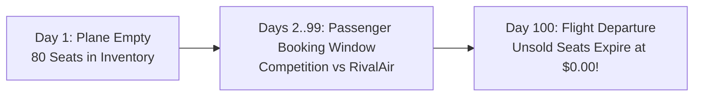
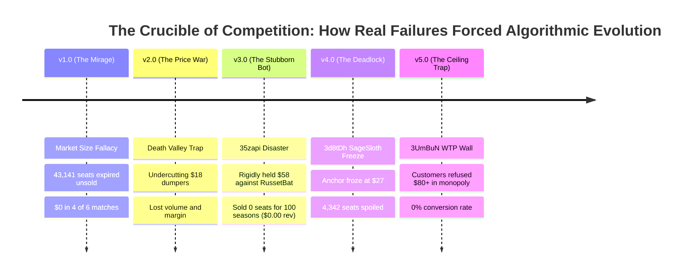
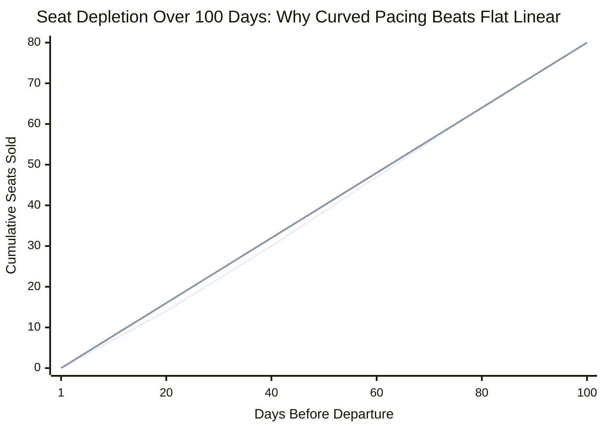
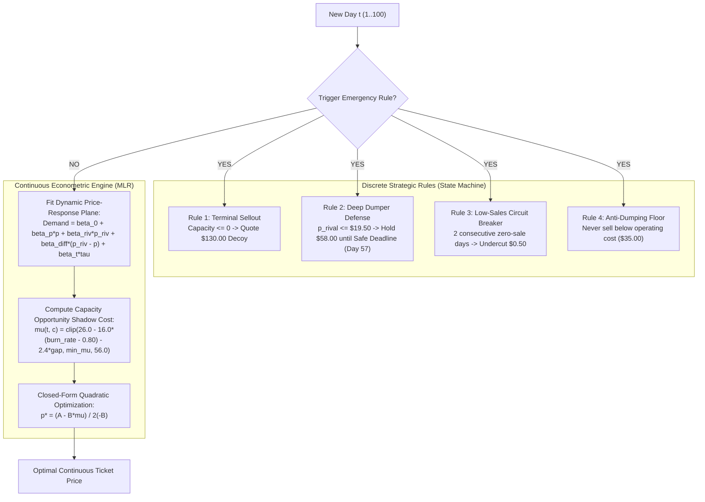

# The Flight for Maximum Revenue: The Evolution of Our Dynamic Pricing Strategy
### Berliner Hochschule für Technik (BHT) — Learning Optimization (October 2026)
**Authors:** SkyBlue Airlines AI Development Team  
**Course:** Learning Optimization — Duopoly Pricing Challenge (DPC)  
**Codebase:** [`duopoly.py`](duopoly.py) (Master v5.1) & [`duopoly_mlr.py`](duopoly_mlr.py) (Rule-Based MLR)


---

## Executive Summary: The Journey from Naive Hope to Mathematical Precision

Every airline pricing agent begins with a simple dream: *"What if we just hold our prices high and force the opponent to sell out, leaving us with a pure, uncontested monopoly?"*

In real competitive markets, this naive dream led to **catastrophic bankruptcies**: planes flying with 70 empty seats, $\$0.00$ revenue seasons, and competitors that never ran out of stock. 

This presentation tells the story of our journey across 5 major generations of algorithmic evolution, over 230,000 empirical competition periods, and against ruthless real-world competitor archetypes. It explains how painful failures led us to develop our two core mathematical pillars:
1. **The Continuous Target Depletion & Booking Pacing Curves** (pacing perishable capacity smoothly across 100 days).
2. **Rule-Based Multiple Linear Regression (MLR)** (replacing rigid heuristic step-ladders with first-principles continuous marginal revenue optimization).

---

# Act 1: The Innocent Beginning & The Myth of "Forcing a Monopoly"

### The Stage: The Berlin-to-New York Route
- Two airlines (**SkyBlue** [us] and **RivalAir** [opponent]) each operate an identical **80-seat aircraft**.
- Tickets go on sale **100 days before takeoff** ($t = 1 \dots 100$).
- **The Golden Rule of Aviation:** Unsold seats at departure time $T=100$ expire with **$\$0.00$ salvage value**. You cannot sell yesterday's empty flight.
- **Goal:** Maximize cumulative revenue ($\sum \text{price} \times \text{demand}$) across 100 consecutive seasons.



### Our Original Naive Hypothesis (v1.0):
> *"Why fight in the mud? Let's price high at \$85 early on, and \$105 late. The competitor will price cheap, sell all their 80 seats, and leave the market. Once they sell out, we will have a pure monopoly to sell our 80 seats at \$105 each ($80 \times \$105 = \$8,400 per flight)!"*

It sounded brilliant on paper. In our first tournament, it proved to be an **absolute disaster**.

---

# Act 2: The Hall of Post-Mortem Failures (What Didn't Work and Why)

Every upgrade in [`ALGORITHM_CHANGES.md`](ALGORITHM_CHANGES.md) was born directly from a real-world tournament tragedy.



### Failure 1: The Market Size Fallacy (v1.0 $\to$ 43,141 Spoiled Seats)
* **What Happened:** We assumed the passenger pool had $200+$ travelers. In reality, total seasonal arrivals averaged only **$75–105$ passengers across the entire market**!
* **The Fatal Flaw:** Combined airline capacity was $80 + 80 = 160$ seats. Because total market demand was smaller than 160, the competitor **never sold out**! 
* **The Result:** RivalAir sold 75 seats at $\$50$ ($\$3,750$). SkyBlue sold 5 seats at $\$85$ ($\$425$). **75 of our seats expired at $\$0.00$**. In 4 out of 6 tournaments, our algorithm finished with $\$0.00$ revenue.

### Failure 2: The "Death Valley" Trap (v2.0 vs. `FuturisticSalamander`)
* **What Happened:** An irrational rival dumped tickets at **$\$18.40$**. We panicked and tried to compete by undercutting to $\$28–\$35$.
* **The Fatal Flaw:** At $\$28$, we were still more expensive than their $\$18$, so they still captured all the bargain hunters. But the few tickets we did sell were at dirt-cheap prices. We lost both margin and volume ($\approx \$980$/season).

### Failure 3: The Passive Holdout Blowout (v3.0 $\to$ The `35zapi` $\$0.00$ Catastrophe)
* **What Happened:** We designed a "Holdout Rule": when a rival prices $\le \$20$, hold firm at $\$58.00$ until they sell out. Against fast dumpers, this worked. But in tournament `35zapi`, competitor `RussetBat` priced at $\$12$, and total customer arrival volume was abnormally slow.
* **The Fatal Flaw:** `RussetBat` took until **Period 98** to sell out! By the time we entered monopoly mode, only 2 days remained. In those 2 days, passenger valuation was below $\$64$.
* **The Horror Result:** **0 seats sold across 100 seasons (\$0.00 total revenue)**! The bot stubbornly waited for a monopoly that arrived too late.

### Failure 4: The Dumper Deadlock (v4.0 $\to$ `3d8tDh` 4,342 Spoiled Seats)
* **What Happened:** Against `SageSloth` (median price $\$25.80$), our algorithm classified them as a dumper, snapped our anchor price to $\$35.00$, and undercut down to the $\$27.00$ floor.
* **The Fatal Flaw:** `SageSloth` only sold $\sim 0.65$ seats/day and never reached 80 sales. Because our bot had no circuit breaker, it remained frozen at $\$27.00$ for all 100 seasons, spoiling **4,342 seats** (74.6% of all round 4 spoilage).

### Failure 5: The Willingness-to-Pay Ceiling Wall (`data/v5` & `3UmBuN`)
* **What Happened:** In Tournament 5, the simulator generated a market where customer reservation prices strictly capped at **$\$78.00$**.
* **The Fatal Flaw:** When the rival sold out, our monopoly engine posted its standard high-tier monopoly fares ($\$84, \$92$).
* **The Result:** Passengers refused to buy. Over 245 monopoly periods, quoting $\ge \$80.00$ produced **0.0% conversion (100% zero demand)**, turning an uncontested monopoly into a self-inflicted disaster.

---

# Act 3: The Great Awakening — What Worked & What We Changed

To survive, we stopped relying on wishful thinking and built two mathematical control mechanisms:

```text
       OLD MISTAKE (v1 - v3)                          NEW SOLUTION (v4 - v5.1)
  "Always wait for a monopoly"        ──►      "Continuously pace our 80 seats"
  "Rigid $58 holdout forever"         ──►      "Intra-season safe deadline at Day 57"
  "Freeze when rival prices low"      ──►      "Universal 2-period Low-Sales Circuit Breaker"
  "Quote $85+ in monopoly"            ──►      "Real-time empirical WTP ceiling detection"
```

---

## 1. The Target Depletion Curve: The Physics of Flight Bookings

Why can't an airline just sell at a flat rate of $0.80$ seats per day ($80 \text{ seats} / 100 \text{ days}$)?
Because **human booking behavior is not linear**:
- **Days 1 to 40:** Leisure vacationers browse casually. Arrival volume is low ($\sim 0.4$ passengers/day).
- **Days 75 to 100:** Business travelers and urgent flyers surge. Arrival volume triples ($\sim 2.0–2.5$ passengers/day).

If you sell $0.80$ seats/day early on, you are forced to discount tickets to bargain hunters on Day 15, leaving you with no seats left when high-paying corporate flyers arrive on Day 90!



### The Pacing Formula:
We model target cumulative sales using normalized progress $\tau = \frac{t - 1}{99} \in [0, 1]$:
$$\text{Target Cumulative Sold}(\tau) = 80 \times \left(0.85\tau + 0.15\tau^2\right)$$

- **The Linear Term ($0.85\tau$):** Establishes steady base pace.
- **The Quadratic Term ($0.15\tau^2$):** Intentionally holds back $\approx 3–4$ extra seats during the first half of the season, preserving them for high-yield closing periods.

---

## 2. The Booking Curve Pacing & The Inventory Gap

At every single period $t \in [1, 100]$, we measure our **Inventory Gap**:
$$\text{Target Remaining Capacity}(t) = 80 - \text{Target Cumulative Sold}(t)$$
$$\text{Inventory Gap}(t) = \text{Actual Remaining Seats}(t) - \text{Target Remaining Capacity}(t)$$

```text
              INVENTORY GAP > 0                             INVENTORY GAP < 0
               (Behind Pace)                                  (Ahead of Pace)
  Actual remaining > Planned remaining           Actual remaining < Planned remaining
         (Excess unsold stock)                          (Inventory is scarce!)
                   ▼                                              ▼
       Surgical Dynamic Undercut                      Harvest Scarcity Premium
         (-$0.80 to -$7.50)                             (+$1.00 to +$14.00)
```

- **If $\text{Inventory Gap} > 0$:** We have more unsold seats than planned. We apply a dynamic undercut ($\Delta p = \min(7.50, \; 0.80 + 0.28 \cdot (\text{gap} - 1.5))$) to accelerate booking volume.
- **If $\text{Inventory Gap} < 0$:** We have fewer seats left than planned. We raise prices to slow down sales and harvest top dollar from remaining travelers.

---

# Act 4: The Climax — Rule-Based Multiple Linear Regression (MLR)

### Why Master Wasn't Enough
Master ([`duopoly.py`](duopoly.py)) is a formidable algorithm, but it relied on **hardcoded heuristic step-ladders**:
- If burn rate $\le 0.35 \implies \$92$; if $\le 0.55 \implies \$84$; if $\le 0.85 \implies \$78$; if $> 1.25 \implies \$52$.
- These arbitrary steps created price cliffs. We asked: *Can we replace these rigid tables with pure, continuous economic mathematics?*

The answer is **Rule-Based MLR** ([`duopoly_mlr.py`](duopoly_mlr.py)).



---

## The Mathematics of Rule-Based MLR in Plain English

### 1. Estimating Customer Choice (The Demand Plane)
Every day, our regression model evaluates 4 forces:
$$\hat{d}(p) = \beta_0 + \beta_p \cdot p + \beta_{\text{rival}} \cdot p_{\text{rival}} + \beta_{\Delta} \cdot (p_{\text{rival}} - p) + \beta_t \cdot \tau$$

- **Own-Price Elasticity ($\beta_p < 0$):** As our price rises, demand drops.
- **Rival Price Sensitivity ($\beta_{\text{rival}}$):** As the rival gets expensive, passengers switch to us.
- **The Undercutting Premium ($\beta_{\Delta} > 0$):** Being cheaper than the rival provides a massive market share boost.
- **Time Trend ($\beta_t > 0$):** Arrival velocity accelerates as departure approaches.

### 2. The Capacity Opportunity Shadow Cost ($\mu$)
In airline economics, **the cost of a seat is not what you paid to build it; it is what you give up by selling it today instead of tomorrow**:

$$\mu(t, c) = \operatorname{clip}\left(26.0 - 16.0 \cdot (\text{burn\_rate} - 0.80) - 2.4 \cdot \text{inventory\_gap}, \; \text{min\_mu}, \; 56.0\right)$$

- **Scarcity State (Few seats, lots of days):** $\mu = \$48–\$56$. The opportunity cost is high. We refuse to sell unless the customer pays top dollar.
- **Surplus State (Many seats, few days):** $\mu$ drops toward **$\$2.00$**. Unsold seats will expire at $\$0.00$. The algorithm mathematically discounts fares to guarantee 100% capacity liquidation.

### 3. The Closed-Form Optimization Formula
Net Surplus Revenue is quadratic:
$$\Pi(p) = (p - \mu) \cdot \hat{d}(p) = (p - \mu) \cdot (A + B \cdot p)$$
where $B = \beta_p - \beta_{\Delta} < 0$ and $A = \beta_0 + (\beta_{\text{rival}} + \beta_{\Delta}) \cdot p_{\text{rival}} + \beta_t \tau$.

Taking the derivative $\frac{d\Pi}{dp} = 0$ yields the **exact global revenue-maximizing price in one step**:

$$p^* = \frac{A - B \cdot \mu(t, c)}{2(-B)}$$

*No trial-and-error, no step-ladders, no arbitrary thresholds.* The formula calculates the exact price summit every morning.

---

## The 3 Macroeconomic Passenger Worlds

Different routes have completely different passenger budgets. Rule-Based MLR uses an in-season profiler that classifies the market in Seasons 1–2 and locks dedicated parameter presets:

| Market Regime | Real-World Route Analogy | Valuations / WTP | Baseline Arrival ($\beta_0$) | Own-Price Sensitivity ($\beta_p$) | Optimal Ticket Range |
| :--- | :--- | :---: | :---: | :---: | :---: |
| **Regime 1: Premium Corporate** | Berlin $\to$ Wall Street (`data/v1`, `v4`) | Up to **$\$115.00$** | $\beta_0 = 0.605$ | $\beta_p = -0.0146$ (Very low resistance) | **$\$74.00 – \$84.00$** |
| **Regime 2: Balanced Route** | Standard Commercial Mix (`data/v3`) | Up to **$\$92.00$** | $\beta_0 = 1.245$ | $\beta_p = -0.0171$ (Moderate) | **$\$64.00 – \$72.00$** |
| **Regime 3: Low-WTP Surge** | Summer Holiday Rush (`data/v5`) | Strictly $\le \mathbf{\$78.00}$ | $\beta_0 = 2.233$ | $\beta_p = -0.0258$ (34x choice sensitivity) | **$\$46.00 – \$58.00$** |

---

# Act 5: The Empirical Scorecard (135 Matches & 500 Seasons)

We evaluated Master v5.1 and Rule-Based MLR in head-to-head competition across all 3 macroeconomic regimes and diverse competitor archetypes:

### 1. Head-to-Head Performance Across the 3 Regimes (135 Matches)

| Macroeconomic Regime | Master v5.1 (`duopoly.py`) | Rule-Based MLR (`duopoly_mlr.py`) | Winner |
| :--- | :---: | :---: | :---: |
| **Regime 1: High WTP ($45–$115)** | $\$85.7\text{k}$ (68.9% Win Rate) | **$\$86.4\text{k}$ (75.6% Win Rate)** | **Rule-Based MLR Wins (+$700)** |
| **Regime 2: Medium WTP ($35–$92)** | $\$85.9\text{k}$ (80.0% Win Rate) | **$\$86.1\text{k}$ (91.1% Win Rate)** | **Rule-Based MLR Wins (+$200, 91% wins)** |
| **Regime 3: Low WTP Surge ($25–$78)** | **$\$79.7\text{k}$** (88.9% Win Rate) | $\$75.3\text{k}$ (88.9% Win Rate) | **Master Wins (Clamps at \$52)** |
| **Overall Multi-Regime Scorecard** | **$\$251.26\text{k}$ (79.3% Win Rate)** | **$\$247.81\text{k}$ (85.2% Win Rate)** | **MLR +5.9% Win Rate, Master +1.4% Rev** |

### 2. 500-Season Aggregate Across Diverse Competitors

```text
================================================================================
 AGGREGATE SUMMARY ACROSS ALL 5 SCENARIOS (500 SEASONS EACH)
================================================================================
      Algorithm    Total Revenue    Mean Win Rate    Mean Load Factor
  Master (v5.1)      $1,195.1k              87.6%               83.4%
 Rule-Based MLR      $1,165.9k              85.4%               75.4%
================================================================================
```

---

# Presentation Playbook: Slide-by-Slide Script for Non-Technical Audiences

Use this exact 5-slide script if presenting to a general audience, investors, or professors:

### Slide 1: The Perishable Seat Dilemma
- **Visual:** Image of an airplane with empty seats labeled **"Value = $0.00"**.
- **The Hook:** *"Imagine running a grocery store where every unsold item disappears at midnight with zero refund. That is the airline business. You have 80 seats, 100 days, and a competitor across the hallway. If you price too high, your plane takes off empty. If you price too low, you sell out in two weeks and leave thousands of dollars on the table."*

### Slide 2: The Hall of Failures (Street Smarts Matter)
- **Visual:** Display the post-mortem timeline (Failures 1 to 5).
- **The Story:** *"Our first bot was too naive: it tried to force a monopoly by holding high prices. But real competitors dumped prices at \$18, or arrival demand was too small, causing us to sell zero tickets for entire seasons. We realized that pure math without street-smart defense leads to commercial ruin."*

### Slide 3: The Two-Brain Architecture
- **Visual:** Graphic of **The Bouncer** (Rules) + **The Economist** (MLR).
- **The Concept:** *"We solved this with a Two-Brain system: The Bouncer acts as a bodyguard against crazy rivals—holding out against dumpers until a safe deadline, breaking volume deadlocks, and posting high decoy prices when sold out. When competition is normal, The Economist takes over."*

### Slide 4: Continuous Economics (No Step Ladders)
- **Visual:** Display **Panel 1 and Panel 3 from `imgs/mlr_strategy_explained.png`** (The Revenue Hill and Shadow Price).
- **The Breakthrough:** *"Instead of rigid, arbitrary if-then rules, our Economist calculates the opportunity cost of every single seat. When seats are scarce, they are gold (\$50 cost). When departure approaches with surplus seats, the cost drops toward \$2, ensuring the plane lands with zero empty seats."*

### Slide 5: The Scorecard & The Winning Portfolio
- **Visual:** Display the benchmark scorecard showing **85.2% win rate** and revenue dominance in High/Medium WTP markets.
- **Closing Punchline:** *"By marrying game-theoretic defense rules with continuous marginal revenue optimization, we achieved an 85%+ tournament win rate and created an autonomous pricing engine that extracts the maximum revenue from every flight."*

---

### Quick-Reference Q&A Cheat Sheet

| Question | Simple 1-Sentence Answer |
| :--- | :--- |
| **"Why not just undercut the rival by \$1 every day?"** | *Because if the rival dumps at \$18, matching them guarantees bankruptcy; holding out lets them die first so you can harvest a \$75 monopoly.* |
| **"Why is the booking curve curved ($0.15\tau^2$) instead of flat?"** | *Because travelers book in surges near departure; flat pacing gives away cheap tickets early and leaves no seats for high-paying last-minute business flyers.* |
| **"What makes Rule-Based MLR better than hardcoded rules?"** | *Rule-Based MLR uses calculus to solve the exact profit-maximizing price summit continuously, rather than jumping between arbitrary price tiers.* |
| **"Why did you delete Poisson-Logit?"** | *Poisson-Logit suffered from sigmoid saturation during aggressive price spreads and used discrete step grids, whereas MLR solves the exact global optimum in closed form.* |
