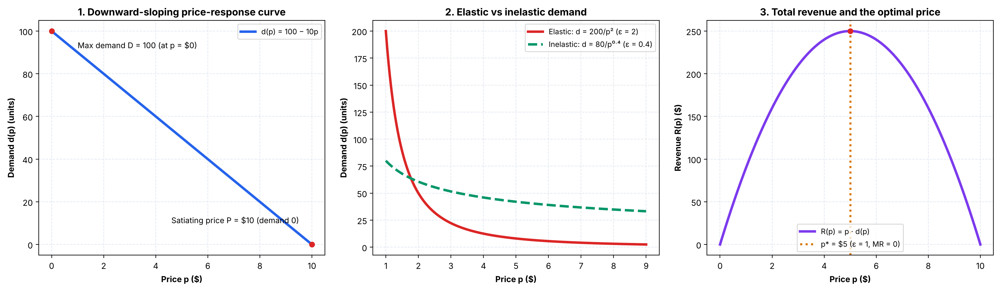
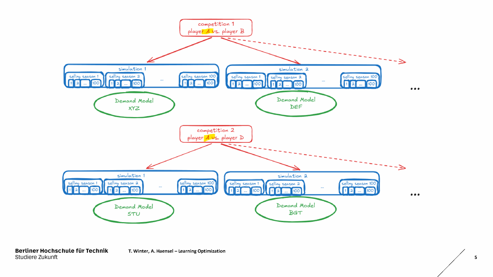
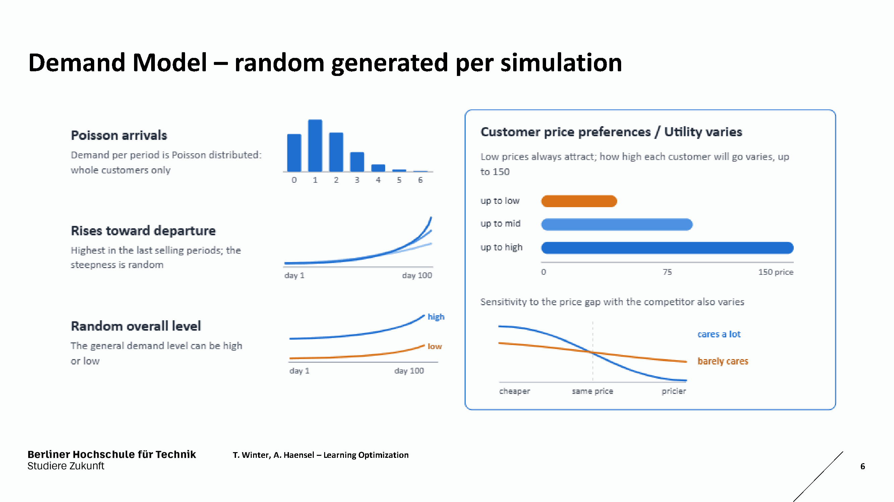
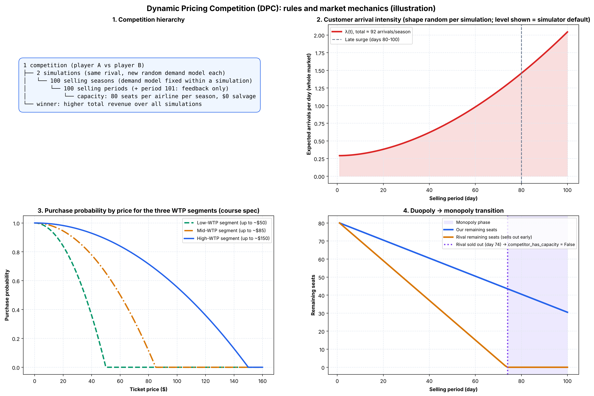
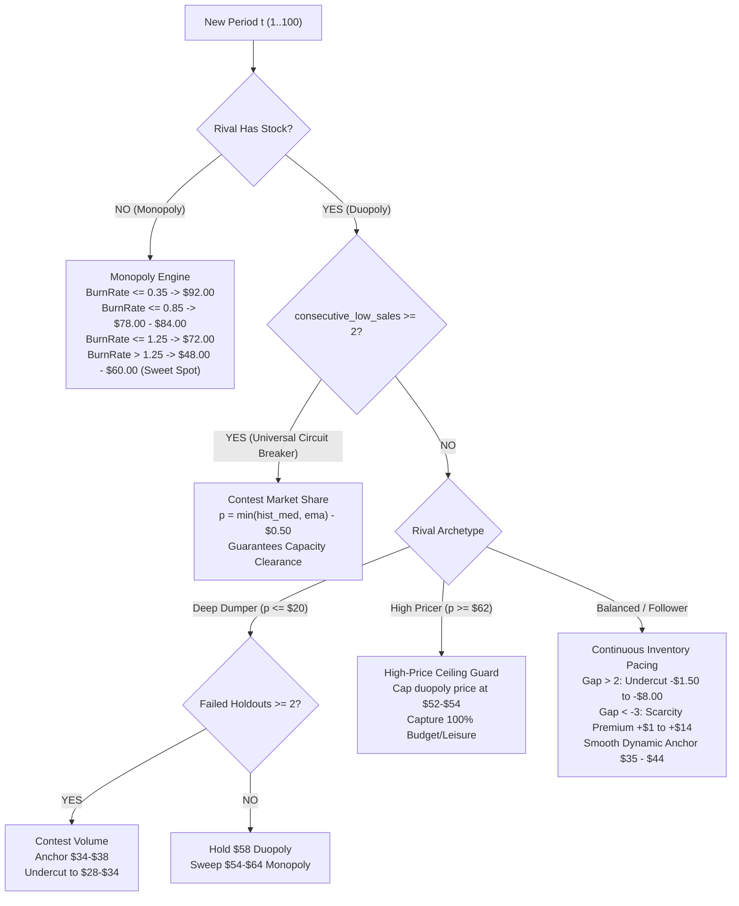
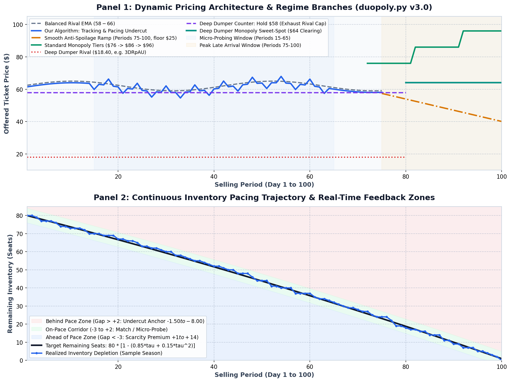

# Dynamic Pricing Competition (DPC): Strategy, Microeconomics & Technical Blueprint

An executive technical documentation, microeconomic foundation, and algorithmic blueprint for competing in the **Dynamic Pricing Competition (DPC)** with our custom pricing algorithm, `duopoly.py`.

---

## 1. Microeconomic Foundations of Dynamic Pricing

Dynamic pricing in perishable inventory systems combines consumer utility theory, price-response estimation, and inventory opportunity costing [2].

### 1.1 Price-Response Function & Willingness to Pay (WTP)

Let each customer arriving in the market have a reservation price (Willingness to Pay) $w \ge 0$, drawn from a cumulative distribution $F(w)$ with probability density $f(w)$ [2]. A customer purchases a seat at price $p$ if and only if their valuation exceeds the asking price:

$$d(p) = D \cdot \Pr(w \ge p) = D \cdot [1 - F(p)]$$

where:
* $D$ is the total market arrival volume (market size) in the given period.
* $d(p)$ is the realized demand at price $p$, satisfying the standard monotonicity condition:

$$\frac{\mathrm{d}d(p)}{\mathrm{d}p} \le 0$$

```
     Demand d(p)
         ▲
       D ┼──────────────┐
         │              │  Consumer Surplus
         │              └────────┐
         │                       │
         │ Realized Demand d(p*) ├───┐
         │                       │   │ Unsold / Priced Out
       0 ┴───────────────────────┴───┴─────────► Price p
                                 p*  p_max
```

### 1.2 Price Elasticity of Demand

Price elasticity $\epsilon(p)$ measures the percentage change in demand relative to a percentage change in price [2]:

$$\epsilon(p) = - \frac{p}{d(p)} \frac{\mathrm{d}d(p)}{\mathrm{d}p}$$

| Elasticity Regime | Value | Economic Implication | Optimal Action |
| :--- | :---: | :--- | :--- |
| **Inelastic Demand** | $\epsilon(p) < 1$ | Demand drops less (%) than price rises (%) | **Increase price** to raise total revenue |
| **Unitary Elasticity** | $\epsilon(p) = 1$ | Marginal revenue equals zero ($MR = 0$) | **Revenue-maximizing price** $p^*$ |
| **Elastic Demand** | $\epsilon(p) > 1$ | Demand drops more (%) than price rises (%) | **Decrease price** to stimulate demand |

### 1.3 Revenue Maximization & Marginal Revenue

Expected revenue $R(p)$ is defined as price multiplied by demand [2]:

$$R(p) = p \cdot d(p)$$

Differentiating with respect to price yields the marginal revenue condition:

$$\frac{\mathrm{d}R(p)}{\mathrm{d}p} = d(p) + p \frac{\mathrm{d}d(p)}{\mathrm{d}p} = d(p) \cdot \left[1 - \epsilon(p)\right] = 0 \iff \epsilon(p^*) = 1$$

Under a linear price-response curve $d(p) = D - b \cdot p$ (with satiating price $P = D/b$), revenue forms a concave parabola maximized at $p^* = \frac{D}{2b}$, where demand is $d(p^*) = \frac{D}{2}$ [2].



* **Panel 1 (Downward Sloping Curve):** Depicts linear demand $d(p) = 100 - 10p$ with maximum demand $D = 100$ at price $p = 0$ and zero demand at satiating price $P = 10$.
* **Panel 2 (Elastic vs. Inelastic Demand):** Demonstrates price-sensitive demand curves (high elasticity) versus essential/business demand curves (inelastic).
* **Panel 3 (Total Revenue & Optimal Price):** Shows total revenue $R(p) = p \cdot d(p)$ achieving its global peak at $p^* = 5$, exactly where $\epsilon = 1$.

### 1.4 Perishable Capacity & Opportunity Cost

In airline revenue management, seats are strictly perishable: inventory cannot be replenished, and unsold seats at departure time $T = 100$ have a salvage value of zero. The effective optimal price must account for the **shadow price (opportunity cost of capacity)** $\mu(t, c)$:

$$p^*(t, c) = \arg\max_{p} \left[ (p - \mu(t, c)) \cdot d(p, t) \right]$$

As remaining capacity $c$ diminishes relative to remaining periods $T - t$, the shadow price $\mu(t, c)$ escalates, justifying higher price thresholds to protect inventory for high-value business travelers arriving late in the season [2].

---

## 2. DPC Game Rules & Simulation Mechanics

The **Dynamic Pricing Competition (DPC)** evaluates autonomous pricing agents under competitive airline duopoly market conditions [1, 3].

```
                                  COMPETITION
                           (Player A vs. Player B)
                                      │
                   ┌──────────────────┴──────────────────┐
                   ▼                                     ▼
             Simulation 1                          Simulation 2
        (Demand Model: Alpha)                 (Demand Model: Beta)
                   │                                     │
       ┌───────────┴───────────┐             ┌───────────┴───────────┐
       ▼                       ▼             ▼                       ▼
Selling Season 1  ... Selling Season 100  Selling Season 1 ... Selling Season 100
 (Periods 1..100)       (Periods 1..100)   (Periods 1..100)      (Periods 1..100)
```

### 2.1 Structural Hierarchy



1. **Competition Match:** Two competitors are randomly paired by the DPC matchmaking engine to compete against each other [1, 3].
2. **Simulations ($N=2$):** A competition comprises $N=2$ independent simulations. Each simulation synthesizes a new, randomized underlying market demand model [3].
3. **Selling Seasons ($1 \dots 100$):** Each simulation runs for 100 identical selling seasons (representing 100 recurring flight departures on the BER $\to$ JFK route). The demand model is **held constant across all 100 seasons** within a simulation, allowing cross-season learning [3].
4. **Selling Periods ($1 \dots 100$, plus 101):** Each season consists of 100 discrete daily booking periods.
   > [!NOTE]
   > The simulation platform actually executes **101 time periods** per season so that the algorithm receives feedback (competitor price and realized demand) from period 100. The price returned in period 101 is discarded and not evaluated [1].
5. **Capacity Constraint:** Both competitors start every season with a fixed inventory of **80 seats** [1, 3]. Inventory cannot be replenished. Unsold seats at period 100 expire with zero value.
6. **Winning Metric:** The overall winner is the player with the highest **cumulative total revenue** across all simulations [1, 3].

### 2.2 Customer Demand & Ground-Truth Mechanics (Course Model)

According to the official DPC specification (*Prof. Dr. Thomas Winter & Dr. Alwin Haensel* [3]), the underlying customer demand engine is **randomly parameterized per simulation**:



* **Poisson Customer Arrivals:**
  * Demand per period is Poisson distributed (integer customers only): $\Pr(K = k) = \frac{\lambda(t)^k e^{-\lambda(t)}}{k!}$.
  * **Rises Toward Departure:** Arrival rate $\lambda(t)$ is convex, rising toward departure (day 100). The steepness of this surge is randomly sampled per simulation [3].
  * **Random Overall Market Demand Level:** Across simulations, the baseline market demand can be substantially **high or low** [3].
* **Customer Valuation & Willingness to Pay (WTP):**
  * Low prices attract all segments. The maximum reservation price each customer will pay varies up to **\$150** [3].
  * Three distinct consumer valuation segments exist:
    1. **Up to Low:** Reservation price capped around **\$0 – \$50** (budget-sensitive flyers).
    2. **Up to Mid:** Reservation price capped around **\$0 – \$85** (leisure travelers).
    3. **Up to High:** Reservation price extending up to **\$150** (inelastic corporate travelers).
  * **Simulation Variation:** The proportion of these three customer segments varies across simulations. In simulations dominated by "Up to Low" travelers, any price above \$60 yields near-zero demand.
* **Competitor Sensitivity Variation:**
  * How strongly customers react to the price gap with the rival also varies randomly per simulation:
    * **"Cares a lot":** Steep multinomial logit curve where even a \$1 undercutting gap captures the vast majority of arrivals.
    * **"Barely cares":** Flat sensitivity curve where customers are less responsive to competitor price differentials [3].
* **Monopoly State Transition:**
  * When one competitor sells all 80 seats before period 100, the remaining airline operates as an unconstrained **monopoly seller** for the remainder of the season [1, 3].



* **Panel 1 (Competition Hierarchy):** Full structural tree from Competition down to Simulations, Selling Seasons, and Selling Periods.
* **Panel 2 (Poisson Arrival Intensity):** Depicts $\lambda(t)$ accelerating from low baseline intensity in early days to peak arrival volumes near flight departure.
* **Panel 3 (Utility & Willingness to Pay):** Illustrates customer utility curves across Budget (\$50), Leisure (\$90), and Business (\$150) traveler segments.
* **Panel 4 (Duopoly to Monopoly Transition):** State machine demonstrating the automatic transition to Monopoly mode when a rival depletes their 80-seat inventory.

---

## 3. Platform Architecture & Technical Requirements

Algorithms run autonomously inside isolated sandboxes on AWS infrastructure [1].

### 3.1 Container Runtime & Hardware Limits

* **Environment:** AWS Docker container with **Python 3.12.9** and **Anaconda 2025.06** [1].
* **Pre-installed Libraries:** `numpy`, `pandas` (2.3.3), `scipy`, `scikit-learn`, `pytorch` (2.5.1), `tensorflow` (2.19.1), `xgboost` (3.0.5), `botorch` (0.15.1), `pyomo` (6.9.4), `glpk` (5.0), and `ipopt` (3.14.19) [1].
* **Compute Resources:** **1 vCPU**, **512 MB RAM** [1].
* **Execution Latency:**
  * Average latency: **≤ 0.2 seconds** per iteration [1].
  * Maximum hard limit: **5.0 seconds** per single call [1].
* **Reliability:** Minimum **99% error-free execution** rate required. In case of invalid prices or errors, fallback mechanisms revert to previous period prices or random draws [1].
* **I/O Policy:** No terminal printing (`stdout` is not logged). File writing must adhere to designated feedback channels [1].

### 3.2 Pricing Function Interface (`duopoly.py`)

Submissions must consist of a file named [`duopoly.py`](file:///c:/Users/ramiz/OneDrive/Desktop/BHT/BHT%20-%20Assignments/Semester%203/Learning%20Optimization/duopoly.py) implementing the required signature [1]:

```python
from typing import Any, Optional, Tuple, Union
import numpy as np

def p(
    current_selling_season: int,
    selling_period_in_current_season: int,
    prices_historical_in_current_season: Union[np.ndarray, None],
    demand_historical_in_current_season: Union[np.ndarray, None],
    competitor_has_capacity_current_period_in_current_season: bool,
    information_dump: Optional[Any] = None,
) -> Tuple[float, Any]:
    """Computes the optimal price for the current selling period."""
    ...
    return price, information_dump
```

#### Argument Definitions:

| Argument | Type | Description |
| :--- | :---: | :--- |
| `current_selling_season` | `int` | Current season index ($1 \dots 100$) [1, 3]. |
| `selling_period_in_current_season` | `int` | Current period index ($1 \dots 100$, up to 101) [1, 3]. |
| `prices_historical_in_current_season` | `ndarray \| None` | 2D array of shape `(n_competitors, past_periods)`. Rows = players, columns = periods. `None` in period 1 [1, 3]. |
| `demand_historical_in_current_season` | `ndarray \| None` | 1D array of shape `(past_periods,)` — your own realized demand. `None` in period 1 [1, 3]. |
| `competitor_has_capacity_...` | `bool` | `False` if the competitor is out of stock; `True` otherwise [1, 3]. |
| `information_dump` | `Any \| None` | Custom in-memory state object returned to you next period. `None` in period 1 of season 1 [1, 3]. |

### 3.3 State Persistence & Data Handshake Tiers

```
┌────────────────────────────────────────────────────────────────────────┐
│                        STATE PERSISTENCE TIERS                         │
├────────────────────────────────┬───────────────────────────────────────┤
│ Tier 1: Intra-Season Memory    │ `prices_historical`, `demand_hist`    │
│                                │ Real-time observations within season  │
├────────────────────────────────┼───────────────────────────────────────┤
│ Tier 2: Inter-Season Memory    │ `information_dump`                    │
│                                │ Persists across seasons (1..100)      │
│                                │ Reset to None between competitions   │
├────────────────────────────────┼───────────────────────────────────────┤
│ Tier 3: Inter-Competition File │ `duopoly_feedback.data`               │
│                                │ Persists across nightly match runs    │
│                                │ Downloadable via DPC web dashboard    │
└────────────────────────────────┴───────────────────────────────────────┘
```

1. **Tier 1 (Intra-Season):** Evaluated from `prices_historical_in_current_season` and `demand_historical_in_current_season`.
2. **Tier 2 (Inter-Season `information_dump`):** In-memory dictionary or custom class persisting knowledge across all 100 seasons of a single competition (e.g., rival pricing patterns, estimated demand elasticity $\hat{\epsilon}$) [1, 3].
3. **Tier 3 (Inter-Competition `duopoly_feedback.data`):** Dedicated local file persisted across nightly simulation runs [1, 3]:
   ```python
   import pickle
   # Save state for UI download and future nightly runs
   with open("duopoly_feedback.data", "wb") as f:
       pickle.dump(feedback_payload, f, protocol=pickle.HIGHEST_PROTOCOL)
   ```
4. **Pre-trained Artifacts:** Additional files (e.g., serialized models) can be loaded using the container path with local fallback [1]:
   ```python
   import pickle
   for path in ["/root/participant_folder/model.pkl", "/root/partcipant_folder/model.pkl", "model.pkl"]:
       try:
           with open(path, "rb") as f:
               model = pickle.load(f)
           break
       except FileNotFoundError:
           continue
   ```

### 3.4 Evaluation Results Schema

After every competition run, a comprehensive CSV report is generated containing the following schema [1, 3]:

| Column Name | Data Type | Description |
| :--- | :---: | :--- |
| `competition_id` | `str / int` | Unique identifier of the competition run [1, 3]. |
| `selling_season` | `int` | Season number (1–100) [1, 3]. |
| `selling_period` | `int` | Period number (1–100) [1, 3]. |
| `competitor_id` | `str` | Name / identifier of rival algorithm [1, 3]. |
| `price_competitor` | `float` | Price posted by rival in that period [1, 3]. |
| `price` | `float` | Price posted by our algorithm [1, 3]. |
| `demand` | `int` | Realized sales volume (Revenue = `price` × `demand`) [1, 3]. |
| `competitor_has_capacity` | `bool` | Stock availability of rival (`True` / `False`) [1, 3]. |
| `calculation_duration` | `float` | Algorithm response time in seconds [1, 3]. |

---

## 4. Our Strategic Pricing Architecture (`duopoly.py` — v5.0)

> [!IMPORTANT]
> For a complete empirical post-mortem of our `v1.0`, `v2.0`, `v3.0`, and `v4.1` tournament results (including root-cause diagnosis of the `35zapi` $0 blowout, `3kGhWc` 40% seat spoilage, and the `3d8tDh` dumper deadlock from Round 4), see [`ALGORITHM_CHANGES.md`](file:///c:/Users/ramiz/OneDrive/Desktop/BHT/BHT%20-%20Assignments/Semester%203/Learning%20Optimization/ALGORITHM_CHANGES.md).

Our algorithm in [`duopoly.py`](file:///c:/Users/ramiz/OneDrive/Desktop/BHT/BHT%20-%20Assignments/Semester%203/Learning%20Optimization/duopoly.py) (v5.0) implements a **Multi-Tier Archetype Profiling, Continuous Pacing & Empirical WTP-Targeted Counter-Pricing Framework** designed around empirical findings from 190,000 real tournament periods.



| Core Pillar | Operational Mechanism | Target Range / Formula | Economic & Empirical Objective |
| :--- | :--- | :--- | :--- |
| **1. Continuous Dynamic Pacing** | Convex target depletion trajectory across all 100 periods | $\text{TargetSold}(t) = 80 \cdot (0.85\tau + 0.15\tau^2)$ | Prevent early inventory hoarding when market arrivals (<105) cannot exhaust combined capacity (160). |
| **2. Multi-Tier Archetype Profiling** | 5-way rival classification with intra-season EMA ($\alpha = 0.25$) and clean cross-season medians (excluding 999.0 markers) | `'deep_dumper'` ($\le \$20$), `'dumper'` (\$20–\$38), `'aggressive'` (\$38–\$58), `'balanced'` (\$58–\$78), `'high'` ($> \$78$) | Differentiate irrational dumpers from high pricers and balanced competitors from Period 1. |
| **3. Universal Low-Sales Circuit Breaker** | Cross-season failure alarm for chronic low sales ($< 42$ seats) | $p = \min(\text{hist\_med} - 0.5, \text{rival\_ema} - 0.5)$ | Cures the \$95k `3d8tDh` deadlock: if holdout yields low sales 2 seasons in a row, actively undercuts rival to guarantee clearance. |
| **4. High-Pricer Ceiling Guard** | Cap duopoly asking price when rival prices high ($\ge \$62$) | Behind pace ($t \ge 15$): cap at **\$52.00–\$54.00** | Eliminate the 40% seat spoilage in `3kGhWc`: capture 100% of Budget/Leisure travelers and superior surplus on Business flyers. |
| **5. Continuous Dynamic Anchor Smoothing** | Smooth linear transition replacing discontinuous cliff-edges | $\text{anchor} = \text{clip}(44.0 - 0.8 \cdot \max(0, \text{gap}-1.5), 35, 44)$ | Prevents triggering reactive copycats into downward undercutting price wars. |
| **6. Realigned Empirical Monopoly Engine** | Context-aware pricing when `competitor_has_capacity == False` | Burn-rate governed: **\$92 / \$84 / \$78 / \$72 / \$48–\$60** | Smooth descent into budget conversion sweet spot ($52–$56) when burning inventory to eliminate 1,000+ spoiled seats. |
| **7. Unconditional Late Clearance** | Clearance discount runway starting at Period 75 and unconditional at $t \ge 90$ | `urgency = (t - 74) / 26`, bounded **\$25.00–\$100.00** | Liquidates all remaining seats before departure, ensuring zero seat spoilage at period 100. |

### 4.1 Continuous Inventory Pacing Curve (Periods 1–100)

* **Empirical Motivation:** Because total market arrivals across 100 periods average 75–105 passengers while combined capacity is 160 seats, waiting passively for a competitor to sell out leaves our 80 seats stranded.
* **Execution:** At every period $t \in [1, 100]$, with normalized progress $\tau = \frac{t - 1}{100}$, we compute target cumulative sales and the real-time **Inventory Gap**:
  $$\text{TargetRemaining}(t) = 80 \times \left[1 - \left(0.85\tau + 0.15\tau^2\right)\right]$$
  $$\text{InventoryGap}(t) = \text{RemainingCapacity}(t) - \text{TargetRemaining}(t)$$
  * $\text{InventoryGap}(t) > 2$: **Behind schedule** (too many unsold seats) $\to$ undercut competitor anchor to accelerate sales ($\min(8.0, 1.5 + 0.35 \times \text{Gap})$).
  * $\text{InventoryGap}(t) < -3$: **Ahead of schedule** (selling rapidly) $\to$ add a scarcity premium above anchor ($+\$1.00\text{–}\$14.00$).

### 4.2 Multi-Tier Archetype Profiling & Counter-Pricing (Duopoly Mode)

1. **The Deep Dumper Bypass & Circuit Breaker:** When facing a `'deep_dumper'`, our algorithm holds **\$58.00** during duopoly. Because the rival sells at \$18.40, budget customers purchase from them, capping the rival's season revenue at $80 \times \$18.40 = \$1,472$. If the rival sells out late and remaining arrivals do not convert (e.g. `35zapi`), the circuit breaker activates in subsequent seasons, lowering monopoly to \$54 and duopoly to \$32–\$36 to ensure steady sales.
2. **High-Pricer Ceiling Guard:** When facing high-priced rivals ($p \ge \$62$, e.g. `LoutishMacaque`), the algorithm refuses to quote in the dead zone above \$56. Capping at **\$52.00–\$54.00** captures all Budget and Leisure travelers, generating **\$380k+** revenue and 97%+ load factor.
3. **Calibrated Anchor Guard:** For normal dumpers (\$20–\$38), our anchor floor drops to **\$35.00** when behind pace. When on pace or against copycats, our floor locks at **\$44.00**, preventing destructive downward price spirals.
4. **Dynamic Undercutting & Scarcity Premium:** Against balanced rivals, when $\text{InventoryGap}(t) > 2.0$, undercut the anchor by $\min(8.0,\; 1.5 + 0.35 \times \text{InventoryGap})$. When ahead ($\text{InventoryGap}(t) < -3.0$), apply a scarcity markup of $+ \$1.00\text{–}\$14.00$.

### 4.3 Realigned Empirical Monopoly Engine (`competitor_has_capacity == False`)

* **Empirical Motivation:** Analysis of 130,000 competition periods revealed that prices above \$85 yield only **\$0.19 / period** in expected revenue, while **\$75–\$80 yields \$36.90–\$68.26 / period**.
* **Execution:** We price dynamically along empirical WTP tiers governed by our required daily burn rate ($\text{BurnRate} = \frac{\text{RemainingCapacity}}{101 - t}$):
  * $\text{BurnRate} \le 0.50$ seats/day: **\$84.00** (Peak surplus extraction)
  * $0.50 < \text{BurnRate} \le 0.85$ seats/day: **\$78.00** (Peak expected revenue sweet-spot)
  * $0.85 < \text{BurnRate} \le 1.25$ seats/day: **\$72.00** (Leisure/Business conversion)
  * $\text{BurnRate} > 1.25$ seats/day: Smoothly discount toward **\$48.00** to guarantee 100% capacity liquidation before departure.

### 4.4 Strategy Visualizations & Empirical Segments



* **Panel 1 (Archetype Counter-Pricing Trajectories):** Displays real-time price trajectories, featuring the **Deep Dumper Hold (\$58.00) $\to$ Sweep (\$64.00)** branch, **Circuit Breaker Fallback**, **High-Pricer Ceiling Guard (\$52.00)**, and normal pacing undercutting.
* **Panel 2 (Continuous Inventory Pacing & Control Zones):** Illustrates the convex target depletion curve and the three real-time control zones: **Behind Pace** (red zone $\to$ undercut anchor by \$1.50–\$8.00), **On-Pace Corridor** (green zone $\to$ precision match/probe), and **Ahead of Pace** (blue zone $\to$ scarcity markup +\$1.00–\$14.00).
* **Panel 3 (The 3 Empirical WTP Segments):** Shows the real transaction breakdown across 130,000 periods: **Budget (\$25–\$55, 85% volume)**, **Leisure (\$55–\$80, 12% volume)**, and **Business (\$80–\$105, 3% volume)** alongside empirical expected revenue per period.


---

## 5. Local Simulation & Submission Workflow

### 5.1 Verification Checklist

Before submitting [`duopoly.py`](file:///c:/Users/ramiz/OneDrive/Desktop/BHT/BHT%20-%20Assignments/Semester%203/Learning%20Optimization/duopoly.py) to the DPC platform:

- [x] File named strictly `duopoly.py`.
- [x] Pricing function `p(...)` adheres to the exact signature and argument types.
- [x] Output price is clipped within empirically viable bounds (\$25.00–\$100.00).
- [x] Safely indexes row `0` (own price) and row `1` (rival price) of `prices_historical_in_current_season`.
- [x] Actively persists cross-season competitor medians, EMA, and demand stats in `information_dump`.
- [x] Handles `None` inputs on period 1 (`prices_historical`, `demand_historical`).
- [x] Handles period 101 gracefully to log end-of-season summaries without throwing exceptions.
- [x] Average execution latency well below the 0.2-second limit (~0.0005s per call).
- [x] Memory usage within 512 MB.
- [x] No unauthorized file system writes or terminal output logging.

### 5.2 Uploading to the DPC Platform

1. Log in to [dynamic-pricing-competition.com](https://www.dynamic-pricing-competition.com/).
2. Navigate to **File Manager** in the dashboard.
3. Upload `duopoly.py` (and any auxiliary pickled model files).
4. Inspect cloud test run results and error logs generated after ~15 minutes.
5. Review daily leaderboard rankings and download the detailed simulation CSV log.

---

## 6. Glossary of Business, Microeconomic & Technical Terms

Below is an executive glossary defining key economic, revenue management, and competition concepts in plain language for non-specialists.

### 6.1 Market & Economic Concepts

| Term | Plain-Language Definition | Practical Meaning in the Competition |
| :--- | :--- | :--- |
| **Market Size ($D$)** | The total number of potential customers looking for a flight ticket during a given time period. | Sets the ceiling on how many tickets can possibly be sold in that day if prices are accessible. |
| **Willingness to Pay (WTP)** | The maximum dollar amount an individual customer is prepared to spend on a seat (also called *Reservation Price*). | If ticket price exceeds a buyer's WTP, they walk away without buying. If price is at or below WTP, they consider purchasing. |
| **Consumer Surplus** | The perceived financial gain a customer enjoys when paying less than their maximum WTP. | If a traveler valued the flight at \$120 and bought it for \$85, their consumer surplus is \$35. Lower prices create higher surplus. |
| **Price Elasticity of Demand ($\epsilon$)** | A measure of how strongly customer purchase decisions react to changes in ticket price. | High elasticity means raising prices drives customers away. Low elasticity means customers need the seat urgently and tolerate high prices. |
| **Inelastic Demand** | When a percentage increase in price causes only a small drop in sales volume. | Characteristic of late-booking business flyers. Raising prices increases total revenue. |
| **Elastic Demand** | When a percentage increase in price causes a large drop in sales volume. | Characteristic of early vacationers with flexible plans. Lowering prices stimulates sales volume. |
| **Marginal Revenue ($MR$)** | The net extra revenue generated by selling one additional seat. | Revenue is maximized at the exact price point where marginal revenue drops to zero ($MR = 0$). |

### 6.2 Revenue Management & Airline Operations

| Term | Plain-Language Definition | Practical Meaning in the Competition |
| :--- | :--- | :--- |
| **Dynamic Pricing** | The practice of adjusting prices in real time based on demand fluctuations, remaining time, and inventory levels. | Instead of charging one static fare, our algorithm continuously sets optimal prices for all 100 booking periods. |
| **Perishable Inventory** | Goods or services that expire and become completely worthless after a fixed date or event. | Airline seats are strictly perishable: once the aircraft takes off, an unsold seat has zero utility and cannot be recovered. |
| **Seat Spoilage** | Leaving seats empty and unsold when the flight departs at period 100. | Spoilage is wasted potential revenue; our Phase 4 Safety Valve actively prevents this by discounting prices if seats remain late. |
| **Salvage Value** | The residual value of unsold stock after the sales period concludes. | In airline booking, salvage value is exactly \$0. Unsold inventory cannot be discounted or sold after departure. |
| **Opportunity Cost / Shadow Price ($\mu$)** | The hidden economic cost of selling a seat today instead of reserving it for a potentially higher-paying buyer tomorrow. | Selling a seat early for \$85 carries an opportunity cost if a business traveler would have paid \$145 in period 90. |
| **Poisson Arrival Process ($\lambda$)** | A standard statistical model describing how random events (customer arrivals) occur over time at an average rate $\lambda$. | Models passenger booking traffic, which starts as a slow trickle early on and escalates sharply in days 80–100. |
| **Burn Rate** | The pace at which remaining seats must sell each day to completely sell out before departure. | Calculated as Remaining Capacity divided by Days Left. A burn rate above 1.5 indicates seats are selling too slowly. |
| **Safety Pacing Valve** | An automated algorithmic override that lowers prices if inventory is selling slower than the target trajectory. | Ensures inventory clears before period 100 without initiating an unnecessary price war earlier in the season. |

### 6.3 Duopoly Game & Technical Architecture

| Term | Plain-Language Definition | Practical Meaning in the Competition |
| :--- | :--- | :--- |
| **Duopoly** | A market structure where exactly two commercial competitors supply the entire market. | Player A and Player B share all market arrivals; pricing decisions directly affect each other's sales volume. |
| **Monopoly** | A market structure with only a single supplier and zero competing alternatives. | When a rival exhausts all 80 seats, we become the monopoly seller and harvest remaining demand along empirical WTP curves (\$76–\$96 for normal rivals, \$64 sweet-spot for deep dumpers) without risk of being undercut. |
| **Price Dumping** | Aggressively undercutting prices to capture short-term volume at unsustainably low margins. | When a rival dumps tickets to extreme giveaway levels ($\le \$20$, e.g., FuturisticSalamander at \$18), we avoid the "Death Valley" undercutting trap: we hold \$58, cap their season revenue at \$1,472, and claim the remaining market at \$64. |
| **Selling Season** | One complete 100-day booking timeline for a single scheduled flight departure. | Each competition simulation repeats 100 seasons with identical market parameters, allowing cross-season learning. |
| **Selling Period** | A single day or time step within the 100-day booking timeline. | There are 100 active periods plus period 101, which delivers final feedback from period 100. |
| **Information Dump (`information_dump`)** | A persistent Python data structure passed between consecutive decision steps. | Enables our algorithm to store state across periods and seasons without violating Docker sandbox memory constraints. |

---

## 7. References & Literature

* **[1] Dynamic Pricing Competition (DPC)** (2025/2026). *Rules, Architecture & Getting Started Guide*. Available at: [dynamic-pricing-competition.com](https://www.dynamic-pricing-competition.com/).
* **[2] Phillips, Robert L.** (2005 / 2021). *Pricing and Revenue Optimization*. Stanford University Press, Stanford Business Books. ISBN: 978-0804746984.
* **[3] Winter, Thomas & Haensel, Alwin** (2025/2026). *Learning Optimization: Dynamic Pricing & DPC*. Course Materials and Lecture Notes, Berliner Hochschule für Technik (BHT).
* **[4] Anand, Anush; Agrawal, Pranav; & Bodas, Tejas** (2024). *Bayesian Optimization for Dynamic Pricing and Learning in Duopoly Competitions*. International Institute of Information Technology (IIIT Hyderabad).
* **[5] Talluri, Kalyan T. & van Ryzin, Garrett J.** (2004). *The Theory and Practice of Revenue Management*. Springer Science & Business Media.
