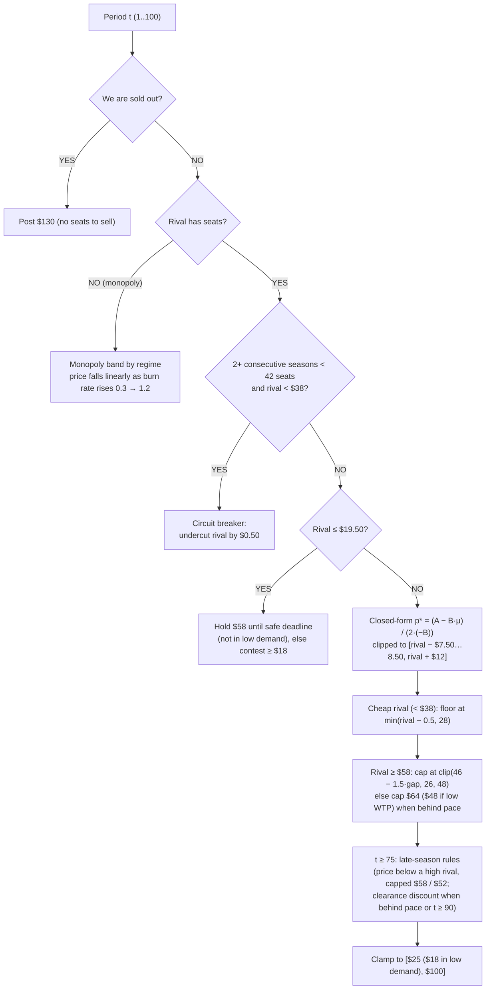
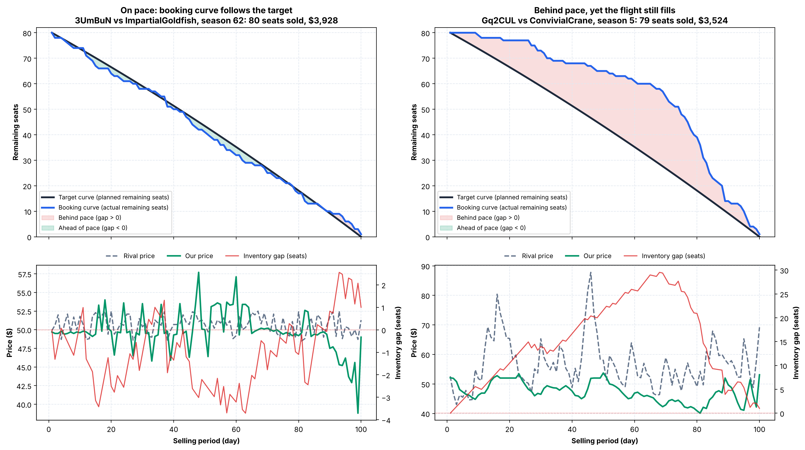

# Dynamic Pricing Competition (DPC): Strategy, Microeconomics & Technical Blueprint

An executive technical documentation, microeconomic foundation, and algorithmic blueprint for competing in the **Dynamic Pricing Competition (DPC)** with our custom pricing algorithm, `duopoly.py`.

---

## 1. Microeconomic Foundations of Dynamic Pricing

Dynamic pricing in perishable inventory systems combines consumer utility theory, price-response estimation, and inventory opportunity costing [2].

### 1.1 Price-Response Function & Willingness to Pay (WTP)

Let each customer arriving in the market have a reservation price (Willingness to Pay) $w \ge 0$, drawn from a cumulative distribution $F(w)$ with probability density $f(w)$ [2]. A customer purchases a seat at price $p$ if and only if their valuation exceeds the asking price:

$$d(p) = D \cdot \Pr(w \ge p) = D \cdot [1 - F(p)]$$

where:
* $D$ is the total market arrival volume (market size) in the given period.
* $d(p)$ is the realized demand at price $p$, satisfying the standard monotonicity condition:

$$\frac{\mathrm{d}d(p)}{\mathrm{d}p} \le 0$$

```
     Demand d(p)
         ▲
       D ┼──────────────┐
         │              │  Consumer Surplus
         │              └────────┐
         │                       │
         │ Realized Demand d(p*) ├───┐
         │                       │   │ Unsold / Priced Out
       0 ┴───────────────────────┴───┴─────────► Price p
                                 p*  p_max
```

### 1.2 Price Elasticity of Demand

Price elasticity $\epsilon(p)$ measures the percentage change in demand relative to a percentage change in price [2]:

$$\epsilon(p) = - \frac{p}{d(p)} \frac{\mathrm{d}d(p)}{\mathrm{d}p}$$

| Elasticity Regime | Value | Economic Implication | Optimal Action |
| :--- | :---: | :--- | :--- |
| **Inelastic Demand** | $\epsilon(p) < 1$ | Demand drops less (%) than price rises (%) | **Increase price** to raise total revenue |
| **Unitary Elasticity** | $\epsilon(p) = 1$ | Marginal revenue equals zero ($MR = 0$) | **Revenue-maximizing price** $p^*$ |
| **Elastic Demand** | $\epsilon(p) > 1$ | Demand drops more (%) than price rises (%) | **Decrease price** to stimulate demand |

### 1.3 Revenue Maximization & Marginal Revenue

Expected revenue $R(p)$ is defined as price multiplied by demand [2]:

$$R(p) = p \cdot d(p)$$

Differentiating with respect to price yields the marginal revenue condition:

$$\frac{\mathrm{d}R(p)}{\mathrm{d}p} = d(p) + p \frac{\mathrm{d}d(p)}{\mathrm{d}p} = d(p) \cdot \left[1 - \epsilon(p)\right] = 0 \iff \epsilon(p^*) = 1$$

Under a linear price-response curve $d(p) = D - b \cdot p$ (with satiating price $P = D/b$), revenue forms a concave parabola maximized at $p^* = \frac{D}{2b}$, where demand is $d(p^*) = \frac{D}{2}$ [2].


*(Generated by `analytics/generate_concept_plots.py`.)*

* **Panel 1 (Downward Sloping Curve):** Depicts linear demand $d(p) = 100 - 10p$ with maximum demand $D = 100$ at price $p = 0$ and zero demand at satiating price $P = 10$.
* **Panel 2 (Elastic vs. Inelastic Demand):** Constant-elasticity curves with $\epsilon = 2$ (elastic) and $\epsilon = 0.4$ (inelastic).
* **Panel 3 (Total Revenue & Optimal Price):** Shows total revenue $R(p) = p \cdot d(p)$ achieving its global peak at $p^* = 5$, exactly where $\epsilon = 1$.

### 1.4 Perishable Capacity & Opportunity Cost

In airline revenue management, seats are strictly perishable: inventory cannot be replenished, and unsold seats at departure time $T = 100$ have a salvage value of zero. The effective optimal price must account for the **shadow price (opportunity cost of capacity)** $\mu(t, c)$:

$$p^*(t, c) = \arg\max_{p} \left[ (p - \mu(t, c)) \cdot d(p, t) \right]$$

As remaining capacity $c$ diminishes relative to remaining periods $T - t$, the shadow price $\mu(t, c)$ escalates, justifying higher price thresholds to protect inventory for high-value business travelers arriving late in the season [2].

### 1.5 Target Curve vs. Booking Curve vs. Capacity Utilization Curve

In modern airline revenue management, distinguishing between what is planned, what is realized, and how capacity is utilized is fundamental. The interaction between these concepts forms the central feedback loop of our algorithm:

```
    Cumulative Sold
         ▲
      80 ┼──────────────────────────────────────────────────────────● [Day 100: Sold Out]
         │                                               . · ' ╱
         │                                        . · '       ╱  Realized Booking Curve
         │                                 . · '             ╱   (Empirical Accumulation)
         │                          . · '                   ╱
         │                   . · '                         ╱
         │            . · '                               ╱
         │     . · '  ───────────────────────────────────'
         │  ·'        ▲
       0 ┼────────────┼─────────────────────────────────────────────► Time t (1..100)
       Day 1       Target Curve: TargetSold(t) = 80*(0.85τ + 0.15τ²)
                   (Optimal Planned Depletion Benchmark)
```

#### 1. Concept Comparison Matrix

| Concept | What It Represents | Formula / Definition | Unit | Operational Role in Strategy |
| :--- | :--- | :--- | :---: | :--- |
| **Target Curve** | The **planned, optimal benchmark** depletion pace | $\text{TargetSold}(t) = 80 \cdot (0.85\tau + 0.15\tau^2)$ | Cumulative Seats ($0 \dots 80$) | The ideal schedule designed to maximize total flight revenue by reserving high-yield seats for late surges. |
| **Booking Curve** | The **realized cumulative bookings** sold up to day $t$ | $\text{RealizedSold}(t) = \sum_{s=1}^{t-1} \text{Demand}(s)$ | Cumulative Seats ($0 \dots 80$) | Measures actual sales traction achieved in the market against passenger arrivals and rival prices. |
| **Capacity Utilization Curve** | The **actual physical state** of the aircraft inventory | $\text{Utilization}(t) = \frac{\text{RealizedSold}(t)}{80}$ or $c(t) = 80 - \text{RealizedSold}(t)$ | Load Factor (%) or Remaining Seats | Tracks real-time occupancy. Directly determines remaining exposure to seat spoilage or premature stockout. |
| **Inventory Gap** | The **divergence between actual and planned** inventory | $\text{InventoryGap}(t) = c(t) - \text{TargetRemaining}(t)$ | Seats (Behind $[+]$ / Ahead $[-]$) | The primary feedback control signal that drives the capacity opportunity shadow price $\mu(t, c)$. |

---

#### 2. Deep Dive: Why $\tau^2$ and Why $0.15$ in the Target Curve?

The Target Curve is defined with normalized selling progress $\tau = \frac{t - 1}{99} \in [0, 1]$:

$$\text{TargetSold}(\tau) = 80 \cdot \left(0.85 \tau + 0.15 \tau^2\right)$$

$$\text{TargetRemaining}(\tau) = 80 - \text{TargetSold}(\tau) = 80 \cdot \left[1 - \left(0.85 \tau + 0.15 \tau^2\right)\right]$$

##### A. Mathematical Boundary Conditions
* **At Day 1 ($t = 1 \implies \tau = 0$):**
  $$\text{TargetSold}(0) = 80 \cdot (0.85(0) + 0.15(0)^2) = 0 \text{ seats sold} \quad (c_{\text{target}} = 80)$$
* **At Day 100 ($t = 100 \implies \tau = 1$):**
  $$\text{TargetSold}(1) = 80 \cdot (0.85(1) + 0.15(1)^2) = 80 \cdot (0.85 + 0.15) = 80 \text{ seats sold} \quad (c_{\text{target}} = 0)$$
Because the weights sum to unity ($0.85 + 0.15 = 1.00$), the curve guarantees that exactly 100% of capacity is scheduled for liquidation by departure.

##### B. Why Not a Linear Schedule ($80 \cdot \tau$)?
If an airline followed a naïve linear pace ($0.80$ seats/day):
* At Day 50 ($\tau \approx 0.5$): Linear pace demands selling $80 \times 0.5 = \mathbf{40 \text{ seats}}$.
* With $0.85\tau + 0.15\tau^2$: At Day 50 ($\tau = 0.5$):
  $$\text{TargetSold}(0.5) = 80 \cdot \left(0.85(0.5) + 0.15(0.25)\right) = 80 \cdot (0.425 + 0.0375) = 80 \cdot 0.4625 = \mathbf{37.0 \text{ seats}}$$
The convex curve **deliberately holds back 3 to 4 extra seats in the first half of the season**. 

##### C. Why $\tau^2$ (Convexity)?
In the official DPC customer arrival process [3], arrival intensity $\lambda(t)$ **rises toward departure**. Our own data agree: in `data/v3` + `data/v4`, the seats *we* sold per period roughly double from about 0.4 on day 1 to about 0.9 around day 85 (see `imgs/regression_empirical_analysis.png`, Panel 3; rival sales are not observed, so total market arrivals cannot be measured directly).
The second derivative of the target curve is positive:
$$\frac{\mathrm{d}^2 \text{TargetSold}}{\mathrm{d}\tau^2} = 80 \cdot 2 \cdot 0.15 = 24 > 0$$
so the planned sales rate rises from $0.69$ to $0.93$ seats/day over the season, in the same direction as arrivals.
Note: the data do **not** show late buyers paying much more. In `data/v5`, over 99% of sales were at $\le \$55$ and nothing sold above \$78. The benefit of holding seats back comes from *more arrivals* late, not from higher willingness to pay.

##### D. Why $0.15$?
The coefficient **$0.15$** is a hand-chosen design parameter (it was not fitted or tuned systematically):
* **85% linear base ($0.85\tau$):** keeps a steady pace so late spoilage is unlikely if demand falters.
* **15% quadratic part ($0.15\tau^2$):** shifts sales slightly later. The largest difference from a linear pace is $80 \cdot 0.15 \cdot 0.25 = 3$ seats, at mid-season.
* *Trade-off:* a larger coefficient (e.g. $0.40$) backloads more inventory and risks spoilage if the late surge is weak; $0$ gives a linear pace.
* **Since v6.2, 0.15 is only the starting value.** Real markets book very differently (fitted bend 0.01 in `3UmBuN`, 0.82 in `Gq2CUL`), so `duopoly.py` now learns the bend $c$ in $80\cdot((1-c)\tau + c\tau^2)$ from the booking curves of past seasons with 75+ seats sold, starting from 0.15 in every market (§4.4 below, §18–19 of ALGORITHM_CHANGES).

---

#### 3. How the Strategy Uses the Inventory Gap (Worked Examples)

The real-time divergence between realized remaining capacity $c(t)$ and planned target remaining capacity $\text{TargetRemaining}(t)$ defines the **Inventory Gap**:

$$\text{InventoryGap}(t) = c(t) - \text{TargetRemaining}(t) = \text{TargetSold}(t) - \text{RealizedSold}(t)$$

This gap directly adjusts the capacity opportunity shadow price $\mu(t, c)$:

$$\mu(t, c) = \operatorname{clip}\left(26 - 16 \cdot (\text{burn\_rate} - 0.80) - 2.4 \cdot \text{InventoryGap}(t), \; \mu_{\min}, \; 56\right), \qquad \mu_{\min} = \$10 \;(\$2 \text{ if low WTP detected})$$

(`_compute_capacity_shadow_cost` in `duopoly.py`), which then determines the closed-form optimal price:

$$p^* = \frac{A - B \cdot \mu(t, c)}{2(-B)}$$

`duopoly.py` then clips $p^*$ to a band around the rival's recent average price: at most \$7.50–\$8.50 below it and at most \$12 above it. In simulation the band is binding in roughly 40% of periods, so the strategy is best described as *rival-relative pricing, steered by the demand model and the shadow cost*.

##### Worked Example 1: Behind Pace (Low Utilization / Excess Unsold Seats)
* **Situation at Day 50 ($t = 50, \tau \approx 0.50$):**
  - Planned Target: $\text{TargetSold} = 37 \implies \text{TargetRemaining} = 43 \text{ seats}$.
  - Realized Sales: Airline has only sold $32 \text{ seats} \implies \text{Actual Remaining } c = 48 \text{ seats}$.
  - Capacity Utilization: $\frac{32}{80} = 40.0\%$ (vs. planned $46.25\%$).
* **Computing the Gap:**
  $$\text{InventoryGap} = 48 - 43 = \mathbf{+5.0 \text{ seats behind pace}}$$
* **Pricing Reaction:**
  - The $+5.0$ seat lag reduces the shadow price $\mu$:
    $$\Delta \mu = -2.4 \cdot (+5.0) = -\$12.00$$
  - Shadow price drops from e.g. $\$26.00$ down to $\$14.00$ (burn-rate term held fixed).
  - In the closed-form pricing equation, $p^*$ moves by half of $\Delta\mu$ for any slope $B$:
    $$\Delta p^* = \frac{-B \cdot \Delta \mu}{2(-B)} = \frac{\Delta \mu}{2} = -\$6.00$$
  - The algorithm lowers the ticket price by about \$6 (unless the rival band clips it).
  - **Outcome:** Lower price stimulates passenger demand, conversions accelerate, and sales catch up to the Target Curve.

##### Worked Example 2: Ahead of Pace (High Utilization / Inventory Scarcity)
* **Situation at Day 65 ($t = 65, \tau \approx 0.65$):**
  - Planned Target: $\text{TargetSold} \approx 51 \implies \text{TargetRemaining} = 29 \text{ seats}$.
  - Realized Sales: Airline has sold $58 \text{ seats} \implies \text{Actual Remaining } c = 22 \text{ seats}$.
  - Capacity Utilization: $\frac{58}{80} = 72.5\%$ (vs. planned $63.8\%$).
* **Computing the Gap:**
  $$\text{InventoryGap} = 22 - 29 = \mathbf{-7.0 \text{ seats ahead of pace (scarce)}}$$
* **Pricing Reaction:**
  - The negative gap escalates the shadow price $\mu$:
    $$\Delta \mu = -2.4 \cdot (-7.0) = +\$16.80$$
  - Shadow price rises from \$26.00 toward \$42.80.
  - In the closed-form equation:
    $$\Delta p^* = \frac{+\$16.80}{2} = +\$8.40$$
  - The algorithm raises the ticket price by about \$8.40 (unless the rival band clips it).
  - **Outcome:** Higher ticket price slows down the burn rate and extracts maximum revenue per seat from the remaining inventory.

---

## 2. DPC Game Rules & Simulation Mechanics

The **Dynamic Pricing Competition (DPC)** evaluates autonomous pricing agents under competitive airline duopoly market conditions [1, 3].

```
                                  COMPETITION
                           (Player A vs. Player B)
                                      │
                   ┌──────────────────┴──────────────────┐
                   ▼                                     ▼
             Simulation 1                          Simulation 2
        (Demand Model: Alpha)                 (Demand Model: Beta)
                   │                                     │
       ┌───────────┴───────────┐             ┌───────────┴───────────┐
       ▼                       ▼             ▼                       ▼
Selling Season 1  ... Selling Season 100  Selling Season 1 ... Selling Season 100
 (Periods 1..100)       (Periods 1..100)   (Periods 1..100)      (Periods 1..100)
```

### 2.1 Structural Hierarchy


1. **Competition Match:** Two competitors are randomly paired by the DPC matchmaking engine to compete against each other [1, 3].
2. **Simulations ($N=2$):** A competition comprises $N=2$ independent simulations. Each simulation synthesizes a new, randomized underlying market demand model [3].
3. **Selling Seasons ($1 \dots 100$):** Each simulation runs for 100 identical selling seasons (representing 100 recurring flight departures on the BER $\to$ JFK route). The demand model is **held constant across all 100 seasons** within a simulation, allowing cross-season learning [3].
4. **Selling Periods ($1 \dots 100$, plus 101):** Each season consists of 100 discrete daily booking periods.
   > [!NOTE]
   > The simulation platform actually executes **101 time periods** per season so that the algorithm receives feedback (competitor price and realized demand) from period 100. The price returned in period 101 is discarded and not evaluated [1].
5. **Capacity Constraint:** Both competitors start every season with a fixed inventory of **80 seats** [1, 3]. Inventory cannot be replenished. Unsold seats at period 100 expire with zero value.
6. **Winning Metric:** The overall winner is the player with the highest **cumulative total revenue** across all simulations [1, 3].

### 2.2 Customer Demand & Ground-Truth Mechanics (Course Model)

According to the official DPC specification (*Prof. Dr. Thomas Winter & Dr. Alwin Haensel* [3]), the underlying customer demand engine is **randomly parameterized per simulation**:


* **Poisson Customer Arrivals:**
  * Demand per period is Poisson distributed (integer customers only): $\Pr(K = k) = \frac{\lambda(t)^k e^{-\lambda(t)}}{k!}$.
  * **Rises Toward Departure:** Arrival rate $\lambda(t)$ is convex, rising toward departure (day 100). The steepness of this surge is randomly sampled per simulation [3].
  * **Random Overall Market Demand Level:** Across simulations, the baseline market demand can be substantially **high or low** [3].
* **Customer Valuation & Willingness to Pay (WTP):**
  * Low prices attract all segments. The maximum reservation price each customer will pay varies up to **\$150** [3].
  * Three distinct consumer valuation segments exist:
    1. **Up to Low:** Reservation price capped around **\$0 – \$50** (budget-sensitive flyers).
    2. **Up to Mid:** Reservation price capped around **\$0 – \$85** (leisure travelers).
    3. **Up to High:** Reservation price extending up to **\$150** (inelastic corporate travelers).
  * **Simulation Variation:** The proportion of these three customer segments varies across simulations. In simulations dominated by "Up to Low" travelers, any price above \$60 yields near-zero demand.
* **Competitor Sensitivity Variation:**
  * How strongly customers react to the price gap with the rival also varies randomly per simulation:
    * **"Cares a lot":** Steep multinomial logit curve where even a \$1 undercutting gap captures the vast majority of arrivals.
    * **"Barely cares":** Flat sensitivity curve where customers are less responsive to competitor price differentials [3].
* **Monopoly State Transition:**
  * When one competitor sells all 80 seats before period 100, the remaining airline operates as an unconstrained **monopoly seller** for the remainder of the season [1, 3].


*(Illustration generated by `analytics/generate_concept_plots.py`.)*

* **Panel 1 (Competition Hierarchy):** Competition → 2 simulations → 100 seasons → 100 periods (+ feedback period 101).
* **Panel 2 (Arrival Intensity):** Shape of $\lambda(t)$ rising toward departure, scaled to the simulator's default of ~92 arrivals per season for the whole market (the real level is random per simulation).
* **Panel 3 (Willingness to Pay):** Purchase probability for the three course segments (up to ~\$50, ~\$85, ~\$150).
* **Panel 4 (Duopoly to Monopoly Transition):** When the rival sells out, `competitor_has_capacity` becomes `False` and we are the only seller.

---

## 3. Platform Architecture & Technical Requirements

Algorithms run autonomously inside isolated sandboxes on AWS infrastructure [1].

### 3.1 Container Runtime & Hardware Limits

* **Environment:** AWS Docker container with **Python 3.12.9** and **Anaconda 2025.06** [1].
* **Pre-installed Libraries:** `numpy`, `pandas` (2.3.3), `scipy`, `scikit-learn`, `pytorch` (2.5.1), `tensorflow` (2.19.1), `xgboost` (3.0.5), `botorch` (0.15.1), `pyomo` (6.9.4), `glpk` (5.0), and `ipopt` (3.14.19) [1].
* **Compute Resources:** **1 vCPU**, **512 MB RAM** [1].
* **Execution Latency:**
  * Average latency: **≤ 0.2 seconds** per iteration [1].
  * Maximum hard limit: **5.0 seconds** per single call [1].
* **Reliability:** Minimum **99% error-free execution** rate required. In case of invalid prices or errors, fallback mechanisms revert to previous period prices or random draws [1].
* **I/O Policy:** No terminal printing (`stdout` is not logged). File writing must adhere to designated feedback channels [1].

### 3.2 Pricing Function Interface (`duopoly.py`)

Submissions must consist of a file named [`duopoly.py`](duopoly.py) implementing the required signature [1]:

```python
from typing import Any, Optional, Tuple, Union
import numpy as np

def p(
    current_selling_season: int,
    selling_period_in_current_season: int,
    prices_historical_in_current_season: Union[np.ndarray, None],
    demand_historical_in_current_season: Union[np.ndarray, None],
    competitor_has_capacity_current_period_in_current_season: bool,
    information_dump: Optional[Any] = None,
) -> Tuple[float, Any]:
    """Computes the optimal price for the current selling period."""
    ...
    return price, information_dump
```

#### Argument Definitions:

| Argument | Type | Description |
| :--- | :---: | :--- |
| `current_selling_season` | `int` | Current season index ($1 \dots 100$) [1, 3]. |
| `selling_period_in_current_season` | `int` | Current period index ($1 \dots 100$, up to 101) [1, 3]. |
| `prices_historical_in_current_season` | `ndarray` &#124; `None` | 2D array of shape `(n_competitors, past_periods)`. Rows = players, columns = periods. `None` in period 1 [1, 3]. |
| `demand_historical_in_current_season` | `ndarray` &#124; `None` | 1D array of shape `(past_periods,)` — your own realized demand. `None` in period 1 [1, 3]. |
| `competitor_has_capacity_...` | `bool` | `False` if the competitor is out of stock; `True` otherwise [1, 3]. |
| `information_dump` | `Any` &#124; `None` | Custom in-memory state object returned to you next period. `None` in period 1 of season 1 [1, 3]. |

### 3.3 State Persistence & Data Handshake Tiers

```
┌────────────────────────────────────────────────────────────────────────┐
│                        STATE PERSISTENCE TIERS                         │
├────────────────────────────────┬───────────────────────────────────────┤
│ Tier 1: Intra-Season Memory    │ `prices_historical`, `demand_hist`    │
│                                │ Real-time observations within season  │
├────────────────────────────────┼───────────────────────────────────────┤
│ Tier 2: Inter-Season Memory    │ `information_dump`                    │
│                                │ Persists across seasons (1..100)      │
│                                │ Reset to None between competitions   │
├────────────────────────────────┼───────────────────────────────────────┤
│ Tier 3: Inter-Competition File │ `duopoly_feedback.data`               │
│                                │ Persists across nightly match runs    │
│                                │ Downloadable via DPC web dashboard    │
└────────────────────────────────┴───────────────────────────────────────┘
```

1. **Tier 1 (Intra-Season):** Evaluated from `prices_historical_in_current_season` and `demand_historical_in_current_season`.
2. **Tier 2 (Inter-Season `information_dump`):** In-memory dictionary or custom class persisting knowledge across all 100 seasons of a single competition (e.g., rival pricing patterns, estimated demand elasticity $\hat{\epsilon}$) [1, 3].
3. **Tier 3 (Inter-Competition `duopoly_feedback.data`):** Dedicated local file persisted across nightly simulation runs [1, 3]:
   ```python
   import pickle
   # Save state for UI download and future nightly runs
   with open("duopoly_feedback.data", "wb") as f:
       pickle.dump(feedback_payload, f, protocol=pickle.HIGHEST_PROTOCOL)
   ```
4. **Pre-trained Artifacts:** Additional files (e.g., serialized models) can be loaded using the container path with local fallback [1]:
   ```python
   import pickle
   for path in ["/root/participant_folder/model.pkl", "/root/partcipant_folder/model.pkl", "model.pkl"]:
       try:
           with open(path, "rb") as f:
               model = pickle.load(f)
           break
       except FileNotFoundError:
           continue
   ```

### 3.4 Evaluation Results Schema

After every competition run, a comprehensive CSV report is generated containing the following schema [1, 3]:

| Column Name | Data Type | Description |
| :--- | :---: | :--- |
| `competition_id` | `str / int` | Unique identifier of the competition run [1, 3]. |
| `selling_season` | `int` | Season number (1–100) [1, 3]. |
| `selling_period` | `int` | Period number (1–100) [1, 3]. |
| `competitor_id` | `str` | Name / identifier of rival algorithm [1, 3]. |
| `price_competitor` | `float` | Price posted by rival in that period [1, 3]. |
| `price` | `float` | Price posted by our algorithm [1, 3]. |
| `demand` | `int` | Realized sales volume (Revenue = `price` × `demand`) [1, 3]. |
| `competitor_has_capacity` | `bool` | Stock availability of rival (`True` / `False`) [1, 3]. |
| `calculation_duration` | `float` | Algorithm response time in seconds [1, 3]. |

---

## 4. Our Strategic Pricing Architecture (`duopoly.py` — v6.3)

> [!IMPORTANT]
> For the full history (`v1.0` → `v6.3`) including tournament post-mortems, see [`ALGORITHM_CHANGES.md`](ALGORITHM_CHANGES.md). v6.1 (§17 there) fixes four bugs in v6.0 that made the regime logic collapse to "always low demand" from season 2 on. v6.2 (§18) learns the shape of the target curve from each market instead of using one fixed curve. v6.3 (§19) tests every part by switching it off, fixes a circuit-breaker bug found that way, and removes the regime priors of the target curve.

`duopoly.py` combines a **closed-form price from a linear demand regression** with a small set of **guards** for situations where the regression is unreliable (cheap or very expensive rivals, monopoly, the last days of a season).



| Component | What the code does | Why |
| :--- | :--- | :--- |
| **1. Demand regression** | OLS on own history: $d = \beta_0 + \beta_p p + \beta_{\text{diff}}(p_{\text{riv}} - p) + \beta_t \tau$. Uses identified slopes $B = \beta_p - \beta_{\text{diff}}$ (own price) and $C = \beta_{\text{diff}}$ (rival price). Guards: $B \le -0.006$, $C \ge 0$. Refit once per season on the last 2,500 observations; regime priors until 80 observations exist. | The v6.0 feature set $[p, p_{\text{riv}}, p_{\text{riv}} - p, \tau]$ had rank 3, so its individual coefficients were not identified. |
| **2. Closed-form price** | $p^* = \arg\max_p (p - \mu)(A + Bp) = \frac{A - B\mu}{2(-B)}$ with $A = \beta_0 + C\,p_{\text{riv}} + \beta_t\tau$, then clipped to a band around the rival. $p_{\text{riv}}$ is yesterday's rival price (§17.6 of ALGORITHM_CHANGES); the guardrails use the 5-day average. | Marginal-revenue logic with a capacity opportunity cost. |
| **3. Shadow cost μ** | $\mu = \operatorname{clip}(26 - 16(\text{burn} - 0.8) - 2.4\cdot\text{gap},\ 10\ (2\text{ if low WTP}),\ 56)$ | Raises price when ahead of the target curve, lowers it when behind. |
| **3b. Learned target curve (v6.2, simplified in v6.3)** | Target $= 80\cdot((1-c)\tau + c\tau^2)$. After each season with 75+ seats sold, the season's bend $c_i$ is fitted to its booking curve; $c = \operatorname{clip}\big((3 \cdot 0.15 + \sum c_i)/(3 + n),\ 0,\ 0.8\big)$, so the starting value 0.15 counts like 3 seasons. Same rule in every market. | The gap (and so μ) is measured against how *this* market books, so we stop discounting in late-booking markets. |
| **4. Regime classification** | Re-evaluated at the end of **every** season: `low_demand` if the season sold < 42 seats (or no sales at ≥ \$55 in 4+ tries with < 60 seats); `high_demand` if the last two seasons averaged ≥ 72 seats with no sales at ≥ \$55; otherwise `average_demand`. Never permanent. | v6.0 latched low demand permanently, and counted a phantom 0-seat season at every season start. |
| **5. In-season low-demand test** | SPRT on periods where we were cheaper than an in-stock rival at ≤ \$55 (see §4.2). Resets each season. | v6.0's "4 zero-sale days" rule fired in 44% of good seasons. |
| **6. Monopoly pricing** | Band per regime (low \$28–\$44, average \$48–\$72, high \$50–\$66; skim price capped at \$60 if WTP looks truncated). Price falls linearly as the burn rate rises from 0.3 to 1.2. | v6.0 always returned the floor (\$46/\$50) because the band's top was below its floor. |
| **7. Guards** | Cheap-rival floor, high-rival ceiling (\$26–\$48 when rival ≥ \$58), late-season rules, terminal clearance at $t \ge 90$, deep-dumper holdout with a safe deadline, two-season circuit breaker. | Situations where a linear demand model fitted on our own history is not trustworthy. |

### 4.1 Regime priors

The regime priors are OLS fits on pooled tournament data, reported as the identified slopes. They only matter until 80 own observations exist (roughly the first season); after that, the per-competition online fit takes over.

| Prior | Fitted on | $\beta_0$ | Own-price slope $B$ | Rival-price slope $C$ | $\beta_t$ | Monopoly band |
| :--- | :--- | :---: | :---: | :---: | :---: | :---: |
| `low_demand` | `data/mlr`, `data/v5.1`, `data/poisson_logit` | 0.2145 | −0.0082 | +0.0080 | 0.2931 | \$28–\$44 |
| `average_demand` | `data/v3`, `data/v4` | 0.9696 | −0.0172 | +0.0065 | 0.3998 | \$48–\$72 |
| `high_demand` | `data/v1` | 2.2329 | −0.0386 | 0.0 (fit: −0.0003) | 0.8327 | \$50–\$66 |

Caveats worth stating in a write-up:
* Fit quality is low (e.g. $R^2 = 0.04$ for the low-demand pool; test $R^2 = 0.15$ in `analytics/train_regression_models.py`). Per-period demand is mostly 0, 1 or 2, so a linear model is a rough approximation.
* The "high demand" prior comes from `data/v1`, where v1.0 priced at \$85+ and sold about 8 seats per season. It is not a clean high-demand sample.
* We only observe our **own** sales. Total market arrivals cannot be measured, so "low demand" in `data/mlr` / `v5.1` / `poisson_logit` is partly confounded with being undercut: we often priced \$25.3 against a \$25.0 rival there. In `poisson_logit` `4HzR7t`, pricing \$28 against a \$30 rival sold 68 seats per season.
* The data are 7 CSV files with 39 competition runs (37 unique IDs) and 390,000 rows, of which 377,570 are active duopoly periods (rival in stock, valid price).

### 4.2 In-season low-demand test (SPRT)

Only periods where we were **cheaper than an in-stock rival at ≤ \$55** are used, because there a normal market reliably sells to us. Calibrated on the tournament CSVs, a normal market sells us about $r_n(\tau) = 0.5 + 0.9\tau$ seats per such period. Low-demand seasons sold about 45% of that: $r_\ell = 0.45\,r_n$. Each informative period adds

$$\Delta \text{LLR} = d \cdot \ln\frac{r_\ell}{r_n} - (r_\ell - r_n)$$

(Poisson log-likelihood ratio). The test flags low demand once $\text{LLR} > \ln 99$ with at least 8 observations. The LLR is floored at −3 so that early good luck doesn't block the test for the whole season.

Replayed on the CSVs (`analytics/generate_strategy_visualization.py`, Panel 3):

| Rule | Good seasons wrongly flagged (n = 1,402) | Low seasons caught in-season (n = 1,078) |
| :--- | :---: | :---: |
| v6.0: 4 zero-sale days while cheaper | 43.7% | 34.5% |
| v6.1: SPRT, threshold ln 99 | **4.2%** | 25.4% |

Low seasons in which we were never cheaper than the rival can't be detected in-season. The end-of-season rule (< 42 seats) catches those from the next season on.

### 4.3 High-rival ceiling guard

When the rival's recent average is ≥ \$58, the price is capped at $\operatorname{clip}(46 - 1.5 \cdot \max(0,\text{gap}),\ 26,\ 48)$, in every regime. This stops the band-around-the-rival logic from following an expensive rival into prices few customers accept (the `3kGhWc` failure in v3.0, where pricing \$63–\$67 under a \$71 rival sold about 3 seats in days 1–75).

### 4.4 Strategy figures


*(Generated by `analytics/generate_strategy_visualization.py`.)*

* **Panel 1:** a simulated season against a ~\$70 rival in the low-demand market (valuations \$20–\$48). The SPRT fires on day 19; the high-rival ceiling then holds the price at its \$26 minimum until late-season clearance.
* **Panel 2:** the same season's realized remaining seats against the target curve. This season stays behind pace, which is why the late clearance discount kicks in.
* **Panel 3:** the detector calibration from §4.2.


*(Generated by `analytics/generate_mlr_explanation_visuals.py` from the functions in `duopoly.py`.)* The revenue hill and band clipping, the target curve vs a linear pace, the shadow cost μ for several burn rates, and the monopoly price per regime.



*(Generated by `analytics/generate_booking_curve_plot.py` from `data/v5`.)* Left: `3UmBuN` season 62 tracks the target within about 4 seats and sells out. Right: `Gq2CUL` season 5 runs up to 30 seats behind the target, which keeps our price about \$10 under the rival's, yet still sells 79 seats. In 307 of 400 `v5` seasons we were more than 10 seats behind at some point, yet 98.8% of seats sold: the hand-chosen target curve was too early for that market. This is what v6.2 fixes:


*(Generated by `analytics/generate_learned_target_plot.py`.)* Left: average real booking curves of the seasons with 75+ seats in `3UmBuN` (books early) and `Gq2CUL` (books late), with the plan each one teaches (bend 0.01 and 0.82) and the old fixed plan (0.15). By day 50 the fixed plan expects 37 seats; `Gq2CUL` averaged 24 and still sold out. Right: the bend v6.2 uses season by season in the three simulated markets. In the low market it stays at 0.15 (no season reaches 75 seats); in the average and high markets it rises towards the 0.8 limit.

### 4.5 Benchmark results (simulation)

`python analytics/benchmark_3regime_models.py --compare <old_duopoly.py>` runs 3 simulated markets × 4 rivals × 5 seeds × 30 seasons. Mean revenue per season, summed over the 4 rivals:

| Market (simulated) | v6.3 | v6.2 | v6.1 (with A2) | v6.0 | Naive "rival − \$1" |
| :--- | :---: | :---: | :---: | :---: | :---: |
| Low (~68 arrivals, WTP \$20–\$48) | **\$4,059** | \$3,324 | \$3,328 | \$3,035 | \$1,425 |
| Average (~95 arrivals, WTP \$35–\$92) | \$8,164 | **\$8,192** | \$7,840 | \$7,787 | \$5,286 |
| High (~135 arrivals, WTP \$25–\$78) | \$10,045 | **\$10,055** | \$9,758 | \$9,838 | \$5,547 |

95% confidence intervals per cell are printed by the script, typically ±\$15–\$75 per rival. The naive strategy does better against the aggressive dumper in the average and high markets (\$1,437 vs \$1,311 and \$1,867 vs \$1,829). v6.3's gain is the circuit-breaker fix in the low market against the bounded rival (\$188 → \$927 per season); average and high are unchanged within noise. Most of v6.2's gain comes from the old v1.0 rival (+13% average, +7.5% high); over 17 scenarios including 5 replayed tournament rivals and 10 seeds, v6.2 earns +1.95% ± 0.23% more than v6.1 (ALGORITHM_CHANGES §18.4). This is a simulator with hand-chosen parameters, so treat it as a regression test rather than a forecast of tournament results.

### 4.6 Ablation study: what each part is worth

`python analytics/ablation_study.py` switches each part of `duopoly.py` off in turn (17 scenarios, 10 seeds × 30 seasons) and counts how often each guard changes the price:


* **Essential:** the high-rival ceiling (−13.5% without it) and the learned target curve (−1.8%).
* **Small but positive:** late clearance, late cap under a high rival, behind-pace cap, regime classification, circuit breaker (0.2–0.6% each). Removed *together* they cost much more than the sum, so they stay.
* **Trade-offs:** the price band around the rival, the \$18 floor, the low-demand test and the dumper holdout. Without them the simulator earns 1–3% more overall, but loses up to 16–23% in the low-demand market. Low-demand rounds were our worst real tournaments, so they stay.
* The study found one bug: the circuit breaker undercut rivals priced above what customers would pay (\$201 per season in one scenario). v6.3 fixes it (+2.09% total vs v6.2, 10 / 10 seeds). Details: ALGORITHM_CHANGES §19.

---

## 5. Local Simulation & Submission Workflow

### 5.1 Verification Checklist

Before submitting [`duopoly.py`](duopoly.py) to the DPC platform:

- [x] File named strictly `duopoly.py`.
- [x] Pricing function `p(...)` adheres to the exact signature and argument types.
- [x] Output price is clipped to \$25.00–\$100.00 (floor \$18.00 once low demand is detected).
- [x] Safely indexes row `0` (own price) and row `1` (rival price) of `prices_historical_in_current_season`.
- [x] Actively persists cross-season competitor medians, EMA, and demand stats in `information_dump`.
- [x] Handles `None` inputs on period 1 (`prices_historical`, `demand_historical`).
- [x] Handles period 101 gracefully to log end-of-season summaries without throwing exceptions.
- [x] Average execution latency well below the 0.2-second limit (~0.05 ms mean, ~12 ms worst case incl. the once-per-season regression refit).
- [x] Memory usage within 512 MB.
- [x] No unauthorized file system writes or terminal output logging.
- [x] `python -m pytest` passes (27 tests).

### 5.2 Uploading to the DPC Platform

1. Log in to [dynamic-pricing-competition.com](https://www.dynamic-pricing-competition.com/).
2. Navigate to **File Manager** in the dashboard.
3. Upload `duopoly.py` (and any auxiliary pickled model files).
4. Inspect cloud test run results and error logs generated after ~15 minutes.
5. Review daily leaderboard rankings and download the detailed simulation CSV log.

### 5.3 Interactive Streamlit Analytics & Day-by-Day Simulation Studio

We provide an interactive analytical cockpit built in Streamlit to explore competition results, audit competitor behavior, and inspect daily decisions:

```bash
streamlit run analytics/app.py
```

#### Key Capabilities:
1. **Interactive Cross-Competition Leaderboard:** Ranks performance across all 7 dataset editions (`v1`, `v3`, `v4`, `v5`, `v5.1`, `mlr`, `poisson_logit`) with revenue, win rate, load factor, and seat spoilage metrics.
2. **Day-by-Day Simulation & Playback Studio:**
   - Step through any historical match day-by-day (Periods 1 to 100) or watch auto-play with 3, 4, or 5-second pauses.
   - Real-time visualization of:
     - Our price vs. rival's price.
     - Units sold by both players in each individual period.
     - Cumulative capacity depletion against the convex Target Curve.
     - Current selling season and macroeconomic regime diagnosis.
3. **Capacity Utilization & Pacing Diagnostics:** Charts empirical capacity utilization against the theoretical Target Curve across all seasons.
4. **WTP Distribution & Elasticity Profiler:** Analyzes conversion rates across price bands to diagnose market reservation ceilings.

---

## 6. Glossary of Business, Microeconomic & Technical Terms

Below is an executive glossary defining key economic, revenue management, and competition concepts in plain language for non-specialists.

### 6.1 Market & Economic Concepts

| Term | Plain-Language Definition | Practical Meaning in the Competition |
| :--- | :--- | :--- |
| **Market Size ($D$)** | The total number of potential customers looking for a flight ticket during a given time period. | Sets the ceiling on how many tickets can possibly be sold in that day if prices are accessible. |
| **Willingness to Pay (WTP)** | The maximum dollar amount an individual customer is prepared to spend on a seat (also called *Reservation Price*). | If ticket price exceeds a buyer's WTP, they walk away without buying. If price is at or below WTP, they consider purchasing. |
| **Consumer Surplus** | The perceived financial gain a customer enjoys when paying less than their maximum WTP. | If a traveler valued the flight at \$120 and bought it for \$85, their consumer surplus is \$35. Lower prices create higher surplus. |
| **Price Elasticity of Demand ($\epsilon$)** | A measure of how strongly customer purchase decisions react to changes in ticket price. | High elasticity means raising prices drives customers away. Low elasticity means customers need the seat urgently and tolerate high prices. |
| **Inelastic Demand** | When a percentage increase in price causes only a small drop in sales volume. | Characteristic of late-booking business flyers. Raising prices increases total revenue. |
| **Elastic Demand** | When a percentage increase in price causes a large drop in sales volume. | Characteristic of early vacationers with flexible plans. Lowering prices stimulates sales volume. |
| **Marginal Revenue ($MR$)** | The net extra revenue generated by selling one additional seat. | Revenue is maximized at the exact price point where marginal revenue drops to zero ($MR = 0$). |

### 6.2 Revenue Management & Airline Operations

| Term | Plain-Language Definition | Practical Meaning in the Competition |
| :--- | :--- | :--- |
| **Dynamic Pricing** | The practice of adjusting prices in real time based on demand fluctuations, remaining time, and inventory levels. | Instead of charging one static fare, our algorithm continuously sets optimal prices for all 100 booking periods. |
| **Target Curve** | The optimal benchmark depletion trajectory $\text{TargetSold}(t) = 80 \cdot (0.85\tau + 0.15\tau^2)$ over time. | The planned selling pace; slightly convex, so it holds back up to 3 seats (mid-season) relative to a linear pace for the late arrival surge. |
| **Booking Curve** | The actual observed accumulation of ticket sales across the 100-day selling window. | Represents real customer conversion; compared continuously against the Target Curve to identify whether we are ahead or behind pace. |
| **Capacity Utilization Curve** | The realized percentage of total aircraft capacity sold over time ($\text{Sold}(t) / 80$). | Measures load factor; remaining capacity $c(t) = 80 - \text{Sold}(t)$ determines vulnerability to seat spoilage or stockout. |
| **Inventory Gap** | The difference between actual remaining capacity and target remaining capacity ($\text{Gap} = c(t) - \text{TargetRemaining}(t)$). | Positive gap means behind pace (prompts lower price to stimulate sales); negative gap means ahead of pace (prompts scarcity premium). |
| **Perishable Inventory** | Goods or services that expire and become completely worthless after a fixed date or event. | Airline seats are strictly perishable: once the aircraft takes off, an unsold seat has zero utility and cannot be recovered. |
| **Seat Spoilage** | Leaving seats empty and unsold when the flight departs at period 100. | Spoilage is wasted potential revenue; our Terminal Safety Valve actively prevents this by discounting prices if seats remain late. |
| **Salvage Value** | The residual value of unsold stock after the sales period concludes. | In airline booking, salvage value is exactly \$0. Unsold inventory cannot be discounted or sold after departure. |
| **Opportunity Cost / Shadow Price ($\mu$)** | The hidden economic cost of selling a seat today instead of reserving it for a potentially higher-paying buyer tomorrow. | Selling a seat early for \$35 carries an opportunity cost if a business traveler would have paid \$65 in period 90. |
| **Poisson Arrival Process ($\lambda$)** | A standard statistical model describing how random events (customer arrivals) occur over time at an average rate $\lambda$. | Models passenger booking traffic, which starts as a slow trickle early on and escalates sharply in days 80–100. |
| **Burn Rate** | The pace at which remaining seats must sell each day to completely sell out before departure. | Calculated as Remaining Capacity divided by Days Left. A burn rate above 1.2 indicates seats are selling too slowly. |
| **Safety Pacing Valve** | An automated algorithmic override that lowers prices if inventory is selling slower than the target trajectory. | Ensures inventory clears before period 100 without initiating an unnecessary price war earlier in the season. |

### 6.3 Duopoly Game & Technical Architecture

| Term | Plain-Language Definition | Practical Meaning in the Competition |
| :--- | :--- | :--- |
| **Duopoly** | A market structure where exactly two commercial competitors supply the entire market. | Player A and Player B share all market arrivals; pricing decisions directly affect each other's sales volume. |
| **Monopoly** | A market structure with only a single supplier and zero competing alternatives. | When a rival exhausts all 80 seats, we become the only seller. `duopoly.py` then prices inside a regime band (average demand \$48–\$72, high \$50–\$66, low \$28–\$44), higher when few seats remain per remaining day and lower when many do. |
| **Price Dumping** | Aggressively undercutting prices to capture short-term volume at unsustainably low margins. | When a rival dumps tickets to extreme giveaway levels (≤ \$20, e.g., FuturisticSalamander at \$18), `duopoly.py` holds \$58 so the dumper sells out, but only until a safe deadline (enough days left to sell our seats) and only when demand is not low; otherwise it contests volume just below the dumper, down to \$18. |
| **SPRT (Sequential Probability Ratio Test)** | A statistical test that keeps adding up evidence for one hypothesis against another and stops once one is much more likely. | Used in-season to decide whether we are in a low-demand market (see §4.2). |
| **Selling Season** | One complete 100-day booking timeline for a single scheduled flight departure. | Each competition simulation repeats 100 seasons with identical market parameters, allowing cross-season learning. |
| **Selling Period** | A single day or time step within the 100-day booking timeline. | There are 100 active periods plus period 101, which delivers final feedback from period 100. |
| **Information Dump (`information_dump`)** | A persistent Python data structure passed between consecutive decision steps. | Enables our algorithm to store state across periods and seasons without violating Docker sandbox memory constraints. |

---

## 7. References & Literature

* **[1] Dynamic Pricing Competition (DPC)** (2025/2026). *Rules, Architecture & Getting Started Guide*. Available at: [dynamic-pricing-competition.com](https://www.dynamic-pricing-competition.com/).
* **[2] Phillips, Robert L.** (2005 / 2021). *Pricing and Revenue Optimization*. Stanford University Press, Stanford Business Books. ISBN: 978-0804746984.
* **[3] Winter, Thomas & Haensel, Alwin** (2025/2026). *Learning Optimization: Dynamic Pricing & DPC*. Course Materials and Lecture Notes, Berliner Hochschule für Technik (BHT).
* **[4] Anand, Anush; Agrawal, Pranav; & Bodas, Tejas** (2024). *Bayesian Optimization for Dynamic Pricing and Learning in Duopoly Competitions*. International Institute of Information Technology (IIIT Hyderabad).
* **[5] Talluri, Kalyan T. & van Ryzin, Garrett J.** (2004). *The Theory and Practice of Revenue Management*. Springer Science & Business Media.
