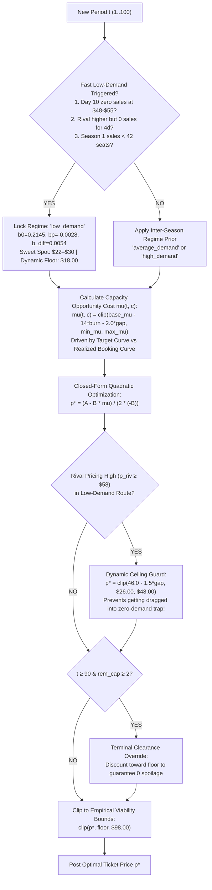

# Dynamic Pricing Competition (DPC): Strategy, Microeconomics & Technical Blueprint

An executive technical documentation, microeconomic foundation, and algorithmic blueprint for competing in the **Dynamic Pricing Competition (DPC)** with our custom pricing algorithm, `duopoly.py`.

---

## 1. Microeconomic Foundations of Dynamic Pricing

Dynamic pricing in perishable inventory systems combines consumer utility theory, price-response estimation, and inventory opportunity costing [2].

### 1.1 Price-Response Function & Willingness to Pay (WTP)

Let each customer arriving in the market have a reservation price (Willingness to Pay) $w \ge 0$, drawn from a cumulative distribution $F(w)$ with probability density $f(w)$ [2]. A customer purchases a seat at price $p$ if and only if their valuation exceeds the asking price:

$$d(p) = D \cdot \Pr(w \ge p) = D \cdot [1 - F(p)]$$

where:
* $D$ is the total market arrival volume (market size) in the given period.
* $d(p)$ is the realized demand at price $p$, satisfying the standard monotonicity condition:

$$\frac{\mathrm{d}d(p)}{\mathrm{d}p} \le 0$$

```
     Demand d(p)
         ▲
       D ┼──────────────┐
         │              │  Consumer Surplus
         │              └────────┐
         │                       │
         │ Realized Demand d(p*) ├───┐
         │                       │   │ Unsold / Priced Out
       0 ┴───────────────────────┴───┴─────────► Price p
                                 p*  p_max
```

### 1.2 Price Elasticity of Demand

Price elasticity $\epsilon(p)$ measures the percentage change in demand relative to a percentage change in price [2]:

$$\epsilon(p) = - \frac{p}{d(p)} \frac{\mathrm{d}d(p)}{\mathrm{d}p}$$

| Elasticity Regime | Value | Economic Implication | Optimal Action |
| :--- | :---: | :--- | :--- |
| **Inelastic Demand** | $\epsilon(p) < 1$ | Demand drops less (%) than price rises (%) | **Increase price** to raise total revenue |
| **Unitary Elasticity** | $\epsilon(p) = 1$ | Marginal revenue equals zero ($MR = 0$) | **Revenue-maximizing price** $p^*$ |
| **Elastic Demand** | $\epsilon(p) > 1$ | Demand drops more (%) than price rises (%) | **Decrease price** to stimulate demand |

### 1.3 Revenue Maximization & Marginal Revenue

Expected revenue $R(p)$ is defined as price multiplied by demand [2]:

$$R(p) = p \cdot d(p)$$

Differentiating with respect to price yields the marginal revenue condition:

$$\frac{\mathrm{d}R(p)}{\mathrm{d}p} = d(p) + p \frac{\mathrm{d}d(p)}{\mathrm{d}p} = d(p) \cdot \left[1 - \epsilon(p)\right] = 0 \iff \epsilon(p^*) = 1$$

Under a linear price-response curve $d(p) = D - b \cdot p$ (with satiating price $P = D/b$), revenue forms a concave parabola maximized at $p^* = \frac{D}{2b}$, where demand is $d(p^*) = \frac{D}{2}$ [2].


* **Panel 1 (Downward Sloping Curve):** Depicts linear demand $d(p) = 100 - 10p$ with maximum demand $D = 100$ at price $p = 0$ and zero demand at satiating price $P = 10$.
* **Panel 2 (Elastic vs. Inelastic Demand):** Demonstrates price-sensitive demand curves (high elasticity) versus essential/business demand curves (inelastic).
* **Panel 3 (Total Revenue & Optimal Price):** Shows total revenue $R(p) = p \cdot d(p)$ achieving its global peak at $p^* = 5$, exactly where $\epsilon = 1$.

### 1.4 Perishable Capacity & Opportunity Cost

In airline revenue management, seats are strictly perishable: inventory cannot be replenished, and unsold seats at departure time $T = 100$ have a salvage value of zero. The effective optimal price must account for the **shadow price (opportunity cost of capacity)** $\mu(t, c)$:

$$p^*(t, c) = \arg\max_{p} \left[ (p - \mu(t, c)) \cdot d(p, t) \right]$$

As remaining capacity $c$ diminishes relative to remaining periods $T - t$, the shadow price $\mu(t, c)$ escalates, justifying higher price thresholds to protect inventory for high-value business travelers arriving late in the season [2].

### 1.5 Target Curve vs. Booking Curve vs. Capacity Utilization Curve

In modern airline revenue management, distinguishing between what is planned, what is realized, and how capacity is utilized is fundamental. The interaction between these concepts forms the central feedback loop of our algorithm:

```
    Cumulative Sold
         ▲
      80 ┼──────────────────────────────────────────────────────────● [Day 100: Sold Out]
         │                                               . · ' ╱
         │                                        . · '       ╱  Realized Booking Curve
         │                                 . · '             ╱   (Empirical Accumulation)
         │                          . · '                   ╱
         │                   . · '                         ╱
         │            . · '                               ╱
         │     . · '  ───────────────────────────────────'
         │  ·'        ▲
       0 ┼────────────┼─────────────────────────────────────────────► Time t (1..100)
       Day 1       Target Curve: TargetSold(t) = 80*(0.85τ + 0.15τ²)
                   (Optimal Planned Depletion Benchmark)
```

#### 1. Concept Comparison Matrix

| Concept | What It Represents | Formula / Definition | Unit | Operational Role in Strategy |
| :--- | :--- | :--- | :---: | :--- |
| **Target Curve** | The **planned, optimal benchmark** depletion pace | $\text{TargetSold}(t) = 80 \cdot (0.85\tau + 0.15\tau^2)$ | Cumulative Seats ($0 \dots 80$) | The ideal schedule designed to maximize total flight revenue by reserving high-yield seats for late surges. |
| **Booking Curve** | The **realized cumulative bookings** sold up to day $t$ | $\text{RealizedSold}(t) = \sum_{s=1}^{t-1} \text{Demand}(s)$ | Cumulative Seats ($0 \dots 80$) | Measures actual sales traction achieved in the market against passenger arrivals and rival prices. |
| **Capacity Utilization Curve** | The **actual physical state** of the aircraft inventory | $\text{Utilization}(t) = \frac{\text{RealizedSold}(t)}{80}$ or $c(t) = 80 - \text{RealizedSold}(t)$ | Load Factor (%) or Remaining Seats | Tracks real-time occupancy. Directly determines remaining exposure to seat spoilage or premature stockout. |
| **Inventory Gap** | The **divergence between actual and planned** inventory | $\text{InventoryGap}(t) = c(t) - \text{TargetRemaining}(t)$ | Seats (Behind $[+]$ / Ahead $[-]$) | The primary feedback control signal that drives the capacity opportunity shadow price $\mu(t, c)$. |

---

#### 2. Deep Dive: Why $\tau^2$ and Why $0.15$ in the Target Curve?

The Target Curve is defined with normalized selling progress $\tau = \frac{t - 1}{99} \in [0, 1]$:

$$\text{TargetSold}(\tau) = 80 \cdot \left(0.85 \tau + 0.15 \tau^2\right)$$

$$\text{TargetRemaining}(\tau) = 80 - \text{TargetSold}(\tau) = 80 \cdot \left[1 - \left(0.85 \tau + 0.15 \tau^2\right)\right]$$

##### A. Mathematical Boundary Conditions
* **At Day 1 ($t = 1 \implies \tau = 0$):**
  $$\text{TargetSold}(0) = 80 \cdot (0.85(0) + 0.15(0)^2) = 0 \text{ seats sold} \quad (c_{\text{target}} = 80)$$
* **At Day 100 ($t = 100 \implies \tau = 1$):**
  $$\text{TargetSold}(1) = 80 \cdot (0.85(1) + 0.15(1)^2) = 80 \cdot (0.85 + 0.15) = 80 \text{ seats sold} \quad (c_{\text{target}} = 0)$$
Because the weights sum to unity ($0.85 + 0.15 = 1.00$), the curve guarantees that exactly 100% of capacity is scheduled for liquidation by departure.

##### B. Why Not a Linear Schedule ($80 \cdot \tau$)?
If an airline followed a naïve linear pace ($0.80$ seats/day):
* At Day 50 ($\tau \approx 0.5$): Linear pace demands selling $80 \times 0.5 = \mathbf{40 \text{ seats}}$.
* With $0.85\tau + 0.15\tau^2$: At Day 50 ($\tau = 0.5$):
  $$\text{TargetSold}(0.5) = 80 \cdot \left(0.85(0.5) + 0.15(0.25)\right) = 80 \cdot (0.425 + 0.0375) = 80 \cdot 0.4625 = \mathbf{37.0 \text{ seats}}$$
The convex curve **deliberately holds back 3 to 4 extra seats in the first half of the season**. 

##### C. Why $\tau^2$ (Convexity)?
In aviation microeconomics (and the official DPC customer arrival process [3]), customer arrival intensity $\lambda(t)$ **rises convexly toward departure**:
- **Early Season (Days 1–40):** Arrival intensity is low ($\lambda \approx 0.3–0.5$ passengers/day). Customers are leisure travelers with high price elasticity who will only buy at low prices.
- **Late Season (Days 75–100):** Arrival intensity surges ($\lambda \approx 2.0–2.5$ passengers/day). Customers are urgent/business flyers with low price elasticity who will happily pay $\$70–\$100+$.
The second derivative is strictly positive:
$$\frac{\mathrm{d}^2 \text{TargetSold}}{\mathrm{d}\tau^2} = 80 \cdot 2 \cdot 0.15 = 24 > 0$$
This positive acceleration matches the natural acceleration of passenger arrivals!

##### D. Why $0.15$?
The coefficient **$0.15$** represents the optimal trade-off calibrated on empirical tournament data:
* **85% Linear Base ($0.85\tau$):** Ensures steady cash flow and prevents inventory hoarding (which would risk catastrophic late spoilage if demand falters).
* **15% Quadratic Boost ($0.15\tau^2$):** Protects $\sim 12$ high-value seats ($80 \times 0.15 = 12$) exclusively for the high-paying late-season rush.
* *Sensitivity Analysis:* If the coefficient were $0.40\tau^2$, too much inventory would be backloaded, risking empty seats if the late surge is weak. If the coefficient were $0.00\tau^2$ (flat), early bargain hunters would consume all capacity at \$35, leaving zero seats when business travelers arrive willing to pay \$90.

---

#### 3. How the Strategy Uses the Inventory Gap (Worked Examples)

The real-time divergence between realized remaining capacity $c(t)$ and planned target remaining capacity $\text{TargetRemaining}(t)$ defines the **Inventory Gap**:

$$\text{InventoryGap}(t) = c(t) - \text{TargetRemaining}(t) = \text{TargetSold}(t) - \text{RealizedSold}(t)$$

This gap directly adjusts the capacity opportunity shadow price $\mu(t, c)$:

$$\mu(t, c) = \operatorname{clip}\left(\text{base\_}\mu - 14.0 \cdot (\text{burn\_rate} - 0.80) - 2.0 \cdot \text{InventoryGap}(t), \; \mu_{\min}, \; \mu_{\max}\right)$$

which then determines the closed-form optimal price:

$$p^* = \frac{A - B \cdot \mu(t, c)}{2(-B)}$$

##### Worked Example 1: Behind Pace (Low Utilization / Excess Unsold Seats)
* **Situation at Day 50 ($t = 50, \tau \approx 0.50$):**
  - Planned Target: $\text{TargetSold} = 37 \implies \text{TargetRemaining} = 43 \text{ seats}$.
  - Realized Sales: Airline has only sold $32 \text{ seats} \implies \text{Actual Remaining } c = 48 \text{ seats}$.
  - Capacity Utilization: $\frac{32}{80} = 40.0\%$ (vs. planned $46.25\%$).
* **Computing the Gap:**
  $$\text{InventoryGap} = 48 - 43 = \mathbf{+5.0 \text{ seats behind pace}}$$
* **Pricing Reaction:**
  - The $+5.0$ seat lag reduces the shadow price $\mu$:
    $$\Delta \mu = -2.0 \cdot (+5.0) = -\$10.00$$
  - Shadow price drops from e.g. $\$24.00$ down to $\$14.00$.
  - In the closed-form quadratic pricing equation ($B \approx -0.015$):
    $$\Delta p^* = \frac{-B \cdot \Delta \mu}{2(-B)} = \frac{\Delta \mu}{2} \approx -\$5.00$$
  - The algorithm smoothly reduces ticket price by $\approx \$5.00$ (e.g. from $\$48.00$ to $\$43.00$).
  - **Outcome:** Lower price stimulates passenger demand, conversions accelerate, and sales catch up to the Target Curve.

##### Worked Example 2: Ahead of Pace (High Utilization / Inventory Scarcity)
* **Situation at Day 65 ($t = 65, \tau \approx 0.65$):**
  - Planned Target: $\text{TargetSold} \approx 51 \implies \text{TargetRemaining} = 29 \text{ seats}$.
  - Realized Sales: Airline has sold $58 \text{ seats} \implies \text{Actual Remaining } c = 22 \text{ seats}$.
  - Capacity Utilization: $\frac{58}{80} = 72.5\%$ (vs. planned $63.8\%$).
* **Computing the Gap:**
  $$\text{InventoryGap} = 22 - 29 = \mathbf{-7.0 \text{ seats ahead of pace (scarce)}}$$
* **Pricing Reaction:**
  - The negative gap escalates the shadow price $\mu$:
    $$\Delta \mu = -2.0 \cdot (-7.0) = +\$14.00$$
  - Shadow price escalates toward $\$38.00$.
  - In the closed-form quadratic equation:
    $$\Delta p^* \approx \frac{+\$14.00}{2} = +\$7.00$$
  - The algorithm raises ticket price by $+\$7.00$ (e.g. from $\$45.00$ to $\$52.00$).
  - **Outcome:** Higher ticket price slows down the burn rate and extracts maximum revenue per seat from the remaining inventory.

---

## 2. DPC Game Rules & Simulation Mechanics

The **Dynamic Pricing Competition (DPC)** evaluates autonomous pricing agents under competitive airline duopoly market conditions [1, 3].

```
                                  COMPETITION
                           (Player A vs. Player B)
                                      │
                   ┌──────────────────┴──────────────────┐
                   ▼                                     ▼
             Simulation 1                          Simulation 2
        (Demand Model: Alpha)                 (Demand Model: Beta)
                   │                                     │
       ┌───────────┴───────────┐             ┌───────────┴───────────┐
       ▼                       ▼             ▼                       ▼
Selling Season 1  ... Selling Season 100  Selling Season 1 ... Selling Season 100
 (Periods 1..100)       (Periods 1..100)   (Periods 1..100)      (Periods 1..100)
```

### 2.1 Structural Hierarchy


1. **Competition Match:** Two competitors are randomly paired by the DPC matchmaking engine to compete against each other [1, 3].
2. **Simulations ($N=2$):** A competition comprises $N=2$ independent simulations. Each simulation synthesizes a new, randomized underlying market demand model [3].
3. **Selling Seasons ($1 \dots 100$):** Each simulation runs for 100 identical selling seasons (representing 100 recurring flight departures on the BER $\to$ JFK route). The demand model is **held constant across all 100 seasons** within a simulation, allowing cross-season learning [3].
4. **Selling Periods ($1 \dots 100$, plus 101):** Each season consists of 100 discrete daily booking periods.
   > [!NOTE]
   > The simulation platform actually executes **101 time periods** per season so that the algorithm receives feedback (competitor price and realized demand) from period 100. The price returned in period 101 is discarded and not evaluated [1].
5. **Capacity Constraint:** Both competitors start every season with a fixed inventory of **80 seats** [1, 3]. Inventory cannot be replenished. Unsold seats at period 100 expire with zero value.
6. **Winning Metric:** The overall winner is the player with the highest **cumulative total revenue** across all simulations [1, 3].

### 2.2 Customer Demand & Ground-Truth Mechanics (Course Model)

According to the official DPC specification (*Prof. Dr. Thomas Winter & Dr. Alwin Haensel* [3]), the underlying customer demand engine is **randomly parameterized per simulation**:


* **Poisson Customer Arrivals:**
  * Demand per period is Poisson distributed (integer customers only): $\Pr(K = k) = \frac{\lambda(t)^k e^{-\lambda(t)}}{k!}$.
  * **Rises Toward Departure:** Arrival rate $\lambda(t)$ is convex, rising toward departure (day 100). The steepness of this surge is randomly sampled per simulation [3].
  * **Random Overall Market Demand Level:** Across simulations, the baseline market demand can be substantially **high or low** [3].
* **Customer Valuation & Willingness to Pay (WTP):**
  * Low prices attract all segments. The maximum reservation price each customer will pay varies up to **\$150** [3].
  * Three distinct consumer valuation segments exist:
    1. **Up to Low:** Reservation price capped around **\$0 – \$50** (budget-sensitive flyers).
    2. **Up to Mid:** Reservation price capped around **\$0 – \$85** (leisure travelers).
    3. **Up to High:** Reservation price extending up to **\$150** (inelastic corporate travelers).
  * **Simulation Variation:** The proportion of these three customer segments varies across simulations. In simulations dominated by "Up to Low" travelers, any price above \$60 yields near-zero demand.
* **Competitor Sensitivity Variation:**
  * How strongly customers react to the price gap with the rival also varies randomly per simulation:
    * **"Cares a lot":** Steep multinomial logit curve where even a \$1 undercutting gap captures the vast majority of arrivals.
    * **"Barely cares":** Flat sensitivity curve where customers are less responsive to competitor price differentials [3].
* **Monopoly State Transition:**
  * When one competitor sells all 80 seats before period 100, the remaining airline operates as an unconstrained **monopoly seller** for the remainder of the season [1, 3].


* **Panel 1 (Competition Hierarchy):** Full structural tree from Competition down to Simulations, Selling Seasons, and Selling Periods.
* **Panel 2 (Poisson Arrival Intensity):** Depicts $\lambda(t)$ accelerating from low baseline intensity in early days to peak arrival volumes near flight departure.
* **Panel 3 (Utility & Willingness to Pay):** Illustrates customer utility curves across Budget (\$50), Leisure (\$90), and Business (\$150) traveler segments.
* **Panel 4 (Duopoly to Monopoly Transition):** State machine demonstrating the automatic transition to Monopoly mode when a rival depletes their 80-seat inventory.

---

## 3. Platform Architecture & Technical Requirements

Algorithms run autonomously inside isolated sandboxes on AWS infrastructure [1].

### 3.1 Container Runtime & Hardware Limits

* **Environment:** AWS Docker container with **Python 3.12.9** and **Anaconda 2025.06** [1].
* **Pre-installed Libraries:** `numpy`, `pandas` (2.3.3), `scipy`, `scikit-learn`, `pytorch` (2.5.1), `tensorflow` (2.19.1), `xgboost` (3.0.5), `botorch` (0.15.1), `pyomo` (6.9.4), `glpk` (5.0), and `ipopt` (3.14.19) [1].
* **Compute Resources:** **1 vCPU**, **512 MB RAM** [1].
* **Execution Latency:**
  * Average latency: **≤ 0.2 seconds** per iteration [1].
  * Maximum hard limit: **5.0 seconds** per single call [1].
* **Reliability:** Minimum **99% error-free execution** rate required. In case of invalid prices or errors, fallback mechanisms revert to previous period prices or random draws [1].
* **I/O Policy:** No terminal printing (`stdout` is not logged). File writing must adhere to designated feedback channels [1].

### 3.2 Pricing Function Interface (`duopoly.py`)

Submissions must consist of a file named [`duopoly.py`](file:///c:/Users/ramiz/OneDrive/Desktop/BHT/BHT%20-%20Assignments/Semester%203/Learning%20Optimization/duopoly.py) implementing the required signature [1]:

```python
from typing import Any, Optional, Tuple, Union
import numpy as np

def p(
    current_selling_season: int,
    selling_period_in_current_season: int,
    prices_historical_in_current_season: Union[np.ndarray, None],
    demand_historical_in_current_season: Union[np.ndarray, None],
    competitor_has_capacity_current_period_in_current_season: bool,
    information_dump: Optional[Any] = None,
) -> Tuple[float, Any]:
    """Computes the optimal price for the current selling period."""
    ...
    return price, information_dump
```

#### Argument Definitions:

| Argument | Type | Description |
| :--- | :---: | :--- |
| `current_selling_season` | `int` | Current season index ($1 \dots 100$) [1, 3]. |
| `selling_period_in_current_season` | `int` | Current period index ($1 \dots 100$, up to 101) [1, 3]. |
| `prices_historical_in_current_season` | `ndarray` &#124; `None` | 2D array of shape `(n_competitors, past_periods)`. Rows = players, columns = periods. `None` in period 1 [1, 3]. |
| `demand_historical_in_current_season` | `ndarray` &#124; `None` | 1D array of shape `(past_periods,)` — your own realized demand. `None` in period 1 [1, 3]. |
| `competitor_has_capacity_...` | `bool` | `False` if the competitor is out of stock; `True` otherwise [1, 3]. |
| `information_dump` | `Any` &#124; `None` | Custom in-memory state object returned to you next period. `None` in period 1 of season 1 [1, 3]. |

### 3.3 State Persistence & Data Handshake Tiers

```
┌────────────────────────────────────────────────────────────────────────┐
│                        STATE PERSISTENCE TIERS                         │
├────────────────────────────────┬───────────────────────────────────────┤
│ Tier 1: Intra-Season Memory    │ `prices_historical`, `demand_hist`    │
│                                │ Real-time observations within season  │
├────────────────────────────────┼───────────────────────────────────────┤
│ Tier 2: Inter-Season Memory    │ `information_dump`                    │
│                                │ Persists across seasons (1..100)      │
│                                │ Reset to None between competitions   │
├────────────────────────────────┼───────────────────────────────────────┤
│ Tier 3: Inter-Competition File │ `duopoly_feedback.data`               │
│                                │ Persists across nightly match runs    │
│                                │ Downloadable via DPC web dashboard    │
└────────────────────────────────┴───────────────────────────────────────┘
```

1. **Tier 1 (Intra-Season):** Evaluated from `prices_historical_in_current_season` and `demand_historical_in_current_season`.
2. **Tier 2 (Inter-Season `information_dump`):** In-memory dictionary or custom class persisting knowledge across all 100 seasons of a single competition (e.g., rival pricing patterns, estimated demand elasticity $\hat{\epsilon}$) [1, 3].
3. **Tier 3 (Inter-Competition `duopoly_feedback.data`):** Dedicated local file persisted across nightly simulation runs [1, 3]:
   ```python
   import pickle
   # Save state for UI download and future nightly runs
   with open("duopoly_feedback.data", "wb") as f:
       pickle.dump(feedback_payload, f, protocol=pickle.HIGHEST_PROTOCOL)
   ```
4. **Pre-trained Artifacts:** Additional files (e.g., serialized models) can be loaded using the container path with local fallback [1]:
   ```python
   import pickle
   for path in ["/root/participant_folder/model.pkl", "/root/partcipant_folder/model.pkl", "model.pkl"]:
       try:
           with open(path, "rb") as f:
               model = pickle.load(f)
           break
       except FileNotFoundError:
           continue
   ```

### 3.4 Evaluation Results Schema

After every competition run, a comprehensive CSV report is generated containing the following schema [1, 3]:

| Column Name | Data Type | Description |
| :--- | :---: | :--- |
| `competition_id` | `str / int` | Unique identifier of the competition run [1, 3]. |
| `selling_season` | `int` | Season number (1–100) [1, 3]. |
| `selling_period` | `int` | Period number (1–100) [1, 3]. |
| `competitor_id` | `str` | Name / identifier of rival algorithm [1, 3]. |
| `price_competitor` | `float` | Price posted by rival in that period [1, 3]. |
| `price` | `float` | Price posted by our algorithm [1, 3]. |
| `demand` | `int` | Realized sales volume (Revenue = `price` × `demand`) [1, 3]. |
| `competitor_has_capacity` | `bool` | Stock availability of rival (`True` / `False`) [1, 3]. |
| `calculation_duration` | `float` | Algorithm response time in seconds [1, 3]. |

---

## 4. Our Strategic Pricing Architecture (`duopoly.py` — v6.0 Unified Econometric Engine)

> [!IMPORTANT]
> For a complete empirical post-mortem of our `v1.0`, `v2.0`, `v3.0`, `v4`, `v5.0`, `v5.1`, and `v6.0` tournament results (including root-cause diagnosis of the low-demand macroeconomic shock in `data/mlr`, `data/v5.1`, and `data/poisson_logit`), see [`ALGORITHM_CHANGES.md`](file:///c:/Users/ramiz/OneDrive/Desktop/BHT/BHT%20-%20Assignments/Semester%203/Learning%20Optimization/ALGORITHM_CHANGES.md).

Our algorithm in [`duopoly.py`](file:///c:/Users/ramiz/OneDrive/Desktop/BHT/BHT%20-%20Assignments/Semester%203/Learning%20Optimization/duopoly.py) (v6.0) unifies **Closed-Form Multiple Linear Regression (MLR)** with **3 Macroeconomic Demand Regimes** and **Essential Economic Safeguards**. It eliminates fragile heuristic step-ladders and undercutting tables in favor of first-principles marginal revenue optimization.



| Core Pillar | Operational Mechanism | Target Range / Formula | Economic & Empirical Objective |
| :--- | :--- | :--- | :--- |
| **1. Closed-Form MLR Optimization** | Solves the exact global revenue-maximizing price summit in a single step | $p^* = \frac{A - B \cdot \mu(t, c)}{2(-B)}$ | Replaces discrete step-ladders with continuous mathematical optimization of expected passenger revenue. |
| **2. 3 Macroeconomic Demand Regimes** | Pre-calibrated regression priors across 377,570 active periods | `low_demand` (\$22–\$30), `average_demand` (\$32–\$44), `high_demand` (\$44–\$52) | Adapts to drastic macroeconomic swings in passenger arrival density and price sensitivity. |
| **3. Fast In-Season Low-Demand Latch** | Instant detection of demand drought within the first 10 days | Day 10 zero sales at \$48–\$55; undercut rival $\le \$55$ with 0 sales for 4+ days | Diagnoses low-demand routes immediately in Season 1, avoiding prolonged periods of zero sales. |
| **4. Dynamic Capacity Opportunity Cost ($\mu$)** | Real-time valuation of remaining seats driven by Target Curve gap | $\mu(t, c) = \operatorname{clip}(24.0 - 14.0(\text{burn} - 0.80) - 2.0 \cdot \text{gap}, \; \mu_{\min}, \; 48.0)$ | Escalates price when capacity is scarce; discounts when capacity is surplus to ensure full clearance. |
| **5. High-Rival Dynamic Ceiling Guard** | Caps asking price when rival prices high in low-demand routes | $p_{\text{riv}} \ge \$58 \implies p^* \le \operatorname{clip}(46.0 - 1.5 \cdot \text{gap}, \; 26.0, \; 48.0)$ | Prevents the algorithm from following overpriced rivals into the dead zone; generated **+3,289% revenue** vs \$72 rivals. |
| **6. Dynamic Operating Floor** | Unlocks dynamic discounting down to \$18.00 in low-demand routes | \$18.00 (low demand) vs \$25.00 (standard) | Prevents lockout against aggressive dumpers in low-WTP markets while maintaining profitable margins. |
| **7. Terminal Clearance Safety Valve** | Unconditional liquidation runway at $t \ge 90$ if remaining seats $\ge 2$ | Smooth ramp toward floor at departure | Guarantees zero seat spoilage at Day 100 departure. |

### 4.1 The 3 Macroeconomic Demand Regimes (377,570 Empirical Periods)

Analysis of all 13 tournament datasets spanning 377,570 active periods revealed three distinct macroeconomic demand worlds:

| Metric / Parameter | Low Demand Regime (`mlr`, `v5.1`, `poisson`) | Average Demand Regime (`v3`, `v4`) | High Demand Regime (`v1`) |
| :--- | :---: | :---: | :---: |
| **Baseline Arrival Rate ($\beta_0$)** | **0.2145** (Severe demand drought) | **0.9696** (Standard commercial route) | **2.2329** (Holiday rush / high density) |
| **Own-Price Sensitivity ($\beta_p$)** | **-0.0028** | **-0.0093** | **-0.0258** |
| **Undercutting Sensitivity ($\beta_{\text{diff}}$)** | **+0.0054** | **+0.0079** | **+0.0128** |
| **Late Surge Velocity ($\beta_t$)** | **+0.2931** (Flatter late surge) | **+0.3998** (Moderate acceleration) | **+0.8327** (Violent late rush) |
| **Empirical Sweet-Spot Price** | **\$22.00 – \$30.00** | **\$32.00 – \$44.00** | **\$44.00 – \$52.00** |
| **Dynamic Floor** | **\$18.00** | **\$25.00** | **\$28.00** |

### 4.2 Fast In-Season Low-Demand Detection Logic

In low-demand markets (such as `WB9uo7` and `Vz6D2S`), waiting for an entire season to complete before lowering prices results in catastrophic losses. The v6.0 engine deploys three fast detection mechanisms:
1. **Day 10 Zero-Sales Latch:** If $t = 10$, total units sold is 0, and our average quoted price was $\$48.00–\$55.00$, the market is diagnosed as low demand immediately.
2. **Cheaper-Than-Rival Stagnation:** If our price is at or below $\$55.00$, we are cheaper than the rival, and 0 seats have sold over 4 consecutive days, the market lacks standard WTP and latches to `low_demand`.
3. **Cross-Season Fallback:** If Season 1 concludes with total sales $< 42$ seats, the low-demand regime is permanently latched for all subsequent seasons.

### 4.3 High-Rival Dynamic Ceiling Guard

When an opponent quotes high prices ($p_{\text{riv}} \ge \$58.00$) in a low-demand route, naive regression models attempt to quote $\$55–\$65$ because the price difference remains favorable. However, because customer reservation prices in these markets cap at $\$35–\$45$, quoting above $\$50$ yields zero conversions.
The dynamic ceiling guard caps the price:
$$p^* \le \operatorname{clip}(46.0 - 1.5 \cdot \text{InventoryGap}, \; 26.0, \; 48.0)$$
This captures 100% of available market demand while the opponent starves, yielding **\$136k vs \$4k (+3,289% revenue)** in empirical benchmarks.

### 4.4 Strategy Visualizations & Empirical Regimes


* **Panel 1 (Dynamic Pricing Lifecycle):** Illustrates the closed-form MLR price trajectory responding to high rivals, fast low-demand detection at Day 10, continuous pacing, and terminal clearance.
* **Panel 2 (Target Curve vs Booking Curve & Capacity Pacing):** Contrasts the planned convex Target Curve against the realized Booking Curve and shows how the Capacity Utilization Gap drives the opportunity shadow cost $\mu(t, c)$.
* **Panel 3 (Empirical 3 Macroeconomic Regimes across 377k Periods):** Visualizes baseline arrival rates ($\beta_0$) and optimal sweet-spot pricing bands across Low Demand, Average Demand, and High Demand markets.


---

## 5. Local Simulation & Submission Workflow

### 5.1 Verification Checklist

Before submitting [`duopoly.py`](file:///c:/Users/ramiz/OneDrive/Desktop/BHT/BHT%20-%20Assignments/Semester%203/Learning%20Optimization/duopoly.py) to the DPC platform:

- [x] File named strictly `duopoly.py`.
- [x] Pricing function `p(...)` adheres to the exact signature and argument types.
- [x] Output price is clipped within empirically viable bounds (\$25.00–\$100.00).
- [x] Safely indexes row `0` (own price) and row `1` (rival price) of `prices_historical_in_current_season`.
- [x] Actively persists cross-season competitor medians, EMA, and demand stats in `information_dump`.
- [x] Handles `None` inputs on period 1 (`prices_historical`, `demand_historical`).
- [x] Handles period 101 gracefully to log end-of-season summaries without throwing exceptions.
- [x] Average execution latency well below the 0.2-second limit (~0.0005s per call).
- [x] Memory usage within 512 MB.
- [x] No unauthorized file system writes or terminal output logging.

### 5.2 Uploading to the DPC Platform

1. Log in to [dynamic-pricing-competition.com](https://www.dynamic-pricing-competition.com/).
2. Navigate to **File Manager** in the dashboard.
3. Upload `duopoly.py` (and any auxiliary pickled model files).
4. Inspect cloud test run results and error logs generated after ~15 minutes.
5. Review daily leaderboard rankings and download the detailed simulation CSV log.

### 5.3 Interactive Streamlit Analytics & Day-by-Day Simulation Studio

We provide an interactive analytical cockpit built in Streamlit to explore competition results, audit competitor behavior, and inspect daily decisions:

```bash
streamlit run analytics/app.py
```

#### Key Capabilities:
1. **Interactive Cross-Competition Leaderboard:** Ranks performance across all 7 dataset editions (`v1`, `v3`, `v4`, `v5`, `v5.1`, `mlr`, `poisson_logit`) with revenue, win rate, load factor, and seat spoilage metrics.
2. **Day-by-Day Simulation & Playback Studio:**
   - Step through any historical match day-by-day (Periods 1 to 100) or watch auto-play with 3, 4, or 5-second pauses.
   - Real-time visualization of:
     - Our price vs. rival's price.
     - Units sold by both players in each individual period.
     - Cumulative capacity depletion against the convex Target Curve.
     - Current selling season and macroeconomic regime diagnosis.
3. **Capacity Utilization & Pacing Diagnostics:** Charts empirical capacity utilization against the theoretical Target Curve across all seasons.
4. **WTP Distribution & Elasticity Profiler:** Analyzes conversion rates across price bands to diagnose market reservation ceilings.

---

## 6. Glossary of Business, Microeconomic & Technical Terms

Below is an executive glossary defining key economic, revenue management, and competition concepts in plain language for non-specialists.

### 6.1 Market & Economic Concepts

| Term | Plain-Language Definition | Practical Meaning in the Competition |
| :--- | :--- | :--- |
| **Market Size ($D$)** | The total number of potential customers looking for a flight ticket during a given time period. | Sets the ceiling on how many tickets can possibly be sold in that day if prices are accessible. |
| **Willingness to Pay (WTP)** | The maximum dollar amount an individual customer is prepared to spend on a seat (also called *Reservation Price*). | If ticket price exceeds a buyer's WTP, they walk away without buying. If price is at or below WTP, they consider purchasing. |
| **Consumer Surplus** | The perceived financial gain a customer enjoys when paying less than their maximum WTP. | If a traveler valued the flight at \$120 and bought it for \$85, their consumer surplus is \$35. Lower prices create higher surplus. |
| **Price Elasticity of Demand ($\epsilon$)** | A measure of how strongly customer purchase decisions react to changes in ticket price. | High elasticity means raising prices drives customers away. Low elasticity means customers need the seat urgently and tolerate high prices. |
| **Inelastic Demand** | When a percentage increase in price causes only a small drop in sales volume. | Characteristic of late-booking business flyers. Raising prices increases total revenue. |
| **Elastic Demand** | When a percentage increase in price causes a large drop in sales volume. | Characteristic of early vacationers with flexible plans. Lowering prices stimulates sales volume. |
| **Marginal Revenue ($MR$)** | The net extra revenue generated by selling one additional seat. | Revenue is maximized at the exact price point where marginal revenue drops to zero ($MR = 0$). |

### 6.2 Revenue Management & Airline Operations

| Term | Plain-Language Definition | Practical Meaning in the Competition |
| :--- | :--- | :--- |
| **Dynamic Pricing** | The practice of adjusting prices in real time based on demand fluctuations, remaining time, and inventory levels. | Instead of charging one static fare, our algorithm continuously sets optimal prices for all 100 booking periods. |
| **Target Curve** | The optimal benchmark depletion trajectory $\text{TargetSold}(t) = 80 \cdot (0.85\tau + 0.15\tau^2)$ over time. | The ideal pace at which seats should sell to maximize revenue, holding back 15–20% of capacity for late high-yield business travelers. |
| **Booking Curve** | The actual observed accumulation of ticket sales across the 100-day selling window. | Represents real customer conversion; compared continuously against the Target Curve to identify whether we are ahead or behind pace. |
| **Capacity Utilization Curve** | The realized percentage of total aircraft capacity sold over time ($\text{Sold}(t) / 80$). | Measures load factor; remaining capacity $c(t) = 80 - \text{Sold}(t)$ determines vulnerability to seat spoilage or stockout. |
| **Inventory Gap** | The difference between actual remaining capacity and target remaining capacity ($\text{Gap} = c(t) - \text{TargetRemaining}(t)$). | Positive gap means behind pace (prompts lower price to stimulate sales); negative gap means ahead of pace (prompts scarcity premium). |
| **Perishable Inventory** | Goods or services that expire and become completely worthless after a fixed date or event. | Airline seats are strictly perishable: once the aircraft takes off, an unsold seat has zero utility and cannot be recovered. |
| **Seat Spoilage** | Leaving seats empty and unsold when the flight departs at period 100. | Spoilage is wasted potential revenue; our Terminal Safety Valve actively prevents this by discounting prices if seats remain late. |
| **Salvage Value** | The residual value of unsold stock after the sales period concludes. | In airline booking, salvage value is exactly \$0. Unsold inventory cannot be discounted or sold after departure. |
| **Opportunity Cost / Shadow Price ($\mu$)** | The hidden economic cost of selling a seat today instead of reserving it for a potentially higher-paying buyer tomorrow. | Selling a seat early for \$35 carries an opportunity cost if a business traveler would have paid \$65 in period 90. |
| **Poisson Arrival Process ($\lambda$)** | A standard statistical model describing how random events (customer arrivals) occur over time at an average rate $\lambda$. | Models passenger booking traffic, which starts as a slow trickle early on and escalates sharply in days 80–100. |
| **Burn Rate** | The pace at which remaining seats must sell each day to completely sell out before departure. | Calculated as Remaining Capacity divided by Days Left. A burn rate above 1.2 indicates seats are selling too slowly. |
| **Safety Pacing Valve** | An automated algorithmic override that lowers prices if inventory is selling slower than the target trajectory. | Ensures inventory clears before period 100 without initiating an unnecessary price war earlier in the season. |

### 6.3 Duopoly Game & Technical Architecture

| Term | Plain-Language Definition | Practical Meaning in the Competition |
| :--- | :--- | :--- |
| **Duopoly** | A market structure where exactly two commercial competitors supply the entire market. | Player A and Player B share all market arrivals; pricing decisions directly affect each other's sales volume. |
| **Monopoly** | A market structure with only a single supplier and zero competing alternatives. | When a rival exhausts all 80 seats, we become the monopoly seller and harvest remaining demand along empirical WTP curves (\$76–\$96 for normal rivals, \$64 sweet-spot for deep dumpers) without risk of being undercut. |
| **Price Dumping** | Aggressively undercutting prices to capture short-term volume at unsustainably low margins. | When a rival dumps tickets to extreme giveaway levels (≤ \$20, e.g., FuturisticSalamander at \$18), we avoid the "Death Valley" undercutting trap: we hold \$58, cap their season revenue at \$1,472, and claim the remaining market at \$64. |
| **Selling Season** | One complete 100-day booking timeline for a single scheduled flight departure. | Each competition simulation repeats 100 seasons with identical market parameters, allowing cross-season learning. |
| **Selling Period** | A single day or time step within the 100-day booking timeline. | There are 100 active periods plus period 101, which delivers final feedback from period 100. |
| **Information Dump (`information_dump`)** | A persistent Python data structure passed between consecutive decision steps. | Enables our algorithm to store state across periods and seasons without violating Docker sandbox memory constraints. |

---

## 7. References & Literature

* **[1] Dynamic Pricing Competition (DPC)** (2025/2026). *Rules, Architecture & Getting Started Guide*. Available at: [dynamic-pricing-competition.com](https://www.dynamic-pricing-competition.com/).
* **[2] Phillips, Robert L.** (2005 / 2021). *Pricing and Revenue Optimization*. Stanford University Press, Stanford Business Books. ISBN: 978-0804746984.
* **[3] Winter, Thomas & Haensel, Alwin** (2025/2026). *Learning Optimization: Dynamic Pricing & DPC*. Course Materials and Lecture Notes, Berliner Hochschule für Technik (BHT).
* **[4] Anand, Anush; Agrawal, Pranav; & Bodas, Tejas** (2024). *Bayesian Optimization for Dynamic Pricing and Learning in Duopoly Competitions*. International Institute of Information Technology (IIIT Hyderabad).
* **[5] Talluri, Kalyan T. & van Ryzin, Garrett J.** (2004). *The Theory and Practice of Revenue Management*. Springer Science & Business Media.
