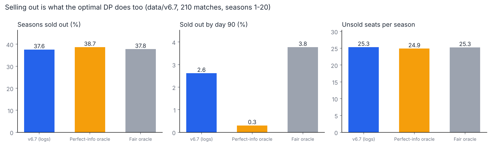
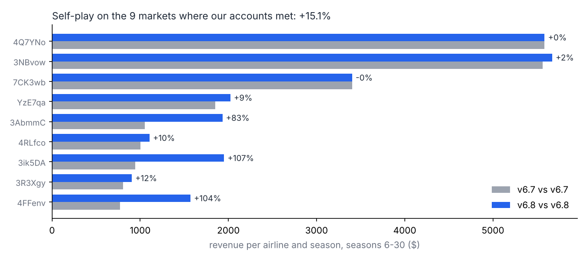

# Review of v6.7 on data/v6.7 (DPC tournaments of 16 and 18 Nov 2026)

> First review, before v6.8 was finalised. The adopted v6.8 has leader pricing switched off (it lowered the self-play gain); final numbers are in [`EVALUATION.md`](EVALUATION.md): self-play +15.1%, test bed +0.02% / −0.05% / −0.01%.

Data: 6 files, 210 matches × 100 seasons. Our three accounts (AirborneTody, DeftDalmatian, ProficientCivet) all ran v6.7.
Theme: dynamic programming and price optimization. Adopted as `duopoly.py` v6.8.

## 1. Sell-outs: not a flaw

v6.7 sold out in 36.2% of seasons. Against the oracle that is the right amount:

| Seasons 1–20, same markets | v6.7 (logs) | Perfect-information DP | Fair DP (typical rival path) |
| :--- | :---: | :---: | :---: |
| Seasons sold out | 37.6% | 38.7% | 37.8% |
| Sold out by day 90 | 2.6% | 0.3% | 3.8% |
| Days with no seats left per season | 1.22 | 0.62 | 1.65 |
| Unsold seats per season | 25.3 | 24.9 | 25.3 |

- 1,603 of the 7,594 sell-outs happen on day 100 (the last seat sold on the last day: ideal). The median sell-out day is 98.
- We have no seats on only 1.46% of all season-days.
- Per match, our sell-out rate tracks the perfect-information DP's with correlation 0.94. Matches where we sell out ≥25 points more than the DP explain 5% of the revenue gap to the DP; matches where we sell out ≥25 points less explain another 5%.
- An unsold seat is worth $0 at the end of the season. A DP that never sells out prices too high on average.
- Most money is not lost through sell-outs. 44% of seasons end with ≥20 unsold seats, and in those seasons our median price over days 91–100 is the $18 floor. On 96% of the days we sit at $18, the oracle prices ≤ $19 too, so this is weak demand, not bad pricing.

Overall efficiency (all 100 seasons): actual / perfect-information DP = **93.1%**, actual / fair DP = **96.8%**. On data/v6.6, v6.6 reached 94.6% of the perfect-information DP.

## 2. Flaws found

| # | Flaw | Evidence | Cost in data/v6.7 |
| :---: | :--- | :--- | :--- |
| 1 | **Price war to the $18 floor against rivals that react** | 16 of the 28 match-files where our own accounts met sat at $18 for ~100 seasons (e.g. 3DkTAv: $1,000–1,400 per season; holding a matched price would earn ~$2,600–2,900). Reproduced in a new self-play simulator. | ~half the revenue in those matches |
| 2 | **Copier flag can never clear** | Copier checks were only taken on days our price moved, and the copier price is flat. False flags latched in qPw7uh (rival copied 15% of the time) and 3Ppuun (two v6.7 copies): $60 for the rest of the match. | −18% to −22% per season in 2 matches (~0.4% of revenue) |
| 3 | **Copier price capped at $60** | The copier DP wants $64–67 against the real copiers (StirringWombat, UncoveredSwift) | −3% in those matches |
| 4 | Rival sold out: we price ~$48, the fair DP ~$37 (days 50–100) | Oracle day table | Small: 2.5% of priced days. Logging these days as "no rival" was already tested and rejected in v6.7. Open. |

**Why flaw 1 happens (the DP/price-optimization root cause).** After the day-50 fit, capacity is slack, so v6.7 prices at the static best reply to the rival's last price. Two best-repliers undercut each other. With the fitted price sensitivity (b ≈ 0.23–0.27), the one-shot equilibrium of the choice model lies below $18. The DP treats the rival's path as fixed, even though v6.7's own reaction model had learned `rival = −0.11 + 0.11·rival_yesterday + 0.90·our_yesterday`: the rival ends up at our price. In the logs, 40 of the 140 matches with enough price variation have a rival that follows our price changes the next day (slope > 0.3).

## 3. Changes in v6.8 (all behind flags)

1. `COPIER_UNLATCH`: on a day we held our price and the rival posted a different one, count it against "copier".
2. `COPIER_PRICE_MAX = 80`: the copier DP may price up to $80 (was $60).
3. `LEADER_PRICING`: if the reaction model gives a steady-state slope ≥ 0.5, the DP and the capacity-slack price use the rival's reaction `r(p) = α + β·p` instead of a fixed rival path (Bertsimas & Perakis, oligopoly: optimize given the competitor's response function).
4. `COOP_PRICING`: if there is evidence of a price war (the rival follows us, both sat at the floor last season, or cooperation held last season), start the season at the matched-price DP price.
   - Match a rival priced between halfway and our offer.
   - After 3 days below halfway, best-reply for the rest of the season.
   - Cooperative seasons must earn at least as much as best-reply seasons; otherwise retry every 10th season.

## 4. Results

| Check | v6.8 vs v6.7 |
| :--- | :---: |
| Self-play, 9 markets where our accounts met (v6.8 vs v6.8 against v6.7 vs v6.7) | **+11.7%** |
| … floor-war markets only | +10% to +110% |
| … high-demand markets (4Q7YNo, 3NBvow, 7CK3wb) | 0% to +2% |
| Self-play, 3Ppuun market, 60 seasons (false copier flag) | +9.1% |
| v6.8 against v6.7 (one side upgraded) | −0.5% to +5% per market (neutral) |
| Test bed, logged rivals (they do not react), data/v6.7, 20 seasons | −0.01% (8 better / 22 worse) |
| Test bed, data/v6.6 / data/v6.5, 20 seasons | −0.04% / −0.02% |
| Test bed, true-copier matches, 100 seasons | +2.8% to +2.9% (49XLgV, 3Cn7kh) |
| Unit tests | 55 pass |

**How to read this.** The test bed replays logged rival prices, so it can only show what v6.8 costs against rivals that ignore us: nothing measurable. The gain appears only against rivals that react. The self-play simulator models those, but only for copies of our own algorithm. Without the price-war evidence gate, cooperation attempts cost 3% against non-reacting rivals, which is why the gate is there. Real classmates' bots that follow us (FierceDuck, WonderfulOxpecker, HumongousLocust, BenevolentSwan, slope 0.4–0.8) can't be tested offline: only an online run shows whether they hold a matched price.

## 5. Open points

- Cooperation is partial in some markets: prices reach $22–28, where the matched-price DP says ~$45. The two copies' offers still drift apart; a shared focal price (e.g. rounded to $5) may help.
- A sold-out rival's days (flaw 4).
- Seasons 1–2 price $4 above the fair DP on average (learning cost; ~2% of revenue).
- DPC rank is noisy, as you said. Judge v6.8 by revenue per match against the same rivals, not by rank.

## Files

- `analytics/selfplay.py`, `analytics/selfplay_markets.py`: two algorithms play each other in a fitted market.
- `duopoly.py`: v6.8 (previous version: `analytics/experiments/duopoly_v67.py`).
- `analytics/demand_fits_v6.7.json`, `analytics/oracle_v6.7.csv`: fits and oracle on data/v6.7.
- Analysis scripts: `analytics/review_v67/` (v67_sellout.py, oracle_sellout.py, copycheck.py, reaction.py; results sp_markets.csv, tb67_v68c.csv).
